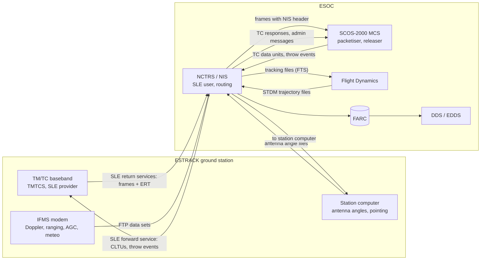
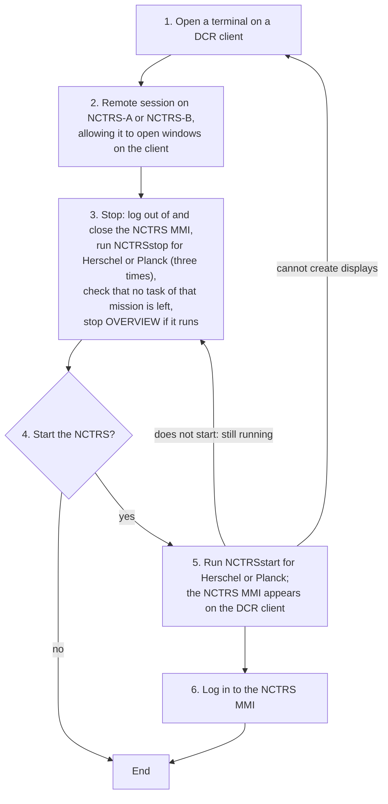
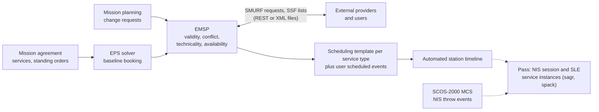

# NCTRS, NIS and the ground station interface

A [SCOS-2000](index.md) mission control system (MCS) never talks to an antenna directly. Between
the ESA ground stations (ESTRACK) and the MCS at ESOC sits a generic gateway that receives the
telemetry the stations deliver, forwards telecommands to the right station, collects tracking
measurements and passes files in both directions. The documents call it the **NCTRS**, the
**NIS** or, in the more recent ones, "NCTRS/NIS" (see [Names](#names) on how the two relate), and
the modern interface between it and the stations is CCSDS
[Space Link Extension (SLE)](../ccsds/sle/index.md). This page gathers what the public documents
say about this layer: its roles, how three missions ran it (INTEGRAL in 2003, Herschel and Planck
in 2011, and CHEOPS, whose paper describes passes through an INTA station without naming the
NCTRS, the NIS or ESTRACK), how SCOS-2000 addresses it
(command routing, throw events, release verification, ground station responses), how ESTRACK
books the passes that the gateway then serves, the tracking data files of the station modem, the
IFMS, and the flight dynamics flows that ride on it. The detailed NCTRS and NIS interface control
documents are not public; the page is explicit about the resulting gaps.

## Names

The acronym NCTRS is expanded in at least six different ways in the library, and NIS in two:

| Acronym | Expansion as printed | Source |
|---|---|---|
| NCTRS | Network Control and TM/TC Router System | GSAW 2005 (ESOC); SpaceOps 2021 (DLR)[^gsaw05][^v3c-acr] |
| NCTRS | Network Controller & TM Router System | GSAW 2003 (ESOC)[^peccia-int] |
| NCTRS | Network Command, Telemetry & Ranging System | GSAW 2003 (ESOC)[^peccia-if] |
| NCTRS | Network Command and Telemetry Routing System (in "NCTRS / SLE") | GSAW 2003 (ESOC)[^peccia-egos] |
| NCTRS | Network Control and Telemetry Routing System | 4S 2024 (DLR)[^4s-acr] |
| NCTRS | Network Control & Telemetry Routing System | IFMS-OCC ICD[^ifms-intro] |
| NCTRS | Network Controller and Telemetry Receiver System | Mars Express and Venus Express data handling papers[^sp-nctrs][^vex-nctrs] |
| NIS | Network Interface Subsystem | Rosetta/Mars Express FDS-MCS ICD (2003)[^fds-nis] |
| NIS | Network Interface System (in "Network Interface System Automatic Schedule Execution (NCTRS)") | GSAW 2005[^gsaw05-ae] |

All the NCTRS expansions describe the same ESOC infrastructure component. The two names
coexisted from at least 2003: the Rosetta/Mars Express FDS-MCS ICD of that year uses both, the
GSAW 2005 slide lists an Aeolus contribution as "Network Interface System Automatic Schedule
Execution (NCTRS)", and the MCS interface control document is titled "NIS/NCTRS".[^fds-nis][^fds-gsid][^gsaw05-ae][^icd-rd][^solo-r3]
The time correlation note of 2018 speaks only of the "NIS header".[^tn-nis]

!!! warning "Inference"
    No available source says explicitly whether the NIS is a subsystem of the NCTRS, a renamed
    NCTRS or its successor. The usage above (NIS alone in the most recent SCOS-2000 note, the pair
    "NCTRS/NIS" in the EDDS ICD of 2025) suggests that NIS is the current name of the same
    gateway.[^tn-nis][^euicd-r]

## Where it sits



The diagram combines the mission papers, the FDS-MCS ICD and the import ICD.[^sp-nctrs][^fds-nis][^fds-stdm][^icd-te-hist]

The Mars Express and Venus Express papers describe the functions. The ground station equipment
performs basic checks on the telemetry and stamps it with the Earth Reception Time (ERT); the NCTRS
passes housekeeping and science telemetry to the relevant MCS and gathers telecommands from the MCS
to forward them to the relevant station. It also acquires and locally stores tracking data
(antenna angles, range and Doppler measurements), made available to Flight Dynamics through the
File Transfer System (FTS) and to authorised PIs through the DDS, and it transfers files generated at the
operations centre, such as antenna pointing information and station schedules, to the
stations.[^sp-nctrs][^vex-nctrs]

ESOC's 2003 overview shows the context of that time. The stations listed were Kiruna, Redu, Perth,
Villafranca, Kourou, New Norcia, Cebreros and the NASA DSN; the wide-area network was ESANET over
X.25 with "migration to TCP/IP planned", alongside SLE; the LEOP configuration shows prime and
backup NCTRS machines next to the prime and backup SCOS-2000 servers. Under the NCTRS interface
the slides list TMP4, TCE, MKII, MPTS MKIII and STC II, apparently the station equipment it
interfaced at the time (the slide does not expand them).[^peccia-ctx][^peccia-leop][^peccia-if] The command releaser was the
SCOS-2000 component that interfaced the external command destination, the NCTRS.[^peccia-cmd]

!!! note "Mission-dedicated instances"
    The Rosetta and Mars Express FDS-MCS ICD lists, per mission, a prime and a backup "Network
    Control" node next to the prime and backup control systems, and names the FTS nodes of the
    NIS as NIA and NIB.[^fds-nodes][^fds-ftsnames] The DDID's TC history of the same missions names
    the release stage "Release from SCOS-2000 to the NCTRS".[^ro-r] Herschel and Planck each had
    one NCTRS per MCS chain (A and B), started on the machines NCTRS-A and NCTRS-B (see
    [Herschel and Planck](#herschel-and-planck-2011-one-nctrs-per-mission-and-chain)).[^hp-sum]

### The SLE user and provider

In SLE terms the NCTRS/NIS is the **SLE service user** at ESOC and the station's TM/TC baseband
system (TMTCS, "TM and TC BaseBand System") is the **SLE service provider**. The import ICD says so
when it distinguishes the two kinds of throw event: those destined for the SLE service provider
(TMTCS) and those executed by the SLE service user (NIS).[^icd-te-hist][^peccia-egos] The EDDS ICD
names the release stage of a telecommand "Release from SCOS-2000 to the SLE User
(NCTRS/NIS)".[^euicd-r] The Rosetta/Mars Express/Venus Express DDS packet header records, for each
packet, the SLE service used, as one of twelve codes: rows SLC, MC, VC and "Bad Frames" combined
with the columns real time, real time with flow control and off-line.[^ro-sle] The DDID does not
expand SLC, MC and VC; their possible mapping onto the SLE return services is discussed, as an
inference, on [GDDS and the DDIDs](gdds-and-ddids.md#telemetry-the-dds-packet-header).

ESOC's 2019 overview of its control-system generations explains why this boundary is the
standardised one. The MCS is the only ground system that manages all interactions with the space
assets, through the ground station network. Because control centres and stations are not
necessarily run by the same organisation, the TM/TC exchange between them was standardised by
CCSDS through SLE, giving access to spacecraft through the international network of stations that
support it; standards between the other ground systems (mission planning, flight dynamics,
payload data processing) were, by contrast, "still lagging behind".[^ical-ctx][^ical-interop]

## Running the gateway: three missions

The public interface documents say little about the gateway as a running system. Three operations
documents fill part of the gap from the mission side.

### INTEGRAL (2003): the NCTRS as part of the MOC

INTEGRAL's Flight Operations Plan, Volume 1 (issue 2, 21 February 2003), lists the NCTRS with the
IMCS (the INTEGRAL Monitoring and Control System) and the flight dynamics system as MOC hardware
and software under ESOC's standard configuration control, every modification needing the approval
of the Spacecraft Operations Manager (SOM).[^int-title][^int-cc] Its operational ground segment
was the routine-phase stations Redu, Goldstone and Villafranca (backup), Perth for the launch and
early orbit phase (LEOP), the MOC at ESOC and the communication facilities. The ground stations'
task was the satellite-to-ground interface; the communications' task was data routing within the
operational ground segment and to the science ground segment, including the transmission of
satellite TM and auxiliary data to the INTEGRAL Science Data Centre (ISDC).[^int-gs][^int-tasks]

The FOP shows the three layers of configuration control that a pass crossed:[^int-cc]

| Layer | Controlled by | Rule in the FOP |
|---|---|---|
| ESA stations | ESOC (TOS-G), as a resource shared between missions | The INTEGRAL SOM approves modifications that could affect INTEGRAL |
| DSN station (Goldstone) | NASA | NASA is expected to consult the SOM; INTEGRAL may have to adapt to JPL/Goldstone changes |
| Communications (MOC to stations, MOC to ISOC and ISDC) | TOS-ON, under the MOC's responsibility | Shared resources; modifications that could affect INTEGRAL need SOM approval |

The mission rules make the gateway's chain a launch criterion. The countdown was to stop if the
IMCS (in particular TM reception and processing and TC generation and release), flight dynamics
and communications ("in particular OPSLAN") were not available in hot redundancy, or if the MOC
could not send TCs to, and receive and process data from, Redu or Villafranca. Missing tracking
at Redu, Villafranca and Goldstone only made the ground segment "not fully operational". After
launch, losing contact with a ground station for more than 24 hours was one of the conditions
for a spacecraft emergency.[^int-rule] The GSAW 2003 slide that uses INTEGRAL as its example of
an "S2K based MCS" is where the NCTRS is expanded as "Network Controller & TM Router System"
(see [Names](#names)).[^peccia-int]

### Herschel and Planck (2011): one NCTRS per mission and chain

The Herschel/Planck flight operations plan (PT-HMOC-OPS-FOP-6001-OPS-OAH, FOP issue 3.1) contains
a ground segment procedure, **C_GSP_MCS_NCTRS** "Herschel/Planck NCTRS Setup" (version 1, created
on 11 August 2011), whose objective is starting or stopping NCTRS-A and B.[^hp-sum] Its constraint
shows how the gateway was deployed for two missions operated side by side: there must only ever
be one instance per mission running, that is only one Herschel NCTRS and one Planck NCTRS per MCS
chain (A and B). An "OVERVIEW" task must never be started on NCTRS-A or B, "because it would allow to
start another instance on a machine of the other mission".[^hp-sum] The procedure has no
spacecraft configuration, command sequences or referenced displays: it is purely a ground
operation.[^hp-sum]



The flowchart redraws the six steps of the procedure.[^hp-steps] In step 3 the stop command is run
"3 times" because the clean-up is sometimes incomplete, and the operator checks the process list for tasks
with "Herschel" or "Planck" in their names. If the NCTRS does not start, it is probably still
running and the operator goes back to stopping it; if it cannot create its windows, the display
permission was forgotten and the procedure starts again.[^hp-steps] The procedure does not expand
DCR; ESOC's 2003 LEOP set-up slide expands it as "dedicated Control Room".[^peccia-leop]

!!! danger "Credentials and host names not reproduced"
    The procedure prints the NCTRS machine names, the operating-system account and the NCTRS MMI
    account with their passwords. This wiki does not reproduce them. The procedure is also
    summarised on [Herschel/Planck interface documents](herschel-planck-interfaces.md#two-flight-operations-procedures).

!!! warning "Inference"
    Three points follow from the procedure but are not stated in it. The NCTRS of that time was a
    set of operating-system processes started per mission by scripts, with its own X-based user
    interface (the "NCTRS MMI") and its own user login, separate from the SCOS-2000 client. "Chain A
    and B" suggests that each NCTRS machine served one of the two redundant MCS chains of both
    missions. And the warning about OVERVIEW suggests a multi-mission start-up mode that the
    Herschel/Planck configuration deliberately avoided.[^hp-sum][^hp-steps]

By February 2014 the NIS user interface was among the ESOC GUIs re-implemented on the Java and
Eclipse-based **EGOS User Desktop** (EUD), next to those of SCOS-2000, SIMSAT and the FARC (see
[EUD](ancillary-and-egs-cc.md#eud-the-common-user-interface-2014)).[^eud-stat]

### CHEOPS: a pass without ESTRACK (2025)

CHEOPS, operated by its consortium with a SCOS-2000 5.4.2 MCS at INTA's Torrejón centre (CEIT),
communicates through the INTA ground station there; its paper mentions neither ESTRACK nor the
NCTRS or NIS, but it describes every step of a pass at the MCS-station boundary:[^ch-intro][^ch-mcs][^ch-fds]

1. **Booking.** INTA's CEIT G/S Planner (written in C#) takes pass requests from CHEOPS and the
   other missions of the station, resolves conflicts and configures the control system of each
   station with the passes, their start and end times, configurations and mode-change times. From
   the flight dynamics visibility file it produces `GSAvailability`, an XML list of the CHEOPS passes
   of the next three weeks with station, start time and duration.[^ch-fds]
2. **Pass preparation.** For each pass the SCOS-2000 CommandBuilder generates TC stacks that begin
   and end "the MCS-G/S communication" and start and stop the downlink of recorded TM, and places
   them in a pass folder.[^ch-pass]
3. **During the pass.** A Python script checks the SCOS-2000 tasks, loads the stack that opens the
   MCS-station connection into an Auto Stack, reads MISC variables to verify that the ground
   commanding capability is available, switches to AD mode and uplinks. Real-time housekeeping TM
   goes straight from the station to the MCS. At the end the stack that closes the connection is
   sent.[^ch-pass][^ch-during]
4. **After the pass.** The recorded TM, which the station wrote to a binary file, is fetched by FTP;
   the SCOS-2000 TM Processor splits it into one file per virtual channel (real-time housekeeping,
   recorded housekeeping, science), and gaps are found from jumps in the virtual channel frame
   counter.[^ch-post]
5. **Tracking.** Two-way Doppler files from the station go to flight dynamics, where PREPRO converts
   them into ESA's NAPEOS tracking data format for orbit determination.[^ch-fds]

!!! warning "Inference"
    The CHEOPS stacks that "begin and end the MCS-G/S communication" occupy the place that the
    Solar Orbiter MIB gives to the NIS throw events OPEN SESSION, OPEN LINK and CLOSE LINK
    ([below](#throw-events)). The paper does not describe their content, their command type or the
    protocol between the MCS and the INTA station, and it mentions SLE only for the
    simulator.[^ch-pass][^ch-sim]

## The interface towards SCOS-2000

### Documents

| Document | Reference and issue | Status |
|---|---|---|
| ICD NIS/NCTRS Volume 2 – MCS interface | EGOS-NIS-NCTR-ICD-0002, issue 4.0.2, November 2009 | Not public; referenced by the import ICD 7.0 and the Solar Orbiter DDID[^icd-rd][^solo-r3] |
| NIS Throw Events ICD | EGOS-NIS-NIS-ICD-0003, issue 1.3, November 2007 | Not public[^icd-rd] |
| ICD NCTRS Volume 3 – detailed interface definition: FDS | NCTRS-ICD-3, N2K-MCS-ICD-0003-TOS-GCI, issue 1.3, 2001-06-27 | Not public; defines antenna angle and Spacecraft Trajectory Data Message (STDM) files[^fds-a14] |
| IFMS-OCC Interface ICD | /MakaluMedia/MR/IFMS/ICD/FTP-OCC, issue 11.4.0, 2006-08-09 | Public ([ifms-occ-icd-mex](../library/ifms-occ-icd-mex.md))[^ifms-title] |

### Time stamps

The ERT of each frame reaches the MCS in the header with which the NIS delivers the frame, and
the [time correlation](time-correlation.md) works backwards from it.[^tn-nis] When the station is
an SLE provider, the ERT is required to equal the frame reception time, so the ground delay is
zero by definition.[^tn-times]

### Command routing

In the MIB, the optional [dst](../mib/tables/dst.md) table routes commands by APID. Any APID not
listed goes to the default destination `NCTRS`, which may only be used for spacecraft commands;
`EGSE.SCOE` (non-spacecraft commands) and `EGSE.TC.<address>` (spacecraft commands sent through a
SCOE and TC front end) are the alternatives, used by SCOS-2000-based EGSE.[^icd-dst] The Solar
Orbiter MIB has a single `dst` record, routing APID 1372 to `EGSE.TC.0x8800`, which is exactly
the example Destination ID printed in the ICD; every other command uses the NCTRS
default.[^mib][^icd-dst] The April 2020 release has the same single record. The instrument
databases in the library carry a `dst` table with no rows: the [SWA](../missions/solar-orbiter/swa.md) database (2021 ASCII set, 198
commands; v6.5.0, 201 commands) and the [STIX](../missions/solar-orbiter/stix.md) database v2.26.38 (100 commands), so in an MCS
importing them every instrument command would take the NCTRS default.[^mib20][^idb-dst]

!!! warning "Inference"
    An empty `dst` in an instrument database is what the ICD's default implies for flight use:
    instrument commands travel through the spacecraft like any other telecommand. Whether the
    instrument teams' own EGSE set-ups used a different routing is not stated in the available
    sources.[^icd-dst][^idb-dst]

The SCOS-2000 EGSE of the Herschel/Planck era exposes the same switch as the MISCconfig variable
`EGSE_MODE`: 0, the releaser connects only to the NCTRS; 1 (the default), to both the NCTRS and the
EGSE router; 2, only to the EGSE router. When the NCTRS was not running the desktop raised a
connection alarm, and an NCTRS simulator could be started from three processes, TCSIM, ADMSIM and
CLCWSIM.[^emcs-mode][^emcs-sim]

### Release and ground verification

A telecommand passes through three ground-related verification stages before any on-board stage,
reported in the TC history as follows (EDDS ICD, version 24.0):[^euicd-r]

| Stage | Meaning |
|---|---|
| R | Release from SCOS-2000 to the SLE user (NCTRS/NIS). Fails if PTV was not OK at release, if no TCP/IP connection to the NCTRS existed, or if the NCTRS accepted and then rejected the command, for example because its station connection was down; in that case an administrative message from the NCTRS is logged |
| G | Ground station reception (first uplink verification stage) |
| T | Uplink, also called radiation (second stage); for a throw event this is its execution stage |
| O | On-board reception (third stage, AD mode only) |

The Solar Orbiter DDID adds that the uplink time in the SCOS-2000 TC packet starts as the release
time and is then updated with the time stamp copied from the station's radiation response message,
and the execution time of an immediate command becomes uplink time plus propagation
delay.[^solo-tc] See [Command verification in the MIB](../mib/command-verification.md) for the
stages after uplink.

CHEOPS shows the same chain in routine use at a non-ESA station. Its automation commands in AD
mode, which detects missing TCs and retransmits them, and "several steps of acknowledgement" are
enabled to trace the reception and the transmission of each TC by the ground station and its
reception and, for immediate TCs, execution on board; with this mode SCOS-2000 verifies "the
correct and complete uplink".[^ch-during]

!!! warning "Inference"
    The two station steps of the CHEOPS paper look like the G and T stages above, and the
    on-board steps like the O stage plus the PUS acceptance and execution reports (see
    [COP-1](../ccsds/cop-1.md) and [ST\[01\]](../ecss/pus/st01-request-verification.md)). The
    paper does not name the stages, so the correspondence is this wiki's.[^euicd-r][^ch-during]

### Ground station responses as telemetry

SCOS-2000 files the station responses it receives as an internal telemetry packet, which the
Solar Orbiter MIB defines as [SPID 66850](../explorer/index.md#/solo/packet/66850) "TM Packet used
by the Releaser G/S response" (APID 1966, type 165, subtype 1, 34 octets):[^mib]

<div class="bitfield" data-title="Releaser G/S response packet, data (272 bits), from the Solar Orbiter MIB" data-width="32"
     data-fields='[{"n":"GS packet size","b":32},{"n":"GS packet type","b":16},{"n":"GS spacecraft ID","b":16},{"n":"GS acceptance time (CDS, 8 octets)","b":64},{"n":"Spare","b":24},{"n":"GS CLTU ID","b":32},{"n":"GS acknowledgement","b":8},{"n":"GS acknowledgement (int)","b":8},{"n":"Spare","b":8},{"n":"GS next TC ID","b":32},{"n":"Spare","b":32}]'></div>

| Octet | Parameter | Type | Values |
|---|---|---|---|
| 0 | GS Packet Size | unsigned, 32 bits | |
| 4 | GS Packet Type | enumerated, 16 bits | 0 BDseq, 1 BDseq_response, 3 LinkStatus_PCM, 4 COP1directive, 5 ThrowEvnt, 6 ThrowEvnt_Resp, 7 CLTU, 8 CLTU_Resp, 9 SDID_MKII_RQM, 10 SDID_MKII_TRM, 20 FSPPkt, 21 FSPPkt_Resp, 22 FSPdirective, 23 FSPdir_Resp |
| 6 | GS Spacecraft ID | unsigned, 16 bits | |
| 8 | GS Acceptance Time | absolute time, CDS with microseconds (PTC 9, PFC 2), not correlated | |
| 16 | spare | 3 octets | |
| 19 | GS CLTU ID | unsigned, 32 bits | |
| 23 | GS Acknowledgement | enumerated, 8 bits | 0 Confirm_Accept, 1 ConfirmTrnsmit, 3 Failure_accept, 4 FailureTrnsmit, 9 Nis_Rejected |
| 24 | GS Acknowledgement | unsigned, 8 bits | (second parameter of the same name) |
| 25 | spare | 1 octet | |
| 26 | GS Next TC ID | unsigned, 32 bits | |
| 30 | spare | 4 octets | |

The values come from the textual calibrations CYGT2202TM and CYGT2207TM. The octets are the
`PLF_OFFBY` values as stored; they start at 0 although `PID_DFHSIZE` of this packet is 16, whereas
the time correlation packets on the same APID start at octet 16 (see
[Time correlation](time-correlation.md#solar-orbiter-the-kernel-implementation-on-a-current-mission)).
Whether they count from the start of the packet data is not documented.[^mib]

!!! warning "Inference"
    The packet looks like a copy of the response messages of the NCTRS/NIS TC interface: the
    packet types name the data units that flow on it (BD sequences, COP-1 directives, CLTUs, throw
    events, link status, FSP packets and directives, and two "SDID MKII" data units from the
    older station equipment), and the acknowledgement separates acceptance by the station from
    transmission, with a separate code for rejection by the NIS itself. This matches the "G" and
    "T" stages above. The interpretation is the wiki's; the message format is defined in the
    non-public NIS/NCTRS Volume 2 ICD.[^mib][^euicd-r][^icd-rd]

## Throw events

A **throw event** is a ground control directive that travels on the command path but is not
uplinked. SLE defines it for the forward CLTU service: the user invokes CLTU-THROW-EVENT to have the
provider forward an event requiring management action to SLE complex management, for example a
change of uplink bit rate after the spacecraft has been commanded to the new rate; the event is
asynchronous with the radiation of CLTUs, and the return only says whether the invocation was
accepted.[^sle-te] Since SCOS-2000 R5.0 the [MIB](../mib/commanding.md) can define two kinds, by
[ccf](../mib/tables/ccf.md) field `CCF_CTYPE`:[^icd-ctype][^icd-te-hist]

| `CCF_CTYPE` | Kind | Executed by | Content |
|---|---|---|---|
| `T` | SLE throw event | Sent to the SLE service provider (station equipment), not uplinked | Event ID and following fields as in Table 2-14 of the NIS/NCTRS Volume 2 ICD |
| `N` | NIS throw event | Executed by the NIS, not forwarded to the station | Event ID and following fields as in Table 3.2 of the NIS Throw Events ICD |

Throw events cannot be blocked with other entries of a sequence or command source.[^icd-te]

### Solar Orbiter's six NIS throw events

The Solar Orbiter MIB defines no SLE throw events but six NIS throw events, all with packet header
`NOS2KHDR` ("NIS Throw Events", a [tcp](../mib/tables/tcp.md) entry without header parameters),
type 251, subtype 1, APID 1964, planning flag `A`:[^mib]

| Command | Description | Event | SLE service |
|---|---|---|---|
| [ESESIONO](../explorer/index.md#/solo/command/ESESIONO) | OPEN SESSION | OPEN_SESSION (10) | – |
| [ESESIONC](../explorer/index.md#/solo/command/ESESIONC) | CLOSE SESSION | CLOSE_SESSION (11) | – |
| [EGENRTMO](../explorer/index.md#/solo/command/EGENRTMO) | GENERIC OPEN TM LINK | OPEN_LINK (20) | RCF (2) |
| [EGENRTMC](../explorer/index.md#/solo/command/EGENRTMC) | GENERIC CLOSE TM LINK | CLOSE_LINK (21) | RCF (2) |
| [EGENRTCO](../explorer/index.md#/solo/command/EGENRTCO) | GENERIC OPEN TC LINK | OPEN_LINK (20) | FCLTU (4) |
| [EGENRTCC](../explorer/index.md#/solo/command/EGENRTCC) | GENERIC CLOSE TC LINK | CLOSE_LINK (21) | FCLTU (4) |

The command parameters carry the enumerations of the throw event fields, read from the
[cpc](../mib/tables/cpc.md) and [pas](../mib/tables/pas.md) tables:[^mib]

| Parameter | Description | Values |
|---|---|---|
| ENISTE02 | Event ID (16 bits) | 10 OPEN_SESSION, 11 CLOSE_SESSION, 12 HEARTBEAT_MSG, 20 OPEN_LINK, 21 CLOSE_LINK, 22 ABORT_LINK, 23 CHANGE_MODE |
| ENISTE03 | SLE Service Type (8 bits) | 1 RAF, 2 RCF, 3 ROCF, 4 FCLTU, 5 FSP |
| ENISTE06 | Mode (8 bits) | 0 PROCESS, 1 INPUT, 2 DATAFLOW |
| ENISTE18 | Channel Type (8 bits) | 0 VIRTUAL, 1 MASTER |
| ENISTE01 | Polling Frequency (16 bits) | |
| ENISTE07 | Link Priority (8 bits) | |
| ENISTE14, ENISTE15, ENISTE16 | TF Version Number (default 0), S/C Identifier (default 650), V/C Identifier | |
| ENISTE24 | First CLTU ID (32 bits) | |
| ENISTE34 to ENISTE38 | "SI_ID ASCII" 14, 15 and 16 characters, and "Service_Instance_End" (variable) | pieces of the SLE service instance identifier |

<div class="bitfield" data-title="ESESIONO, NIS throw event OPEN SESSION (48 bits)" data-width="16"
     data-fields='[{"n":"Event ID","b":16,"v":"10","d":"OPEN_SESSION"},{"n":"(fixed)","b":8,"v":"0"},{"n":"Polling frequency","b":16},{"n":"Spare","b":8,"v":"0"}]'></div>

<div class="bitfield" data-title="EGENRTMO, NIS throw event OPEN TM LINK, first 224 bits (then 3 SI-ID pieces)" data-width="32"
     data-fields='[{"n":"Event ID = OPEN_LINK","b":16,"v":"20"},{"n":"SLE service = RCF","b":8,"v":"2"},{"n":"TF version","b":8},{"n":"S/C ID","b":16,"d":"default 650"},{"n":"VC ID","b":8},{"n":"Channel type","b":8,"d":"0 VIRTUAL"},
                   {"n":"Mode","b":8,"d":"0 PROCESS"},{"n":"Link priority","b":8},{"n":"Start time used","b":8},{"n":"Time (32)","b":32},{"n":"Time (32)","b":32},{"n":"End time used","b":8},{"n":"Time (32)","b":32},{"n":"Time (32)","b":32}]'></div>

The four 32-bit time fields of EGENRTMO are all described "Start time" in the MIB, two after a
"Start Time Used" flag and two after "End Time Used"; the opening of the TC link (EGENRTCO) carries
instead a First CLTU ID. All link events end with three string pieces that, concatenated, form an
SLE service instance identifier: `sagr=144.spack=NN11-PERM.rsl-fg=1.rcf=onlc0001` for the RCF
link (EGENRTMO, EGENRTMC) and `sagr=144.spack=NN11-PERM.fsl-fg=1.cltu=cltu01` for the CLTU link
(EGENRTCO, EGENRTCC). The pieces are raw default values of command parameters that the MIB marks
editable rather than fixed (`CDF_ELTYPE` = `E`, `CDF_INTER` = `R`) in [cdf](../mib/tables/cdf.md),
identical in the 2025 and 2020 releases.[^mib][^mib20][^icd-cdf] The attribute names and their order are those of CCSDS 911.1: service
agreement `sagr`, service package `spack`, forward or return functional group `fsl-fg` or
`rsl-fg`, then the service name with an instance number; for return services the value starts
with `onlc`, `onlt` or `offl`, which the standard does not spell out but which match its online
complete, online timely and offline delivery modes.[^sle-siid]

!!! warning "Inference"
    These NIS throw events let a SCOS-2000 operator or automation open and close the NIS session
    and bind or unbind the SLE return (RCF, one virtual channel) and forward (FCLTU) service
    instances of a pass from the command stack, instead of through the NIS's own interface. The
    event semantics are defined in the non-public NIS Throw Events ICD; the reading above is
    deduced from the MIB definitions and the SLE standards only. The APID 1964 is also used by
    on-board event packets in the same MIB; for a command that is never uplinked it presumably has
    no meaning.[^mib][^icd-ctype]

The 2020 MIB release has the same six throw events.[^mib20]

## Booking the pass: ESTRACK scheduling and cross support

The service agreement (`sagr`) and service package (`spack`) attributes in those identifiers take
values that are, in the words of the SLE books, to be agreed between the user and the
provider;[^sle-siid] agreements and packages are the objects of SLE service management (see
[SLE service management](../ccsds/sle/service-management.md)). Before the NIS can bind anything,
the pass has to be booked. A SpaceOps 2025 paper by authors at ESOC describes that side, as
seen from the ESTRACK Scheduling Office (ESO).[^eo-abs][^eo-intro]

**Capacity and partners.** In twenty years the number of ESA spacecraft in flight tripled while
ESTRACK capacity stayed the same, and deep-space demand now exhausts the network at peak
periods. ESTRACK therefore books six external providers and in turn serves five external
partners, acting as user, provider and broker.[^eo-abs][^eo-intro][^eo-users]

**From standing orders to a booking.** Each project starts with a mission agreement listing the
available services and the interfaces to implement them, often with standing orders (planning
requirements and constraints) that are translated into the configuration of the ESTRACK Planning
System (EPS). The EPS solver combines all users' standing orders into one consistent booking,
typically 4 weeks ahead for the low Earth orbit network and up to 12 months for deep-space
antennas. Users then request additions, modifications and deletions, and providers sometimes
propose supports themselves.[^eo-eps] Every change request is checked in four steps:[^eo-eps]

| Check | Content |
|---|---|
| 1. Validity | Format, identifiers and privileges are correct |
| 2. Conflict | The request is blocked until all conflicts are resolved |
| 3. Technicality | The service is available to the user at the requested terminal, and the visibility suits the activity |
| 4. Availability (external provider) | The request is forwarded to the provider |

The ESTRACK Management System web Portal (EMSP) handles all these exchanges, for people through
the web and for systems through REST or files. Requests and supports can change on either side
without notice (LEOP, maintenance, failures), so ESTRACK closes the loop with the provider's
**Simple Schedule Format** (SSF) list of everything it has agreed to support rather than with
per-request confirmations; new interfaces since 2017 use the SSF and the draft SMURF request
format, and the core is shielded from each partner's variant by XML and XSL transforms.[^eo-users][^eo-loop][^eo-fmt]
Across six agencies and five commercial entities, the same minimal data set proved sufficient:
spacecraft, ground station or terminal, beginning and end of track, a service name or comment,
plus service parameters and the user and provider identifiers.[^eo-data]

**From a booking to an executed pass.** ESTRACK network operations are fully automated. Each
service type is linked to a scheduling template that lists the automated tasks to run on the
target systems, and the templates turn every allocation into an executable timeline. A published
catalogue of "user scheduled events", basic actions at absolute times such as starting or
stopping the uplink or a recording, covers occultations and link changes inside a support; it has
become a de facto standard for ESTRACK users and providers. External providers receive the same
information (service type, parameters, events) and may execute it automatically or
manually.[^eo-exec] The paper's advice is to keep only tested configurations reachable through
the interface and to be able to set up a service from instructions read over a voice loop when
automation fails.[^eo-svc][^eo-lessons]



The solid arrows restate the paper's process;[^eo-eps][^eo-users][^eo-exec] the dotted arrows to
the NIS are this wiki's link to the throw events above.

!!! warning "Inference"
    The ESTRACK paper does not mention the NIS, the NCTRS or the MCS, and the NIS/NCTRS ICDs are not
    public. That the booked service package is the one quoted in the Solar Orbiter throw events
    (`spack=NN11-PERM`) is a reading of the SLE identifier syntax, not a documented fact; the
    `-PERM` suffix may denote a permanent package reused for every pass, as discussed on
    [SLE service management](../ccsds/sle/service-management.md#service-agreement-and-package-identifiers-in-the-solar-orbiter-mib).[^mib][^eo-exec]

The full treatment of the paper, with its lessons on service definitions, request protocols and
standing orders, is on
[SLE service management](../ccsds/sle/service-management.md#part-7-estrack-in-practice-spaceops-2025).
The EGOS-CC era adds an ESTRACK schedule interface that converts ESTRACK Management System
schedule files into EGS-CC ground schedule increments, one of its ground station operations
components (see
[ancillary systems](ancillary-and-egs-cc.md#the-component-list-of-2019)).[^airb-t2]

## Tracking data: the IFMS-OCC interface

The **IFMS** (Intermediate Frequency & Modem System, also "IF and Modem System") is the station
modem that produces the radiometric measurements (Doppler and ranging themselves are described on
[RF and ranging](../ccsds/rf-and-ranging.md#ranging-and-doppler-tracking-ecss-e-st-50-02c)). Its interface with data clients such as the
NCTRS is "for historical reasons" called the IFMS-to-OCC (Operations Control Centre) interface,
and issue 11.4.0 of its ICD (2006) is public through the Mars Express radio science archive.[^ifms-intro][^ifms-title]

### Protocol and services

The interface is entirely FTP over TCP/IP; the IFMS is a file server, and files are read-only for
users. The server supports at least `USER`, `PASS`, `QUIT`, `PORT`, `MODE` (stream only), `TYPE`
(ASCII and image only), `STRU` (file only), `CWD`, `PWD`, `LIST` and `RETR`; no restart, no
experimental commands. It offers four services: catalogue access by directory listing, off-line
data set retrieval, "pseudo-on-line" access (instead of streaming, short data sets are closed at
configurable durations, so retrieving them frequently approximates a stream; technically identical
to off-line access) and file management, which is performed only by the IFMS (creation by its
acquisition processes; deletion automatically or on request through its STC and DCP
interfaces).[^ifms-ftp][^ifms-svc] External users use one read-only account; they can neither
modify nor delete data sets or logs.[^ifms-access]

### Data sets

Data sets are stored under `<root>/station/spacecraft/`, open-loop data under a separate root.
File names have eight underscore-separated fields:[^ifms-dir][^ifms-name]

| Field | Characters | Example | Meaning |
|---|---|---|---|
| Station ID | 4 | `PER1` | From the IFMS configuration |
| Spacecraft ID | 4 | `CLU3` | From the configuration |
| Year | 4 | `2002` | Year of DAP start |
| Day of year | 3 | `108` | Day of DAP start |
| Data set kind | 2 | `OP` | Free mission choice, e.g. OP, TS, CL |
| DAP type | 2 | `RG` | D1, D2 (Doppler 1 and 2), G1, G2 (AGC), ME (meteo), OL (open loop), RG (ranging) |
| DAP start time | 6 | `145513` | hhmmss |
| Data set sequence ID | 4 | `0001` | Extended to 5 digits beyond 9999 |

The example `PER1_CLU3_2002_108_OP_RG_145513_0001` is the ICD's: operational ranging, which the
ICD's own narrative describes as a "Perth_1, Cluster_3" DAP.[^ifms-name][^ifms-seq] A DAP (data acquisition procedure) lasts at most 20 hours and a data set at
least 100 samples at 0.1 s, so a long DAP can reach sequence IDs of about 7200; a configuration
change closes the data set and opens the next with the same DAP start time.[^ifms-seq]

Ranging measurements taken during ambiguity resolution carry an offset known only once the
ambiguity is resolved, so the IFMS keeps uncorrected copies in a `raw/` subdirectory with a `.raw`
extension and a header flag; issue 11.1.0 notes that the ranging data were not yet corrected, only
raw files being available. Every closed ASCII data set also exists gzipped, except open-loop
data.[^ifms-seq][^ifms-log]

### Content

Every data set starts with a header: station, spacecraft, kind, DAP type, reference time tag of
sample 0, first and last sample times, requestor (`DCP` or `STC`) and request ID, why it was
opened (`DAP_Started`, `Conf_Change`, `Max_Size_Reached`, `Tone_Lost`), total samples, sample period,
the use of the internal reference oscillator, the 70 or 230 MHz uplink carrier base, the actual
carrier and tone indicators, the source of the "EPD" value (configuration or Doppler prediction;
the ICD does not expand the term), the ranging correction
flag, the sequence ID and the active configuration tables (modulator, frequency plan, tracking,
demodulators). Time tags use `YYYYMMDD.hhmmss.mmm`.[^ifms-fmt][^ifms-hdr]

| DAP type | Fields per sample |
|---|---|
| Doppler 1 and 2 | sample number and time, 17.5 MHz NCO clock count, unwrapped carrier phase (turns), spurious carrier flag, accumulated one-way delta delay (s) |
| AGC 1 and 2 | carrier level (dBm), polarization angle, incoherent AGC gain, input power on channels A and B, carrier lock status |
| Meteo | humidity (%), pressure (hPa), temperature (°C) |
| Ranging | round-trip delay modulo the code ambiguity, current code (1 to 24), ambiguity-resolved, spurious carrier and tone and previous-correlation flags, estimated Doppler, and DSP status (lock, tone and code levels, phase error, tone loop SNR, modulation index) |
| Open loop | binary records of complex RHC and LHC samples at 1, 2, 4 or 12 bits |

The table condenses ICD Tables 1 to 4 and §6.7.[^ifms-dop][^ifms-agc][^ifms-rg]

The Doppler data set gives the delta delay computed from the carrier phase. With the count $C$ of
the 17.5 MHz clock and the carrier replica phase $\Phi$ at the DAP start (index 0) and at sample
$N$:[^ifms-dop]

$$
\Delta t = \frac{C_N - C_0}{17.5\times 10^{6}}, \qquad
\Delta\Phi_{D} = (\Phi_N - \Phi_0) - \Delta t \cdot f_{in}, \qquad
\Delta\tau = -\frac{\Delta\Phi_{D}}{k\, f_{down}}
$$

where $f_{in}$ is the nominal (Doppler-free) carrier offset at the IFMS input relative to 70 MHz,
$f_{down}$ the downlink carrier frequency, and $k = 2$ for a coherent transponder (two-way: the
value is half the two-way delay) or $k = 1$ for a non-coherent one.

**Open-loop records** have a 44-octet header of eleven big-endian 32-bit words followed by 136
blocks of 6 octets:[^ifms-ol]

<div class="bitfield" data-title="IFMS open-loop record header (352 bits)" data-width="32"
     data-fields='[{"n":"magic 0xA3C725B6","b":32},{"n":"length = 136*6 + 44","b":32},{"n":"sp_message (type, quantization, rate divisor)","b":32},{"n":"sp_samptime (0.1 s ticks)","b":32},{"n":"sp_sampofs (17.5 MHz clocks)","b":32},{"n":"sp_centre (filter centre)","b":32},{"n":"sp_gain","b":32},{"n":"statusoffset","b":32},{"n":"markeroffset (0)","b":32},{"n":"dataoffset","b":32},{"n":"parityoffset (0)","b":32}]'></div>

The samples derive from the IFMS's 17.5 Msps complex baseband stream, itself filtered and decimated
from the 280 Msps 8-bit output of the common front end; a 6-octet block holds 12, 6, 3 or 1
samples for 1, 2, 4 or 12-bit quantization; a new data set opens every minute; the filter centre
frequency is the `sp_centre` value times $17.5\times10^6/2^{32}$ Hz (about 4.075 mHz).[^ifms-ol]

**Support logs.** Six ASCII support-log files (`D1SupportLog`, `D2SupportLog`, `G1SupportLog`,
`G2SupportLog`, `MESupportLog`, `RGSupportLog`) record open, close and delete events with reasons,
durations and sample counts, as a backup monitoring mechanism only, because FTP cannot lock
them.[^ifms-log2]

### How the MCS uses them

For Rosetta and Mars Express the IFMS files did not originate in the MCS, which only delivered
them unchanged: the MCS, via the NIS, obtained ranging, Doppler 1 and 2, meteo and signal strength
files from the IFMS and the antenna angle files from the station computer, stored them in the
[FARC](archives.md) and passed them to Flight Dynamics; NASA/DSN tracking files came instead
through a dedicated flight dynamics gateway.[^fds-nis] High-priority files had to go straight to
their destination, sent twice by the source when they also needed archiving; the FTS was point to
point, so a file for two destinations was injected twice.[^fds-prio][^fds-multi]

| Measurement | IFMS DAP | FTS file type (from NIx) | DDS data source for radio science |
|---|---|---|---|
| Doppler 1, 2 | D1, D2 | D1FD, D2FD | DOP1, DOP2 |
| Ranging | RG | RGFD | RANG |
| Meteorological | ME | MTFD | MET_ |
| AGC 1, 2 | G1, G2 | AGC1, AGC2 (direct to FD, not archived); G1FD, G2FD in the DDID | AGC1, AGC2 |
| Antenna angles | (station computer) | AAF_ | – |

Sources: the FDS-MCS ICD file tables and the DDID data sources.[^fds-nis][^fds-tables][^ro-apa]
In the opposite direction, Flight Dynamics delivered **Spacecraft Trajectory Data Messages
(STDMs)** for ESA stations, archived by the MCS and transferred "via the NIS (also passive
regarding data file contents)" to the station computers; for the DSN it delivered CCSDS ephemeris
messages through its gateway. Rosetta's MPTS files were the one exception to FTS transfer, fetched
by Flight Dynamics with manual FTP from the two Rosetta "Network Control" nodes.[^fds-stdm][^fds-mpts][^fds-nodes] The
one-way light time files used for time correlation are identified by a Flight Dynamics
ground station ID that, the ICD warns, does not correspond to the NCTRS ground station ID.[^fds-gsid]

The CHEOPS paper of 2025 shows the radiometric side at a non-ESA station without any of this
machinery: the station's tracking data files with two-way Doppler measurements go to the flight
dynamics system, whose PREPRO module converts the frequency shifts (Hz) into radial velocities
(km/s) in the NAPEOS tracking data format for orbit determination by BAHN, twice a day after each
session of passes. The paper does not say how the files travel from the station.[^ch-fds]

## Ground station identity and monitoring in the MCS

Every SCOS-2000 TM packet carries the numerical ID of the station that received its frame. Solar
Orbiter's list: 21 Kourou, 22 Perth, 23 New Norcia, 24 Cebreros, 25 Malargüe, 30 Maspalomas, 201
reference test station (ESOC), 202 NDIU Lite and 203 NDIU IFMS.[^solo-gs] The Rosetta/Mars
Express/Venus Express list is on [GDDS and the DDIDs](gdds-and-ddids.md#telemetry-the-dds-packet-header).

The Solar Orbiter MIB also defines station monitoring telemetry, packets "LMS_NNO", "LMS_CEB" and
"LMS_MLG" for New Norcia, Cebreros and Malargüe, each in a low and a high frequency
variant:[^mib]

| SPID | APID | Description | Parameters | tpcf size |
|---|---|---|---|---|
| [66029](../explorer/index.md#/solo/packet/66029), [66030](../explorer/index.md#/solo/packet/66030) | 2048, 2049 | LMS_NNO low / high frequency | 156 / 16 | 716 / 69 |
| [66025](../explorer/index.md#/solo/packet/66025), [66026](../explorer/index.md#/solo/packet/66026) | 2060, 2061 | LMS_CEB low / high frequency | 152 / 6 | 700 / 66 |
| [66027](../explorer/index.md#/solo/packet/66027), [66028](../explorer/index.md#/solo/packet/66028) | 2064, 2065 | LMS_MLG low / high frequency | 150 / 6 | 691 / 66 |

The New Norcia low-frequency packet carries 78 64-bit real values and 78 3-bit enumerated
"VALIDITY" parameters. The real values include weather station
temperature, wind speed, rain, hail, humidity and pressure, antenna actual and predicted azimuth
and elevation and their rates, round-trip delay, S- and X-band uplink EIRP, amplifier output
powers, and for two downlink chains the AGC carrier level, estimated SNR and frame counters
("Rece F", "Good F").[^mib]

!!! warning "Inference"
    APIDs 2048 to 2065 do not fit the 11-bit APID field of a space packet (maximum
    2047),[^spp-apid] so these packets cannot come from the spacecraft: they are ground-generated pseudo-packets that bring
    station monitoring into the SCOS-2000 parameter world, where they can be displayed, limit-checked
    and archived like spacecraft telemetry. LMS is not expanded in the available sources, and how
    the data reach the MCS (through the NIS or another station monitoring interface) is not
    stated.[^mib]

## SCOS-2000 descendants: DLR's SLE switchboard

DLR's German Space Operations Center runs **GECCOS**, a monitoring and control system branched off
from SCOS-2000. GECCOS talks to the stations with the NCTRS protocol, and a separate **SLE Switch
Board (SSB)** translates between that bespoke protocol and standard SLE, giving GECCOS access to the
worldwide station networks that offer SLE.[^v3c-geccos][^4s-geccos] In DLR's 2021 demonstration of
a mobile, compact control centre for the BIROS satellite, the first campaign used the NCTRS protocol
to the ground station, with the SSB part of the ground data system; the second was to integrate the
SSB into the MCS for a standards-compliant antenna interface.[^v3c-design][^v3c-ext] The 2024 paper
on integrating small satellites places GECCOS with the SSB at the heart of the GSOC multi-mission
environment, alongside the MIB and procedures, before a future move to EGS-CC.[^4s-geccos]

!!! warning "Inference"
    That a SCOS-2000 descendant still speaks "the NCTRS protocol" in 2021–2024 and needs a
    protocol bridge to reach SLE stations suggests that the MCS-side NCTRS interface outlived the
    NCTRS software and that the NIS keeps it towards the MCS while speaking SLE towards the
    stations. The available sources do not describe the protocol itself.[^v3c-geccos][^4s-geccos]

## What is not public

* The NIS/NCTRS ICD volumes: Volume 2 (MCS interface: TM and TC data units, NIS header, admin
  messages, SLE throw events table 2-14) and Volume 3 (FDS interface: antenna angle and STDM files),
  and the NIS Throw Events ICD (table 3.2).[^icd-rd][^fds-a14]
* Any user or design manual of NCTRS or NIS, and the station-side STC and DCP interfaces of the
  IFMS.[^ifms-svc]
* Consequently: the layout of the NIS frame header (beyond the fact that it carries the ERT), the
  wire format and transport of the NCTRS protocol, the TC data unit formats behind the packet types
  of SPID 66850, and the semantics of the NIS throw event fields.
* The NCTRS and NIS operator interfaces (the MMI started in the 2011 Herschel/Planck procedure, and
  its EUD-based replacement of 2014), beyond their existence.[^hp-steps][^eud-stat]
* How a pass booked through the ESTRACK EPS and EMSP becomes an NIS session and SLE service
  instances, and how the service package identifiers of the throw events are allocated.[^eo-exec]

## Related pages

* [SLE: concept and architecture](../ccsds/sle/index.md), [SLE return services](../ccsds/sle/return-services.md),
  [SLE forward service FCLTU](../ccsds/sle/fcltu.md) and [SLE over TCP/IP](../ccsds/sle/isp1-and-api.md).
* [COP-1](../ccsds/cop-1.md) (the BD and AD modes and directives that the response types mention)
  and [the CLTU](../ccsds/tc-coding-cltu.md).
* [Time correlation in SCOS-2000](time-correlation.md), [Mission archives](archives.md) and
  [GDDS and the DDIDs](gdds-and-ddids.md).
* [Commanding in the MIB](../mib/commanding.md) and [SCOS-2000 as EGSE](egse.md).
* [SLE service management](../ccsds/sle/service-management.md) (ESTRACK scheduling and the
  service agreement and package identifiers) and [SLE forward service FSP](../ccsds/sle/fsp.md).
* [RF and ranging](../ccsds/rf-and-ranging.md) (what the IFMS measures) and
  [space link identifiers](../ccsds/space-link-identifiers.md) (spacecraft and virtual channel IDs).
* [Herschel/Planck interface documents](herschel-planck-interfaces.md), the
  [SCOS-2000 page](index.md#integral-and-cheops-two-operator-views) (INTEGRAL and CHEOPS) and
  [ancillary systems](ancillary-and-egs-cc.md) (EUD, the INTEGRAL MOC, CHEOPS).

## SQL used

??? example "SQL used"
    ```sql
    -- solo-2025-09-16.sqlite (MIB__20250916M25925PFMS001_SOL)
    SELECT * FROM dst;                                            -- 1372 | EGSE.TC.0x8800
    SELECT quote(CCF_CTYPE), count(*) FROM ccf GROUP BY 1;        -- '' 5443, F 2, N 6, R 3
    SELECT CCF_CNAME, CCF_DESCR, CCF_PKTID, CCF_TYPE, CCF_STYPE, CCF_APID, CCF_PLAN
      FROM ccf WHERE CCF_CTYPE = 'N';
    SELECT * FROM tcp WHERE TCP_ID = 'NOS2KHDR';                  -- NIS Throw Events
    SELECT c.CDF_CNAME, c.CDF_ELTYPE, CAST(c.CDF_BIT AS INT), c.CDF_ELLEN, c.CDF_PNAME,
           p.CPC_DESCR, p.CPC_PTC, p.CPC_PFC, c.CDF_VALUE, c.CDF_DESCR
      FROM cdf c LEFT JOIN cpc p ON p.CPC_NAME = c.CDF_PNAME
     WHERE c.CDF_CNAME IN ('ESESIONO','ESESIONC','EGENRTMO','EGENRTMC','EGENRTCO','EGENRTCC')
     ORDER BY 1, 3;
    SELECT CPC_NAME, CPC_DESCR, CPC_PTC, CPC_PFC, CPC_PAFREF, CPC_DEFVAL FROM cpc WHERE CPC_NAME LIKE 'ENISTE%';
    SELECT PAS_NUMBR, PAS_ALTXT, PAS_ALVAL FROM pas
     WHERE PAS_NUMBR IN ('CNISX205TC','CNISX207TC','CNISX211TC','CNISX214TC');
    SELECT l.PLF_NAME, l.PLF_OFFBY, p.PCF_DESCR, p.PCF_PTC, p.PCF_PFC, p.PCF_CURTX
      FROM plf l JOIN pcf p ON p.PCF_NAME = l.PLF_NAME WHERE PLF_SPID = 66850;
    SELECT TXP_NUMBR, TXP_FROM, TXP_ALTXT FROM txp WHERE TXP_NUMBR IN ('CYGT2202TM','CYGT2207TM');
    SELECT * FROM pid WHERE CAST(PID_APID AS INT) >= 2048;        -- LMS packets 66025..66030
    SELECT p.PCF_PTC, p.PCF_PFC, count(*) FROM plf l JOIN pcf p ON p.PCF_NAME = l.PLF_NAME
     WHERE PLF_SPID = 66029 GROUP BY 1, 2;                        -- 2/3 78, 5/2 78
    SELECT PLF_SPID, count(*) FROM plf WHERE PLF_SPID BETWEEN 66025 AND 66030 GROUP BY 1;
    SELECT * FROM tpcf WHERE TPCF_SPID BETWEEN 66025 AND 66030;
    -- solo-2020-04-16.sqlite: SELECT CCF_CNAME, CCF_DESCR FROM ccf WHERE CCF_CTYPE = 'N';  -- same six

    -- Service instance identifier pieces of the link throw events (both Solar Orbiter releases)
    SELECT CDF_CNAME, CAST(CDF_BIT AS INT), CDF_ELLEN, CDF_PNAME, CDF_VALUE FROM cdf
     WHERE CDF_CNAME IN ('EGENRTMO','EGENRTMC','EGENRTCO','EGENRTCC')
       AND CDF_PNAME IN ('ENISTE34','ENISTE35','ENISTE36','ENISTE37','ENISTE38') ORDER BY 1, 2;
    -- EGENRTMO 224 ENISTE35 'sagr=144.spack=' | 344 ENISTE38 'NN11-PERM.rsl-f' | 464 ENISTE37 'g=1.rcf=onlc0001'
    -- EGENRTCO  56 ENISTE35 'sagr=144.spack=' | 176 ENISTE38 'NN11-PERM.fsl-f' | 296 ENISTE37 'g=1.cltu=cltu01'
    SELECT CDF_ELTYPE, CDF_INTER, count(*) FROM cdf
     WHERE CDF_CNAME IN ('EGENRTMO','EGENRTMC','EGENRTCO','EGENRTCC')
       AND CDF_PNAME IN ('ENISTE35','ENISTE37','ENISTE38') GROUP BY 1, 2;
    -- E | R | 12  (both releases)

    -- Command routing in both Solar Orbiter releases and in the instrument databases
    SELECT * FROM dst;              -- solo-2020-04-16: 1372 | EGSE.TC.0x8800
    SELECT count(*) FROM dst;       -- swa-idb, swa-idb-v6.5.0, stix-idb-2.26.38: 0
    SELECT count(*) FROM ccf;       -- swa-idb 198, swa-idb-v6.5.0 201, stix-idb-2.26.38 100
    ```

[^gsaw05]: [Guerrucci et al., Mission Families, GSAW 2005](../library/gsaw2005-guerrucci.md), slide "ESOC Software Infrastructure", PDF p. 5.
[^gsaw05-ae]: [Guerrucci et al., GSAW 2005](../library/gsaw2005-guerrucci.md), slide "Missions contribution to the EE Kernel (2)", PDF p. 16.
[^peccia-ctx]: [Peccia, SCOS-2000: ESA's Spacecraft Control for the 21st Century, GSAW 2003](../library/gsaw2003-peccia.md), slide "Complete system overview", PDF p. 11.
[^peccia-leop]: [Peccia, GSAW 2003](../library/gsaw2003-peccia.md), slide "Spacecraft control systems - LEOP system", PDF p. 12.
[^peccia-int]: [Peccia, GSAW 2003](../library/gsaw2003-peccia.md), slide "An S2K based MCS in a GS Context", PDF p. 13.
[^peccia-if]: [Peccia, GSAW 2003](../library/gsaw2003-peccia.md), slide "System interfaces", PDF p. 23.
[^peccia-cmd]: [Peccia, GSAW 2003](../library/gsaw2003-peccia.md), slide "Commanding functions", PDF p. 25.
[^peccia-egos]: [Peccia, GSAW 2003](../library/gsaw2003-peccia.md), slide "A vision for the future", PDF p. 30.
[^v3c-acr]: [Gärtner et al., A Mobile and Compact Control Center for Quick Decentral Satellite Access, SpaceOps 2021 (author accepted manuscript)](../library/spaceops2021-dlr-mobile-mcs.md), list of acronyms, PDF p. 2.
[^v3c-design]: [Gärtner et al., SpaceOps 2021](../library/spaceops2021-dlr-mobile-mcs.md), §2.1 system design and §2.2 Monitoring and Control System, PDF pp. 4–5.
[^v3c-geccos]: [Gärtner et al., SpaceOps 2021](../library/spaceops2021-dlr-mobile-mcs.md), §2.2.1 GECCOS and §2.2.4 Other Components (SLE Switchboard), PDF pp. 6–8.
[^v3c-ext]: [Gärtner et al., SpaceOps 2021](../library/spaceops2021-dlr-mobile-mcs.md), §2.5 External Interfaces and §4.1 Integration Concept, PDF pp. 13 and 18.
[^4s-acr]: [Brügge et al., Integrating small satellite missions into a multi-mission operations environment with EGS-CC, 4S 2024](../library/4s-2024-egscc-bruegge.md), acronym list, PDF p. 16.
[^4s-geccos]: [Brügge et al., 4S 2024](../library/4s-2024-egscc-bruegge.md), §2.1 Established systems and standardization, PDF pp. 2–4.
[^ifms-title]: [IFMS-OCC Interface ICD, issue 11.4.0](../library/ifms-occ-icd-mex.md), title page and change history, PDF pp. 1–2.
[^ifms-intro]: [IFMS-OCC ICD](../library/ifms-occ-icd-mex.md), §1 Introduction and §2 Network access, PDF p. 5.
[^ifms-ftp]: [IFMS-OCC ICD](../library/ifms-occ-icd-mex.md), §3 Protocols supporting the interface, PDF pp. 6–7.
[^ifms-svc]: [IFMS-OCC ICD](../library/ifms-occ-icd-mex.md), §4 Services supported on the interface, PDF pp. 7–8.
[^ifms-dir]: [IFMS-OCC ICD](../library/ifms-occ-icd-mex.md), §5.1 File-system structure, PDF p. 8.
[^ifms-name]: [IFMS-OCC ICD](../library/ifms-occ-icd-mex.md), §5.2 File naming, PDF p. 9.
[^ifms-seq]: [IFMS-OCC ICD](../library/ifms-occ-icd-mex.md), §5.2 (sequence identification, uncorrected ranging data, compression) and §5.3 File format, PDF p. 10.
[^ifms-log]: [IFMS-OCC ICD](../library/ifms-occ-icd-mex.md), change history, entry 11.1.0, PDF p. 2.
[^ifms-fmt]: [IFMS-OCC ICD](../library/ifms-occ-icd-mex.md), §6 Data-sets content and §6.1, PDF p. 11.
[^ifms-hdr]: [IFMS-OCC ICD](../library/ifms-occ-icd-mex.md), §6.2 Header information, Table 1, PDF p. 12.
[^ifms-dop]: [IFMS-OCC ICD](../library/ifms-occ-icd-mex.md), §6.3 Doppler data, Table 2 and the delta-delay algorithm, PDF pp. 13–14.
[^ifms-agc]: [IFMS-OCC ICD](../library/ifms-occ-icd-mex.md), §6.4 Gain (AGC) data and §6.5 Meteorological data, PDF p. 14.
[^ifms-rg]: [IFMS-OCC ICD](../library/ifms-occ-icd-mex.md), §6.6 Ranging data, Table 4, PDF p. 15.
[^ifms-ol]: [IFMS-OCC ICD](../library/ifms-occ-icd-mex.md), §6.7 Open-Loop data, PDF pp. 15–16.
[^ifms-log2]: [IFMS-OCC ICD](../library/ifms-occ-icd-mex.md), §7 IFMS Support-Log files, PDF p. 17.
[^ifms-access]: [IFMS-OCC ICD](../library/ifms-occ-icd-mex.md), §8 IFMS user access, PDF p. 18.
[^fds-nis]: [RO-ESC-ID-5003 issue B1, Rosetta and Mars Express FDS-MCS ICD](../library/mex-esc-id-5003-fds-icd.md), §1.3.1 Data from MCS to FDS (tracking data files), PDF p. 10.
[^fds-tables]: [FDS-MCS ICD](../library/mex-esc-id-5003-fds-icd.md), §1.3.1.1 and §1.3.1.2 high priority files, and §6.3.2 and §6.3.4 file tables, PDF pp. 10–11 and 24–27.
[^fds-stdm]: [FDS-MCS ICD](../library/mex-esc-id-5003-fds-icd.md), §1.3.2 Data from FDS to MCS (spacecraft trajectory data files), PDF p. 12.
[^fds-gsid]: [FDS-MCS ICD](../library/mex-esc-id-5003-fds-icd.md), §1.3.3 Installed Software (propagation delay software), PDF p. 13.
[^fds-a14]: [FDS-MCS ICD](../library/mex-esc-id-5003-fds-icd.md), §1.5 Applicable Documents (A-14) and §7.3–7.4, PDF pp. 14 and 28.
[^fds-prio]: [FDS-MCS ICD](../library/mex-esc-id-5003-fds-icd.md), §2.2.1 High Priority Operational Files, PDF p. 16.
[^fds-multi]: [FDS-MCS ICD](../library/mex-esc-id-5003-fds-icd.md), §2.2.4 File Delivery to Multiple Destinations, PDF p. 17.
[^fds-nodes]: [FDS-MCS ICD](../library/mex-esc-id-5003-fds-icd.md), §4.4 Node and Device Addressing, PDF p. 20.
[^fds-ftsnames]: [FDS-MCS ICD](../library/mex-esc-id-5003-fds-icd.md), §6.3 note on FTS node names (NIx = NIA or NIB), PDF p. 24.
[^fds-mpts]: [FDS-MCS ICD](../library/mex-esc-id-5003-fds-icd.md), §2.1 assumptions 5 and 6, and §6.3.2.1 Rosetta MPTS Files, PDF pp. 16 and 26.
[^sp-nctrs]: [Zender et al., Spacecraft and Payload Data Handling, ESA SP-1291](../library/sp-1291-data-handling.md), §2.2 Collection of Telemetry Data, PDF p. 6.
[^vex-nctrs]: [Delhaise et al., Venus Express data handling (SP-1295)](../library/vex-delhaise-web.md), §1 (data levels) and §2.2 Collection of telemetry, PDF pp. 2 and 4.
[^icd-rd]: [SCOS-2000 Database Import ICD issue 7.0](../library/icd-7-0-final.md), reference documents RD-18 and RD-19, PDF p. 20.
[^icd-te]: [ICD 7.0](../library/icd-7-0-final.md), §3.3.3.2.1 Command characteristics: ccf, introductory remarks on throw events, PDF p. 132.
[^icd-ctype]: [ICD 7.0](../library/icd-7-0-final.md), §3.3.3.2.1 ccf, field 4 `CCF_CTYPE`, PDF pp. 134–135.
[^icd-dst]: [ICD 7.0](../library/icd-7-0-final.md), §3.3.3.2.1.1 Command routing: DST, PDF pp. 141–142.
[^icd-cdf]: [ICD 7.0](../library/icd-7-0-final.md), §3.3.3.2.3 Commands definition: cdf, field CDF_ELTYPE ('A' fixed area, 'F' fixed parameter, 'E' editable parameter), PDF p. 154.
[^icd-te-hist]: [ICD 7.0](../library/icd-7-0-final.md), Annex 1, "Support of NIS Throw Events", PDF p. 256.
[^euicd-r]: [EDDS EUICD EGOS-GEN-EDDS-ICD-1001, version 24.0](../library/euicd-v25.md), §6.6 ASCII, Table 26 TC Report ASCII column output, PDF pp. 52–53.
[^emcs-mode]: [EGSE based on SCOS 2000, EMCS Software User Manual issue 4.0](../library/emcs-sum-4-0.md), MISCconfig variable `EGSE_MODE`, PDF p. 23.
[^emcs-sim]: [EMCS SUM issue 4.0](../library/emcs-sum-4-0.md), §2.3.1.2 Connecting NCTRS, PDF p. 18.
[^tn-nis]: [EGOS-MCS-S2K-TN-1030 Time Correlation TN](../library/tn-1030-time-correlation.md), §4 Time Correlation Mechanisms, PDF p. 13.
[^tn-times]: [TN-1030](../library/tn-1030-time-correlation.md), §6.1 Times and Delays Used in Time Correlation, items e and i, PDF p. 26.
[^ro-r]: [Rosetta/MEX/VEX DDID issue C2](../library/ro-esc-if-5003-ddid-c2.md), §7.7.3.2 TC printout columns, verification status headings, PDF p. 73.
[^ro-sle]: [DDID issue C2](../library/ro-esc-if-5003-ddid-c2.md), §7.6.2 Header Records (SLE Type), PDF p. 65.
[^ro-apa]: [DDID issue C2](../library/ro-esc-if-5003-ddid-c2.md), Appendix A Data Streams Available and ADIDs, PDF pp. 102–106.
[^solo-r3]: [Solar Orbiter Data Delivery ICD SOL-ESC-IF-05011, issue 1 revision 2](../library/solo-ddid-i1r2.md), §1.3.2 Reference Documents (R-3), PDF p. 8.
[^solo-gs]: [Solar Orbiter DDID](../library/solo-ddid-i1r2.md), §7.1.1 SCOS-2000 Common Packet Header Structure (G/S ID), PDF p. 20.
[^solo-tc]: [Solar Orbiter DDID](../library/solo-ddid-i1r2.md), SCOS-2000 TC Packet Header Structure (UT and ET fields), PDF p. 24.
[^sle-te]: [CCSDS 912.1-B-5, SLE Forward CLTU Service](../library/ccsds-912-1-912x1b5e1.md), §3.11.1 CLTU-THROW-EVENT purpose, PDF p. 95.
[^sle-siid]: [CCSDS 911.1-B-5, SLE Return All Frames Service](../library/ccsds-911-1-911x1b5e1.md), Annex A, service instance identifier attributes, PDF p. 125.
[^spp-apid]: [CCSDS 133.0-B-2, Space Packet Protocol](../library/ccsds-133-0-133x0b2e2.md), §4.1.3.3 packet identification field (APID, 11 bits), PDF pp. 32–33.
[^mib]: [Solar Orbiter MIB release MIB__20250916M25925PFMS001_SOL](../library/mib-20250916m25925pfms001-sol.md), tables `dst`, `ccf`, `tcp`, `cdf`, `cpc`, `pas`, `pid`, `plf`, `pcf`, `txp` and `tpcf`, queried by this wiki on 2026-11-12.
[^mib20]: [Solar Orbiter MIB release MIB__20200416M10720PFMS001_SOL](../library/mib-20200416m10720pfms001-sol.md), tables `ccf`, `cdf` and `dst`, queried by this wiki on 2026-11-12.
[^idb-dst]: SWA instrument database, [2021 ASCII set](../library/swa-idb-ascii.md) and [v6.5.0](../library/swa-idb-v6-5-0.md), and [STIX instrument database v2.26.38](../library/stix-idb-v2-26-38-raw.md), tables `dst` and `ccf`, queried by this wiki on 2026-11-12.
[^ical-ctx]: [M. Pecchioli, "Old and New Generation Control Systems at ESA", ICALEPCS 2019, paper WEAPP01](../library/icalepcs2019-weapp01-esa-control-systems.md), "System Context" (the MCS as the only system interacting with the space assets), PDF pp. 3–4.
[^ical-interop]: [Pecchioli, ICALEPCS 2019](../library/icalepcs2019-weapp01-esa-control-systems.md), "System Design", inter-operability (SLE), PDF p. 6.
[^int-title]: [INTEGRAL Flight Operations Plan, Vol. 1 Mission Management, INT-MOC-FOP-FOP-1001-TOS-OGI, issue 2 revision 0 (21 February 2003)](../library/fop-vol01.md), title page and change record sheet, PDF pp. 1–2.
[^int-gs]: [INTEGRAL FOP Vol. 1](../library/fop-vol01.md), Book 1 §1.1.4 Ground Segment Set-Up, PDF p. 10.
[^int-tasks]: [INTEGRAL FOP Vol. 1](../library/fop-vol01.md), Book 2 §1.2.1 Distribution of Tasks, PDF p. 16.
[^int-rule]: [INTEGRAL FOP Vol. 1](../library/fop-vol01.md), Book 3 §1.3.2 Launch Hold Criteria (Mission Rules 2.1 and 2.2) and §1.3.3 Satellite Emergency (Mission Rule 3.1), PDF p. 25.
[^int-cc]: [INTEGRAL FOP Vol. 1](../library/fop-vol01.md), Book 4 §1.4.3.1 Operational Ground Segment (MOC, ESA stations, DSN stations, communications), PDF pp. 33–34.
[^hp-sum]: [Herschel/Planck FOP procedure C_GSP_MCS_NCTRS "Herschel/Planck NCTRS Setup", PT-HMOC-OPS-FOP-6001-OPS-OAH, FOP issue 3.1](../library/c-gsp-mcs-nctrs.md), procedure summary (objectives, constraints, configuration control information), PDF p. 1.
[^hp-steps]: [C_GSP_MCS_NCTRS](../library/c-gsp-mcs-nctrs.md), steps 1 to 6, PDF pp. 3–4.
[^eud-stat]: [J. Schütz, "EGOS User Desktop", GSAW 2014](../library/2014s12b-schutz.md), slide 4 "EUD Overview" (Java, Eclipse RCP) and slide 11 "Current Status" (replacement GUI for SCOS-2000, SIMSAT, NIS and FARC), PDF pp. 4 and 11.
[^ch-intro]: [Heitzmann et al., "CHEOPS Ground Segment: Systems and Automation for Mission and Science Operations", arXiv:2505.08352 (13 May 2025)](../library/cheops-ground-segment-systems-and-automation-for-mission-and-science-o.md), Abstract and §1 Introduction, PDF p. 1.
[^ch-fds]: [CHEOPS ground segment paper](../library/cheops-ground-segment-systems-and-automation-for-mission-and-science-o.md), §2.2 Predicted orbit and G/S contacts from MOC (PREPRO, BAHN, CEIT G/S Planner, GSAvailability), PDF pp. 3–4.
[^ch-mcs]: [CHEOPS ground segment paper](../library/cheops-ground-segment-systems-and-automation-for-mission-and-science-o.md), §3.2 TC Conversion and Pass Assignment (SCOS-2000 version 5.4.2), PDF p. 6.
[^ch-pass]: [CHEOPS ground segment paper](../library/cheops-ground-segment-systems-and-automation-for-mission-and-science-o.md), §4 CHEOPS passes and §4.1 Pre-pass activities, PDF p. 6.
[^ch-during]: [CHEOPS ground segment paper](../library/cheops-ground-segment-systems-and-automation-for-mission-and-science-o.md), §4.2.1 Pass preparation and execution (Auto Stack, MISC variables, AD mode, acknowledgement steps), PDF p. 7.
[^ch-post]: [CHEOPS ground segment paper](../library/cheops-ground-segment-systems-and-automation-for-mission-and-science-o.md), §4.3 Post-pass activities, PDF p. 8.
[^ch-sim]: [CHEOPS ground segment paper](../library/cheops-ground-segment-systems-and-automation-for-mission-and-science-o.md), §6.2 CHEOPS Spacecraft Simulator (SLE), PDF p. 12.
[^eo-abs]: [Unal et al., "ESTRACK Deep Space Cross Support using CCSDS Service Management", SpaceOps 2025 #16](../library/spaceops-0016-estrack-deep-space-cross-support-using-ccsds-servi.md), Abstract and author affiliations, PDF p. 1.
[^eo-intro]: [SpaceOps 2025 #16](../library/spaceops-0016-estrack-deep-space-cross-support-using-ccsds-servi.md), §1 Introduction, PDF p. 2.
[^eo-eps]: [SpaceOps 2025 #16](../library/spaceops-0016-estrack-deep-space-cross-support-using-ccsds-servi.md), §2 Inside the box: ESTRACK Scheduling Office tools and processes, PDF p. 2.
[^eo-users]: [SpaceOps 2025 #16](../library/spaceops-0016-estrack-deep-space-cross-support-using-ccsds-servi.md), §3.2 Interfacing with users (REST and file-based exchange) and §3.3 Interfacing with provider (ESTRACK as service broker), PDF p. 4.
[^eo-loop]: [SpaceOps 2025 #16](../library/spaceops-0016-estrack-deep-space-cross-support-using-ccsds-servi.md), §3.1 Overall process (closing the loop with the SSF), PDF p. 3, and §5.2 (SSF reply rather than individual request confirmation), PDF p. 8.
[^eo-fmt]: [SpaceOps 2025 #16](../library/spaceops-0016-estrack-deep-space-cross-support-using-ccsds-servi.md), §3.3 Interfacing with provider (XSL shielding) and §4.2 Format, PDF pp. 5–6.
[^eo-data]: [SpaceOps 2025 #16](../library/spaceops-0016-estrack-deep-space-cross-support-using-ccsds-servi.md), §4.1 Data, PDF p. 6.
[^eo-svc]: [SpaceOps 2025 #16](../library/spaceops-0016-estrack-deep-space-cross-support-using-ccsds-servi.md), §4.4 Service Definition (voice loop), PDF p. 6.
[^eo-exec]: [SpaceOps 2025 #16](../library/spaceops-0016-estrack-deep-space-cross-support-using-ccsds-servi.md), §4.5 Support execution, PDF p. 7.
[^eo-lessons]: [SpaceOps 2025 #16](../library/spaceops-0016-estrack-deep-space-cross-support-using-ccsds-servi.md), §5.1 Things that worked well (only tested configurations), PDF p. 7.
[^airb-t2]: [Walsh et al., "Developing EGS-CC based applications; the EGOS-CC experience", SESP 2019](../library/airdrive-b8b986f.md), Tables 1 and 2, cross-domain and ground station components (ESTRACK ground station schedule interface), PDF p. 5.
