# Operations preparation: databases, procedures and tools

A mission control system such as [SCOS-2000](index.md) is generic software. Before it can fly a
particular spacecraft it needs a large body of **tailoring data**: monitoring and control data
definitions, procedures, user-defined displays and more. At ESOC the Phase E operations teams
prepare this data; the EGSE and AIT teams of Phases C/D prepare equivalent products for
their test campaigns. ESA's own 2017 paper says that producing and maintaining a consistent set of
these products takes considerable effort, and that missions and data systems had grown separate
preparation environments with no complete, coherent solution.[^tri-intro]

This page follows the preparation chain from the requirements that shape the on-board data, through
the spacecraft database and the flight procedures, to the tools that edit, check, convert and
publish them. It closes with two missions that show the whole chain in operation: INTEGRAL's
configuration control and CHEOPS's automated mission operations centre.

!!! info "At a glance"
    * **Requirements first.** ESA's Generic OIRD (version 1.0, July 2019) fixes one common set of
      operability and PUS-C requirements for future missions; an Earth-observation technical note
      (PE-TN-ESA-GS-405, issue 2.6, March 2026) states, as requirements to be waived only with
      justification, how payload data should be packetised for ground processing.[^go-stat][^gs-hist][^gs-scope]
    * **One database, many users.** Thales Alenia Space's HPSDB (Herschel/Planck) and its successor
      SRDB (MTG) organise the spacecraft database as objects, items and category flags so that AIT,
      operations and software teams see consistent subsets.[^tas-intro][^tas-def]
    * **Procedures are tested data.** INTEGRAL's flight procedures were generated with a tool
      (FOPGEN) that accessed the actual database, usually tested on the simulator and approved by the
      Spacecraft Operations Manager before controllers could run them.[^int-fop]
    * **The next generation.** ESA's OPEN framework (Java, Eclipse RCP, EMF) underlies OPEN-M, OPEN-S,
      OPEN-D and the Mission Model Editor, and OPEN-M converts SCOS-2000 MIB 6.9 data to the EGS-CC
      model.[^oc-intro][^oc-harm][^oc-conv][^tri-impl]
    * **The database is not always static.** Terma's CCS5 builds MIB packet definitions on the fly from
      PUS service 3 commands, and scripts its telecommand verifier for time-tagged and cyclic
      commands.[^kz-abs][^ar-gen]

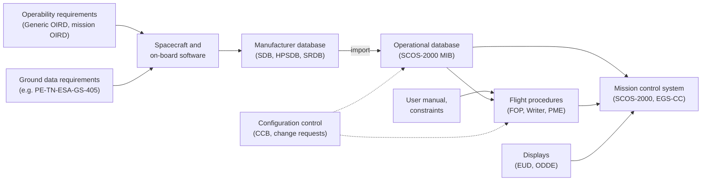

The chain is this wiki's summary. Each element is described, with its source, in the sections
below.[^int-odb][^int-fop][^go-gen][^tas-intro][^eud-ben]

## What has to be prepared

ESA's paper on the next-generation Mission Operations Preparation Environment lists the data
definitions that its EGS-CC based preparation environment was to support, and for which ESOC
product each is needed: MICONYS-CC (the mission control system suite), GSMC-CC (ground station
monitoring and control) or SIMULUS (simulators).[^tri-cc][^tri-tab]

| Data definition | What it is | MICONYS-CC | GSMC-CC | SIMULUS |
|---|---|:-:|:-:|:-:|
| Monitoring and Control Model | The EGS-CC M&C model that configures the EGS-CC kernel | x | x | x |
| TM/TC packets | Packet definitions for the EGS-CC packet encoder/decoder | x | | x |
| ESA ground station M&C ICD definitions | Variable lists, transient variables, tasks and other interface structures | | x | |
| On-board M&C services (PUS) | PUS-based monitoring and control services | x | | x |
| User defined displays | Displays running in the EGS-CC user interface | x | x | x |
| Synthetic parameters | Derived parameters | x | x | |
| Expressions | Expressions in the EGS-CC script language | x | x | |
| Activity lists | Lists of activities | x | | |
| Ground station subsystem interface definitions | Interface to the station subsystems | | x | |
| Flight control procedures | Manual flight control procedures | x | | |
| Scripts | Scripts in the EGS-CC based script language | x | x | |
| Automation procedures (Java) | Native EGS-CC automation procedures | x | | |
| Automation procedures (DSL) | Automation procedures in a domain-specific language | x | x | |
| Automation schedule templates | Schedules for automated execution | x | x | |
| Mission planning rules | Planning rule definitions | x | | |
| FCT documentation | Generation of flight control team documents | x | | |
| FCT preparation activity planning | Reports of activities in the MCM tree | x | | |
| Ground station main menu | Tailored station M&C menu with its actions | | x | |
| Problem and requirements tracking | Requirements with cross-references to procedures and validation data | x | x | |
| Simulator preparation data | For example simulator scripts | | | x |

[^tri-tab]

Future extensions could cover mission-specific on-board control procedures, flight operations plan
requirements, timelines, diagnostic rules, tracking of tailoring-data validation, and verification
and validation data.[^tri-tab] For comparison, a SCOS-2000 [MIB](../mib/index.md) holds packets
in [`pid`](../mib/tables/pid.md) and [`plf`](../mib/tables/plf.md), parameters in [`pcf`](../mib/tables/pcf.md), [synthetic parameters](../mib/synthetic-parameters.md),
[displays](../mib/displays.md) and [command sequences](../mib/sequences.md).[^icd-sum] See
[the MIB data model](../mib/data-model.md).

INTEGRAL's flight operations plan names the operational tools that its flight control team kept
under control: the flight operations plan itself, the Operational Database (ODB), the On-Board
Software Maintenance System (OBSMS), the simulator, the mission control system (IMCS) and the flight
dynamics system.[^int-cm][^int-tools] Most of them appear as boxes in ESA's 2003 picture of an
SCOS-2000-based MCS, where a satellite database import feeds the INTEGRAL ODB, which in turn feeds
the INTEGRAL Monitoring and Control System.[^peccia13]

## Requirements upstream

Operations preparation starts before the spacecraft is built: what the ground can do later depends
on what the space segment is required to provide. Two ESA documents in the library show how such
requirements are now written.

### The Generic OIRD

Operability requirements are an early input to spacecraft development. Most ESA missions write them
in an **Operations Interface Requirements Document** (OIRD), either standalone or inside the System
Requirements Document, tightly coupled with the CCSDS and ECSS standards. ESA's 2019 presentation
lists the problems: each mission had its own OIRD derived from previous ones, lessons learnt did not
always propagate, the documents looked more different than they were, they had evolved independently
of PUS-C and the OBCP standard, and the variability hampered product orientation both on board and in
the mission control system.[^go-intro]

In June 2016 SAVOIR entrusted ESOC with establishing a **Generic OIRD** (GOIRD) that would form the
baseline specification for future missions and allow compatible on-board software libraries. Mission
OIRDs are to be created from it with only mission-specific deltas, plus the sizing of PUS-C services
such as mission timeline capacity.[^go-intro]

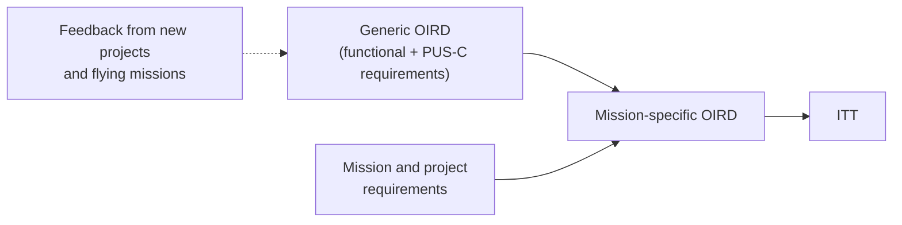

[^go-gen][^go-stat]

The GOIRD is not a replacement for mission OIRDs. Missions must take all GOIRD requirements, apply
truly mission-specific changes (constants, sizing of PUS-C services, de-scoping of what does not
apply), trace every change, and must not copy and paste from previous mission OIRDs.[^go-gen]

| Aspect | Generic OIRD 1.0 |
|---|---|
| Structure | Part I: on-board functional requirements, linked to [ECSS-E-ST-70-11C](../ecss/e-st-70-11c.md) (space segment operability). Part II: PUS-C requirements, tailoring [ECSS-E-ST-70-41C](../ecss/pus/index.md), with [ECSS-E-ST-70-01C](../ecss/e-st-70-01c.md) (OBCP) |
| Delivery | A PDF document with three Excel files as its core: functional requirements, PUS-C requirements and a change log tracking all changes since Draft A |
| Scope | Robotic missions with an avionics-like subsystem in mind |
| Functional groups | General, modes, operations/mission phases, spacecraft control, telecommands, authentication (Earth observation only), telemetry, timing, in-flight testing, general autonomy, FDIR, safe mode, and subsystems (attitude control and navigation, on-board processors and software, data storage and file system, power, thermal, TT&C, payloads, mechanisms) |
| Functional format | Kept in DOORS: ID, requirement and notes, relationship to ECSS-E-ST-70-11C (unchanged, new or modified) with clause, justification of modifications, mission-family flag (interplanetary, astronomy, Earth observation); a second module lists the operability requirements tailored out |
| PUS-C format | DOORS, against the original standard, with an applicability flag (unchanged, modified, deleted, new) and a justification per change; exportable as full tailored standard or deltas only |
| Status | Released July 2019; already used for the Copernicus high-priority candidate missions, ERO/Mars Sample Return and HERA |

[^go-struct][^go-func][^go-pusc][^go-stat]

Why not use PUS-C as it is? The presentation counts 20 services with 33 subservices but no mapping to
an architecture; 316 TCs and TM reports if all subservices are implemented, of which only 88 are
mandatory (this wiki's own tally of ECSS-E-ST-70-41C Annex C, in the [PUS message type catalogue](../ecss/pus/message-types.md), finds 318 message types, 81 of them in minimum capability sets; how the presentation counted is not stated); and 382 "shall be declared when specifying" statements, so that two untailored
implementations would end up with very different interfaces. Some functions that ESOC missions need
are missing (critical event log or system log, file transfer, backup mission timeline), as are some
lessons from previous OIRDs.[^go-pusc] The PUS-C part of the GOIRD therefore consists of these
classes of requirement:[^go-class]

| Class | Content | Share of the GOIRD PUS-C requirements |
|---|---|---|
| Services, subtypes and capabilities selection | One common set of services, subservices, TC/TM packet types and capabilities for all future ESA missions, so that the satellite interface is fairly mission-independent | about 60% |
| Additional observables | Parameters added to most services, because PUS-C relies on on-demand reports and mandates few housekeeping parameters | about 2% |
| New capabilities | Critical event log / system log, parameter extraction from housekeeping, backup MTL, file-based operations; high-level requirements only, interfaces left open, to be raised as change requests to the standard | about 19% |
| Avionics architecture | A few services centralised (for example service 11, the mission timeline); services 1, 3, 5, 6 (if applicable) and 17 mandated in all packetised units | less than 1% |
| Clarifications and refinements | Lessons learnt from previous missions and OIRDs | about 12% |
| Changes to the standard | Kept to the absolute minimum, never changing defined TC/TM interfaces, each justified (typos, omissions, strong operational needs) | less than 1% |

The presentation warns that PUS-C leaves key low-level aspects unstandardised, such as the number of
bytes used to encode certain packet fields, which matters for interoperability; it asks for
coordination among PUS-C library implementers. The OBCP standard is not tailored, and a few extra
requirements for service 18 sit in the PUS-C part.[^go-prob] The concluding slide sets out a common
requirement set to reduce variability and cost. As a long-term vision it asks whether PUS-C library
developers could collaborate and whether interoperable implementations with a generic TM/TC ICD are
possible, and it proposes further harmonisation of other elements such as procedures and
databases.[^go-concl] For the services named above
see [ST[01]](../ecss/pus/st01-request-verification.md), [ST[03]](../ecss/pus/st03-housekeeping.md),
[ST[05]](../ecss/pus/st05-event-reporting.md), [ST[06]](../ecss/pus/st06-memory-management.md),
[ST[11]](../ecss/pus/st11-time-based-scheduling.md), [ST[17]](../ecss/pus/st17-test.md) and
[ST[18]](../ecss/pus/st18-onboard-operations-procedure.md); for the differences between PUS
versions see [PUS-A vs PUS-C](../ecss/pus/pus-a-vs-pus-c.md).

### Ground inputs to the on-board data architecture (PE-TN-ESA-GS-405)

A technical note from ESA's Earth Observation programme, first issued in November 2014 and at issue
2 revision 6 of 26 March 2026, states what the ground segment needs from the on-board data
architecture so that payload data can be analysed, simulated and processed efficiently. Its change
record shows it being refined for BIOMASS, TRUTHS, FORUM, Harmony and NGGM.[^gs-hist] It explicitly
does not apply to TT&C/S-band links. It also covers missions that use [CFDP](../ccsds/cfdp.md) on
top of the [Space Packet Protocol](../ccsds/space-packet.md), noting that CFDP is new to
Earth-observation missions and that their payload downlink differs from space science: many short
passes, through stations usually procured as a service rather than operated by the flight operations
segment.[^gs-scope] The
note's working assumptions include routing from on-board source to ground sink on the primary
header or the CFDP file name, unmodified commercial CCSDS ground equipment, the Level-1 processor
as end consumer, and preferably fully open-loop payload downlink.[^gs-scope]

Its glossary separates the data kinds that a database designer has to keep apart:[^gs-acr]

| Term | Meaning in the note |
|---|---|
| Observation data (OBS) | Instrument output, as Space Packets, when the stimuli are the mission's targets |
| Calibration data (CAL) | Instrument output when the stimuli are internal or external calibration targets |
| Ancillary data (ANC) | Space Packets generated on board, mostly by software, in support of observations: navigation, temperature, timing, configuration; "instrument ancillary" or "platform ancillary" by origin |
| Auxiliary data (AUX) | Files needed by ground processing but not part of the payload data (for example orbit files, calibration coefficients) |
| Housekeeping telemetry (HKTM) | Data for monitoring and control in the mission control centre; a separate stream not used in payload processing |
| Payload Data | Observation, calibration and instrument ancillary data; excludes instrument HKTM and platform ancillary data |
| RAW / Level 0 | Concatenated packets as received, with no header (RAW); ground-segment header plus concatenated packets (Level 0) |

The requirements, numbered by topic, are summarised below.

| Group | Requirements (paraphrased) |
|---|---|
| Data categories | R-001: payload data is categorised as observation, internal calibration, external calibration or instrument ancillary |
| Identification | R-010: every payload packet carries a logical stream identifier, the APID, and end-to-end routing relies exclusively on it; an APID is unique on the satellite even across RF bands, virtual channels or files. R-020: each packet type needing distinct ground processing or routing gets its own APID, including separate APIDs per calibration type, observation mode and test mode. R-030/R-040/R-050: platform and instrument ancillary parameters go in dedicated packets, and ancillary packets from different sources (for example navigation and thermal) have different APIDs |
| Secondary header | R-110/R-120: a common, CCSDS-compliant secondary header with a time stamp; the PUS-C secondary header is allowed but service type and subtype must not be used to discriminate data types. R-130: the time field uses the PUS-C time format (PTC 9 or 10) |
| Packet content | R-140: every packet is self-contained, so no round-robin or slice-based subcommutation. R-150: PUS structure IDs (SIDs) are to be avoided for payload data, because a given APID always has the same structure. R-160: no padding |
| Navigation | R-200 to R-270: position, velocity and time (PVT), attitude quaternions and time-correlation parameters go in a platform packet called NAVATT; PVT in an Earth-fixed frame, attitude in an inertial frame, both at configurable minimum rates (PVT by default 1 Hz, the GNSS PPS) |
| Storage | R-300/R-310: ancillary packets available for downlink whatever the instrument state. R-320/R-321: any payload or platform-ancillary data type can be allocated from ground to any packet store |
| Data link | R-400: avoid the AOS insertion zone. R-410: recorded payload packets downlinked with the virtual channel packet service of [TM](../ccsds/tm-sdlp.md), [AOS](../ccsds/aos.md) or [USLP](../ccsds/uslp.md). R-420: payload and platform ancillary data on virtual channels separate from TT&C. R-450: with several physical channels, each packet store is downlinked over one channel only |
| Files | R-500 to R-595: data types in separate files, unique file names that identify type and instance, configurable destination (CFDP destination IDs per data type), configurable priority by type and age, repeat and complete re-downlink, file sizes chosen against link outages, open-loop (CFDP class 1) as a goal |
| Operations and downlink | R-600/R-610: time-tagged and position-tagged schedules. R-700: everything stored can be downlinked at any time. R-710: only complete packet sequences per the segmentation flags. R-720: autonomous downlink control around acquisition and loss of signal |

[^gs-cat][^gs-apid][^gs-fmt][^gs-nav][^gs-store][^gs-link][^gs-file][^gs-oth]

These rules also shape the ground database. Under R-020 and R-150 each APID has one fixed structure
and maps to one Level-0 product, and under R-010 routing relies on the APID alone.[^gs-apid][^gs-fmt] The Solar Orbiter MIB, from a science mission outside the note's scope,
shows the opposite choice for its science telemetry. Solar Orbiter's 11-bit APID is a 7-bit process
ID plus a 4-bit packet category, category 12 being reserved for its science service 21.[^solo-apid]
In the September 2025 release, the 45 on-board science APIDs carry 334 packet definitions. 328 of
them are TM(21,3), (21,5) or (21,6), which are told apart by an additional identification field: the
[`pic`](../mib/tables/pic.md) table puts PI1 for these three subtypes at byte 16, 8 bits wide
(317 definitions have a non-zero PI1 value; the other 6 are TM(21,7), which has no PI1).
35 of the 45 APIDs carry more than one definition, up to 45 on APID 1548.[^mib-sci]

!!! warning "Inference"
    In the note's terms, Solar Orbiter's science packets use a structure identifier inside the packet
    to select the layout, which R-150 asks Earth-observation payloads to avoid. The note does not
    discuss Solar Orbiter, and nothing here says that either design is wrong for its mission; the
    comparison only shows what the requirement changes in a ground database.

## Spacecraft databases

### From the manufacturer's database to the ODB

On INTEGRAL, the ODB was derived from the Satellite Database (SDB) that the satellite manufacturer
delivered before launch. The SDB was not maintained afterwards: during the routine phase all
changes went directly into the ODB.[^int-odb] The two spacecraft analysts of the flight control team
maintained it; every modification needed the Spacecraft Operations Manager's (SOM) approval, after
which the analysts updated every system that used the ODB: the IMCS, the FOP generation tool and the
OBSMS.[^int-odb][^int-team] Change requests could come from the flight control team, the science
ground segment or the instrument teams; requests from the science side were first verified at
science-ground-segment level and, if needed, went to the Configuration Control Board.[^int-odb]

### HPSDB and SRDB: a database with views

Thales Alenia Space's 2015 presentation traces its system reference database from Herschel/Planck to
MTG and towards EGS-CC. The **Herschel/Planck System Data Base (HPSDB)** answered two ESA
requirements: commonality between the two spacecraft and between the users of the database, and
smooth transition, the reuse of validated data from one programme phase to the next up to
operations. Commonality was achieved by physical instantiation and category flags, smooth transition
by logical instantiation and category flags. The **SRDB** adapted HPSDB for MTG; its one major
conceptual change is that an object can be attached to a former version of another, where HPSDB
could attach only the most recent one.[^tas-intro] How HPSDB processed SCOS-2000 MIB files is
described on [Mission tailoring of the MIB](../mib/tailoring.md#hpsdb-how-the-system-database-processed-mib-files)
and [MIB tooling](../mib/tooling.md#project-databases-hpsdb-and-the-satellite-database).

The model has three kinds of element. An **object** is a node of the product tree at element,
subsystem or model level, such as a reaction wheel, the AOCS or the spacecraft. An **item** is a database entry belonging to an object: a TM packet, a TM parameter, a curve,
a synthetic parameter, a group or a constant. A **pseudo-item** is a sub-record inside an item, for
example one entry in a packet's list of parameters, with its own category flag, parameter
reference, byte offset and bit offset.[^tas-rules][^tas-def][^tas-log] Item identifiers have a core part with a
type letter and an instantiation part that prefixes it:[^tas-rules]

| Prefix of the core identifier | Item type | Example from the slides |
|---|---|---|
| `A` | TM packet | `A001` |
| `C` | Curve | `C001`, instantiated `RWC001` |
| `D` | Synthetic parameter | `D001`, instantiated `AZZZD001` |
| `G` | Group | `G001` |
| `K` | Constant | `K001`, instantiated `A101K001` |
| `M` | TM parameter | `M001`, instantiated `A101M001` |

[^tas-rules][^tas-log][^tas-grp]

Category flags select the users of each item and pseudo-item (AIT, OPS, SW in the example). The
manager sees everything. In the slide's example the AIT view of the reaction wheel contains packet
`A001`, parameter `M001` without its OPS-only pseudo-item, `M002` and the curve; the OPS view omits
the packet, which is flagged for AIT and software only; the software view contains only the packet.
The main constraint is that every view must be consistent.[^tas-def]

| Mechanism | What it does |
|---|---|
| Physical instantiation | A defined object (reaction wheel `RW`) has realised instances with serial numbers (`RW001` ...). An instance can physically delete, modify or add items: `RW001` drops packet `A001`, modifies `M002` and adds curve `RW001C002` |
| Logical instantiation | A higher-level object places lower-level objects at positions: the AOCS places reaction wheels at `A101` and `A102` and a gyro at `A200`, giving `A101M001`, `A102M001`, `A200M001`. The higher level can logically delete, modify or define items, and its own items sit at a pseudo-position (`AZZZ`), for example a synthetic parameter `D001 = A101M002 + A102M002` |
| Combined instantiation | Element, subsystem and model levels (RW, AOCS, HERSCHEL) each have defined and realised parts; in the slide's example a constant `K001` is overridden physically at the realised element (`RW001`), logically at the subsystem level (`AOCS`) and physically at the realised model (`HERSCHEL001`) |
| Generic object | A `GENERIC` object at pseudo-position `STD` holds items visible from every object, such as `STDK001` |
| Configurable levels | The number of logical levels is configurable |
| Resources | A parameter can be declared valid only when a resource item is in a given state, for example `M001` valid if relay resource `R001` is closed; a mapping at module level binds `A101R001` to the PCDU's relay status `A200M001`, and the exported operational files carry the validity condition |
| Groups | Group items collect items, also across positions: the AOCS group `G001` = `A101G001` + `A102G001` + `A200A001`, so `AZZZG001` holds the members of both wheel groups plus the gyro's packet |
| XML views | A *flat* view lists every instantiated item of an object; a *full* view keeps the generic, definition and attachment structure (`OBJ_GN`, `OBJ_DF`, `OBJ_ATTACH`) |

[^tas-phys][^tas-log][^tas-gen][^tas-lev][^tas-res][^tas-grp][^tas-xml]

Editing follows a check-out/check-in cycle across three areas. An object is checked out from the
reference area into a working area, modified there, and checked back in; the previous reference
version then moves to the archive area.[^tas-areas]

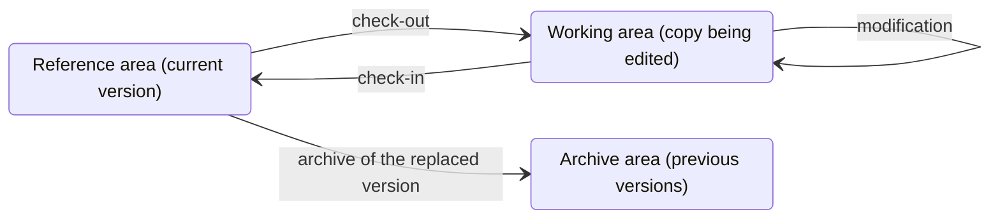

[^tas-areas]

Every check-in increments an **environment counter** and can carry a label. By default an inheriting
object follows the latest version of its parent (automatic propagation). A forced attachment pins
it to an environment counter or label, so that two objects inheriting from the same parent can see
different versions of it until the default attachment is reset.[^tas-ver] This is the SRDB feature
that HPSDB lacked. For EGS-CC, the high-level model (objects and instantiation) was expected to map
onto the EGS-CC product structure, and the low-level model (items and pseudo-items) onto other EGS-CC
packages through conversion algorithms; in 2015 this mapping was "still to be done".[^tas-egs][^tas-concl]
MTG had also added resources, an owner flag and lists of aliases.[^tas-concl]

### How a delivered MIB identifies itself

Whatever tool builds the database, the SCOS-2000 import names each delivery in the
[`vdf`](../mib/tables/vdf.md) table. The ICD says the last imported record sets the internal version
name, which SCOS-2000 shows to users and checks, for example, when a saved stack file is loaded
against the database that produced it; release and issue numbers support version
management.[^icd-vdf] The Solar Orbiter release of 16 September 2025 has one record, `25925PFM`
with comment `20250916-CSW3.1.2_MAS7.33`, release 25925 and issue 733. The SWA instrument database
instead keeps all 70 versions it went through, from `SWA_00.2` ("Received from MSSL") to `SWA_6.3.4`
of 29 November 2021; 26 of the dated releases fall in 2016 and 23 in 2017, more than in any other
year.[^mib-vdf][^swa-vdf] Both are discussed further on [The Solar Orbiter MIB](../missions/solar-orbiter/mib.md)
and [SWA](../missions/solar-orbiter/swa.md).

## Procedures

### Flight procedures under configuration control: INTEGRAL

INTEGRAL's flight operations plan (FOP, issue 2.0 of February 2003) is the reference for all flight
operations. Its mission rules say that the FOP's timelines and flight procedures, nominal and
contingency, are to be used after separation, that FOP procedures override all other derived
procedures, and that deviations need the permission of the Flight Director or SOM during LEOP and of
the SOM or a nominated representative thereafter.[^int-rules] The flight control
team prepares and maintains the FOP under the SOM, who alone approves modifications (parts that
concern the interface to the science ground segment also need its representatives' approval); changes that
could affect mission performance are coordinated with the Project Scientist.[^int-fop]

A procedure is written by the responsible spacecraft operations engineer (SOE), tested by that
engineer and by another SOE or analyst, usually on the satellite simulator, and approved by the SOM.
Only then is it given to the controllers (SPACONs), who may execute approved procedures only.[^int-fop] The FOP lists the validation levels; the two not relevant in the routine phase are
marked deleted in the source:[^int-fop]

| Level | Validation step |
|---|---|
| 1 | The spacecraft or instrument manufacturer verifies the inputs given in the user manual (in the routine phase the manufacturer is normally no longer involved) |
| 2 | The SOE visually inspects the procedure when generating it |
| 3 | Generation with **FOPGEN** checks the parameters implicitly, because FOPGEN accesses the actual database |
| 4 | The SOE tests the procedure on the simulator if necessary (not systematically) |
| 6 | SPACONs may run procedures on the control system against the simulator: this verifies the command sequence and the telemetry parameters named in the procedure, but not the logic |
| 8 | Throughout, the SOEs keep a verification matrix of which procedure was tested in which context |

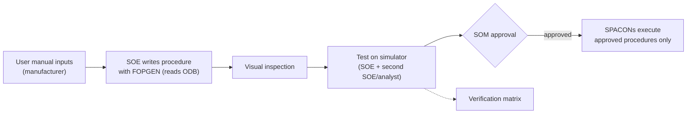

[^int-fop]

### MOIS and ASTRAL-Prepare

RHEA's MOIS, presented in 2023 as ASTRAL-Prepare, is a long-standing preparation product that RHEA
says has supported over 100 spacecraft. It authors manual, semi-automated and automated procedures,
checks the TM and TC they use against different spacecraft database versions, validates them, and
publishes them to a flight operations manual or to operations languages for automation; it also
manages spacecraft databases. Procedures can be edited in synchronised tabular, flowchart and script
views; configuration management, role-based access and an approval workflow govern releases.[^rh-astral]

Its framework classifies configuration data into **data types**, whose instances are **data items**.
The files and metadata that make up a data type are managed as a group, as a single configuration
item. Each data type has common properties (name, description, type) used for search across the
whole data set, specific properties, and four mandatory methods: consistency checks, query,
generate products and publish, which the framework calls when it checks or publishes the entire data set, for example a
FOP release.[^rh-fw] Data types and editors already existed for OBCPs, mission planning rules, PLUTO
scripts (see [ECSS-E-ST-70-32C](../ecss/e-st-70-32c.md)), Writer procedures and Word documents, and
SCOS-2000 synthetic-parameter scripts.[^rh-fw]

The established SCOS-2000 procedure format is the **Writer**: a per-procedure database with a
forms-based editor that uses MS Excel for visualisation, plus a flowchart view. RHEA finds it
comfortable for mostly linear procedures because a form can show many attributes, such as
calibration curves, while scripting does better with loops, branching and complex expressions. Some
ESOC missions automated routine operations with Writer procedures and the MOIS Scheduler, with an
event monitor starting contingency recovery procedures on known out-of-limit events.[^rh-phase]

### PME and the Extensible Procedure Model

RHEA's newer **Procedure Model Editor (PME)** distinguishes two uses of a procedure. A
*product-generating* procedure is a design document that may be detailed enough to generate EGS-CC
activity lists, SCOS-2000 MIB sequences or code in an operations language (OBCPs in OL, Tcl/TOPE
automation, SPELL). A plain sequence is linear and carries no logic or guidance for the operator,
which is why RHEA wants to start from a richer procedure. An *executable* procedure is run directly
by ASTRAL-Automate instead of being submitted to a control system.[^rh-pme]

Procedures must be reviewable by non-programmers in textual, flowchart and tabular views, so RHEA
starts from a model rather than a language: the **Extensible Procedure Model (XPM)**.[^rh-pme]

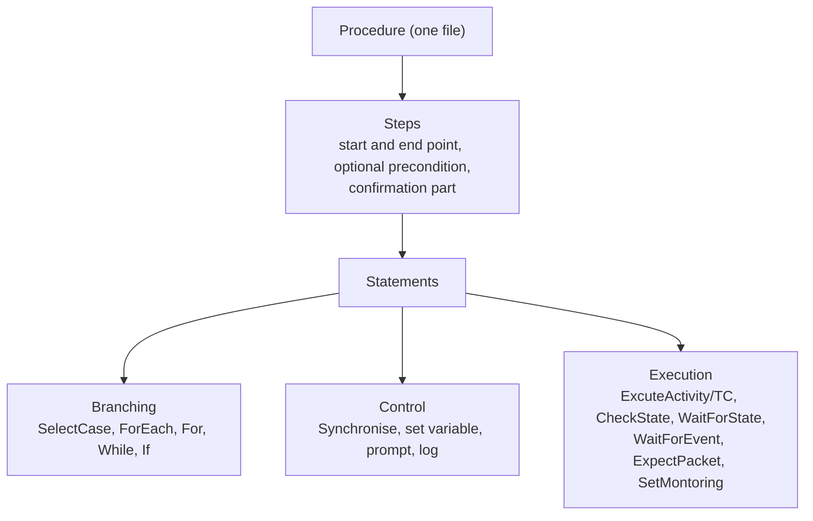

The statement names are given as printed in the paper ("ExcuteActivity", "SetMontoring").[^rh-xpm]

The minimal XPM is an interface that every structured procedure implements: verifiable steps,
executable statements and basic branching. It is enough for flowcharts and for export to activity
lists or SCOS-2000 sequences, but execution needs a language extension.[^rh-xpm] RHEA defines a
domain-specific language (PDSL) with Xtext, whose grammar is derived from the EMF model so that the
model is also the abstract syntax tree. Steps have pre- and post-conditions; activities are called
asynchronously and can be synchronised on completion; otherwise execution is single-threaded.
Boolean and arithmetic expressions are delegated to a scripting language (Groovy, Python possible),
and the generated Groovy carries annotations so that breakpoints and variables can be inspected in
the PDSL itself.[^rh-dsl] The flowchart editor is built with Sirius; text and flowchart can be edited
in parallel, and several flowcharts of different granularity can describe one procedure.[^rh-flow]
The PME currently supports two DSLs, one for AIT test procedures and one for ESOC flight control
procedures, sharing flowcharts, queries and relational checks against the mission model.[^rh-dsl]

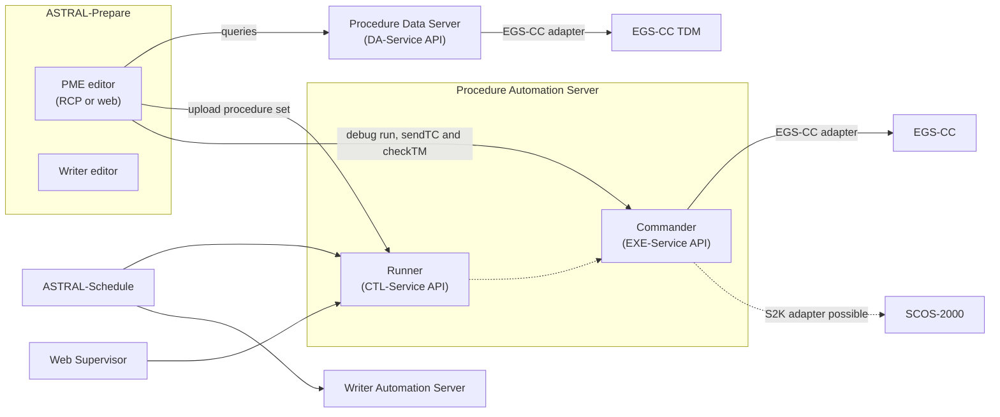

[^rh-srv][^rh-sched]

The editor reaches the mission model only through the Procedure Data Server, whose EGS-CC adapter
returns simple objects from TDM queries; a SCOS-2000 adapter is conceivable but not required, since
the MME imports the MIB and the SCOS-2000 automation server needs no MIB access. The Automation
Server splits into the Runner, which executes procedures server-side without a user interface, and
the Commander, which performs atomic actions such as sending a TC or checking TM.[^rh-srv] The
Scheduler, used at ESOC for years to run Writer procedures with SCOS-2000, gained a second connector
so that one plan can mix Writer and PME procedures.[^rh-sched]

RHEA describes three transition steps:[^rh-conv][^rh-phase][^rh-move]

1. **Conversion.** Writer procedures can be converted to PDSL on import, whether or not the mission
   moves to EGS-CC; the MIB is converted to the EGS-CC TDM with the MME's MIB importer.
2. **Phase-in on SCOS-2000.** Writer and PME procedures coexist in the data set and in the schedule,
   so a team can keep a Writer-only plan and, in parallel, a plan where validated PME procedures
   replace their Writer counterparts. For SCOS-2000 the PME generates command sequences, and it runs
   on Windows and Linux, whereas Writer is Windows/Office based.
3. **Move to EGS-CC.** The move is complete when the MIB is converted to the TDM. PME procedures need
   no conversion. A database analyst imports into a local workspace backed by SVN, runs a consistency
   check of the whole procedure set against the new TDM, and checks in only if it passes.

For scale: the September 2025 Solar Orbiter MIB holds 3,404 command sequences with 13,879 elements,
of which 12,629 are commands and 1,250 nested sequences; there are no textual-comment
elements.[^mib-seq] This is the linear, logic-free product RHEA describes;[^rh-pme] see
[Command sequences and parameter sets](../mib/sequences.md).

## The next-generation environment: OPEN

### Objectives and layers

ESA's answer to the proliferation of preparation tools is a light, data-type-agnostic framework with
generic services, extended by plug-ins for specific data types. Its stated objectives are to
streamline tailoring and reduce operator effort, to host all preparation applications in one
consistent environment, to harmonise the tools of spacecraft and ground station operations teams, and
to bring advanced features such as configuration management to all operations artefacts. A secondary
objective is to support the transition from SCOS-2000 to EGS-CC.[^tri-intro][^tri-sec]

The framework, the **Operations Preparation Environment** (OPEN; the 2019 paper calls it the "OPEN
Preparation Environment"), has two layers.[^tri-intro][^oc-intro][^oc-fw]

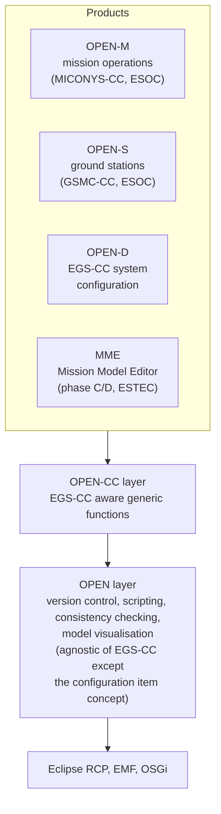

[^oc-fw][^oc-harm][^tri-impl]

Extensions can be added to both layers, but EGS-CC-specific extensions only to OPEN-CC.[^oc-fw]
OPEN's functions fall into three groups: **managed data** (the supported definitions), **data
management services** (version and access control, consistency checking such as dependencies
between data sets, merge and compare, baselines, reports, change logs, delta and complete
import/export) and **editors and browsers**.[^tri-fun] Format-specific services, such as importing an
S2K MIB, are dedicated extensions.[^tri-fun]

| Topic | What the sources say |
|---|---|
| Implementation | Java on OSGi and Eclipse RCP; every function a distinct plug-in; managed data held as EMF models and stored and exchanged through a distributed version control system |
| Deployment | Desktop applications on several operating systems including Windows; offline editing, with sporadic TCP/IP connections to a central repository when online |
| Data model | The EGS-CC Conceptual Data Model (CDM) and its LDM library, shipped with the EGS-CC binaries rather than with OPEN; any EMF-compatible model or CDM extension can be loaded "with a few assumptions" |
| Model visualisation | Views to navigate CDM types, sub-types and references, replacing the HTML EGS-CC reference manual for the data model |
| Shared repositories | OPEN-M, OPEN-S, OPEN-D and MME can work on the same repositories, so FCT tailoring data can be checked against the EGS-CC system configuration without the FCT editing it |
| SCOS-2000 migration | OPEN-M includes a converter from SCOS-2000 MIB 6.9 to the CDM; ESA calls the EGS-CC model "semantically richer", so the migration is possible; validation used data from BepiColombo, ExoMars TGO, Gaia, JUICE and the Sentinels |
| External deliveries | The MICONYS-CC environment was to import legacy MIB data both to migrate missions and to accept MIB-format deliveries from external organisations |
| FOP editor | Planned as a re-engineering of MOIS Writer as an OPEN-CC extension |
| Licence | ESA Community License with weak copyleft; proprietary extensions allowed; redistribution outside ESA Member States needs ESA Technology Transfer Board authorisation |
| Status (Feb. 2019) | Development since 2017 with more than six companies in one agile team; JUICE and Sentinels flight control engineers using alpha versions with flying-mission data; goal: OPEN-M fit for operational use by 2020; next: display editors, constellations, EGS-CC system configuration |

[^tri-impl][^oc-tool][^oc-harm][^oc-conv][^tri-cc][^oc-lic][^oc-stat]

ESA presents OPEN as a way to "raise the software stack", like Eclipse RCP below it, so that
implementers of EGS-CC tailoring tools need not reimplement basic functions and can share framework
maintenance.[^oc-mkt] How ESOC's missions will move their MIBs into OPEN-M, in three categories, is
described on [Ancillary systems, MICONYS and the move to EGS-CC](ancillary-and-egs-cc.md#what-happens-to-the-mib-three-categories).

### The Mission Model Editor

The MME, developed by RHEA and now part of EGS-CC, edits data of the EGS-CC Technical Data Model
(TDM). It adds a presentation layer that arranges packets, parameters and procedures in a Mission
Model tree and hides the TDM's M&C elements, mappers, mapped implementations and file-backed
configuration items. It imposes one M&C element per configuration item file, so that a sub-tree is
an independent, replaceable set of files that different organisations can work on in parallel. Its
TM Parameter Editor maps directly to TDM engineering parameters. Because the MME extends OPEN, it
inherits OPEN's SCOS-2000 MIB importer.[^rh-mme]

## Telemetry definitions on the fly: dynamic housekeeping

### The problem

An on-board data pool can hold tens or hundreds of thousands of parameters from many suppliers.
During AIT and on-board software validation, engineers often define new housekeeping packets on board with
[PUS service 3](../ecss/pus/st03-housekeeping.md) commands, picking only the parameters they need.
A central checkout system that recognises packets only from its database then cannot identify these
packets unless someone has already written matching static definitions.[^kz-abs]

The SCOS-2000 import ICD states the conventional rule: SCOS-2000 has no service-specific processing
of service 3, every received packet must be defined in the database before generation is enabled,
and the efficient ESA practice is to create the packet definition first and generate the service 3
commands from it in the database manager, not in the kernel.[^icd-s3] Terma's CCS5 reverses the
direction and derives the database entry from the command.[^kz-ccs5]

### The service 3 commands used

| Message | Name | Application data |
|---|---|---|
| TC(3,1), TC(3,2) | Define new housekeeping / diagnostic parameter report | SID; collection interval in units of the default housekeeping scheduling rate (`DIAG_MIN_INTERV`); counters and the list of on-board parameter IDs (with NFA, NREP and NPAR2 for super-commutated groups) |
| TC(3,3), TC(3,4) | Clear housekeeping / diagnostic definitions | A list of SIDs |
| TC(3,5) | Enable housekeeping parameter report generation | Not detailed in the paper; the operator sends it after the definition is in place |
| TM(3,25), TM(3,26) | Housekeeping / diagnostic parameter report | SID followed by parameter samples, possibly super-commutated |

[^kz-s3][^kz-ccs5][^kz-pic]

SID, APID and subtype together identify a report definition, so the definition commands carry
enough information for the ground to create and delete its own packet definitions.[^kz-s3]

### How CCS5 does it

CCS5 reads a SCOS-2000-compatible MIB and runs Tcl-based TOPE procedures (see
[TOPE](egse.md#tope-the-test-and-operations-procedure-environment)). At session start it loads the MIB
tables into memory, where TOPE can read all tables and write some; it can merge several MIBs, marking
each record's origin in a "Source" field.[^kz-ccs5] The core of the DYNHK component is a TOPE
script, `DynHkMonitor.tcl`, running on the CCS server console.[^kz-ccs5]

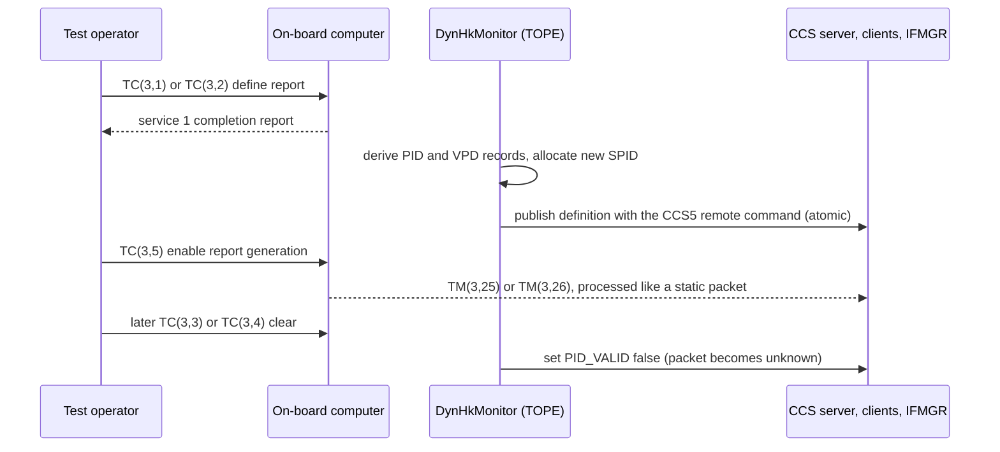

[^kz-ccs5]

Redefining a SID disables the old definition and creates a new one with a new SPID, so SPIDs and
TPSDs are never reused within a session. Dynamic records stay in memory and vanish when the MIB is
reloaded; they are tagged with Source = `DYNHK` and can be saved and merged in the next session, which
is optional because it depends on whether the on-board software keeps its dynamic definitions over
a reboot.[^kz-ccs5] Packets that arrive after their definition is cleared are archived as unknown,
but variable-packet samples already archived remain accessible.[^kz-ccs5][^kz-concl]

### Mapping PUS to MIB tables

CCS5 identifies packets as SCOS-2000 does: APID from the primary header, type and subtype from the
data field header, the [`pic`](../mib/tables/pic.md) record giving the position of PI1 and PI2, the
[`pid`](../mib/tables/pid.md) record giving the SPID, and finally [`plf`](../mib/tables/plf.md) or
[`vpd`](../mib/tables/vpd.md) for the layout.[^kz-match][^icd-pic] Because the definition command
lists parameter IDs without offsets, DYNHK uses `vpd`, which packs parameters one after another and
also allows variable-length strings.[^kz-match] It needs two settings that PUS does not supply: a
`schedulingRate` to convert the collection interval into milliseconds for parameter expiry, and a
mapping from TC APID to TM APID, since the report does not necessarily come from the APID that
received the command. The `pic` records for the new packets must exist in advance, because the MIB
does not reference the SID directly.[^kz-match][^kz-pic]

| Table and field | DYNHK value |
|---|---|
| `PID_TYPE`, `PID_STYPE` | 3; 25 for housekeeping or 26 for diagnostic |
| `PID_APID` | From the TC-to-TM APID setting |
| `PID_PI1_VAL`, `PID_PI2_VAL` | From the SID, split according to `pic` (or all in PI1) |
| `PID_SPID` | Counter from a user-configurable offset, clear of static SPIDs, incremented per definition |
| `PID_DESCR` | Generated, for example `Dyn HK <SID value>` |
| `PID_TPSD` | Equal to the SPID |
| `PID_DFHSIZE` | Derived from `pic`: start reference for the variable parameters |
| `PID_TIME` | `Y` (on-board time assumed in the header) |
| `PID_INTER` | From the collection interval |
| `PID_CHECK` | 1 (packet error control assumed present) |
| `PID_VALID` | Set to false on TC(3,3) or TC(3,4) |
| `VPD_TPSD`, `VPD_POS`, `VPD_NAME` | TPSD; positions 1 to NPAR; the `pcf` name whose `PCF_PID` equals the parameter ID in the TC |
| Super-commutation (NFA = 1) | An extra group-repeater row: `VPD_NAME` = `REPEATER`, `VPD_GRPSIZE` = NPAR2, `VPD_FIXREP` = NREP |

[^kz-pic]

The ICD defines `VPD_GRPSIZE` as the number of following records repeated by a counter and
`VPD_FIXREP` as a fixed repetition count carried by a dummy parameter that is defined in `pcf` but not
present in the packet, which is how DYNHK's `REPEATER` row works.[^icd-vpd]

### Worked example: a Solar Orbiter definition seen through DYNHK

Solar Orbiter does the opposite of DYNHK: its MIB already contains the reports together with
predefined commands that create them (see [ST[03] §9.5](../ecss/pus/st03-housekeeping.md#95-the-numbers-in-the-mib)).
This makes it possible to check DYNHK's rules against a real, static definition. The command
[`ZCA2Z05B`](../explorer/index.md#/solo/command/ZCA2Z05B) "Define HK: AOCS Dynamics FAST" is a TC(3,1)
to APID 188 whose application data consists only of fixed areas, so these bytes are real MIB
data:[^mib-dyn]

<div class="bitfield" data-title="TC(3,1) application data of ZCA2Z05B, first 8 of 36 octets (real values), and the MIB fields DYNHK would fill from them" data-width="32"
     data-fields='[{"n":"SID","b":8,"v":"0x4D","d":"77; DYNHK: PID_PI1_VAL via pic (PI1 at byte 16, 8 bits)"},{"n":"Collection interval","b":16,"v":"0x0030","d":"48 cycles, described in cdf as 6000 ms; DYNHK: PID_INTER via schedulingRate"},{"n":"NPAR","b":8,"v":"0x08","d":"8; DYNHK: VPD_POS 1 to 8"},{"n":"Parameter ID 1","b":32,"v":"0x0B201C1C","d":"PCF_PID 186653724 = NCAG6VN0; DYNHK: VPD_NAME; seven more IDs follow"}]'></div>

Resolving the eight IDs through `PCF_PID` gives the `vpd` rows DYNHK would write, and packing them
back-to-back after the 16 header octets and the SID reproduces exactly the byte offsets of the real
fixed layout of SPID [29530](../explorer/index.md#/solo/packet/29530):[^mib-dyn]

| `VPD_POS` (derived) | Parameter ID | `VPD_NAME` (from `pcf`) | PTC/PFC | Size (octets) | Offset in the real `plf` |
|---|---|---|---|---|---|
| 1 | `0B201C1C` | [`NCAG6VN0`](../explorer/index.md#/solo/param/NCAG6VN0) GyrStarOutputEstRateEst | 7/24 | 24 | 17 |
| 2 | `0B201950` | `NCAG4NP0` ErrGenErrAngErr | 7/24 | 24 | 41 |
| 3 | `0B201C1B` | `NCAG6VL0` GyrStarOutputEstQuat | 7/32 | 32 | 65 |
| 4 | `0B20143B` | `NCAT1AG0` RW1_RATE | 5/1 | 4 | 97 |
| 5 | `0B201459` | `NCAT1B10` RW2_RATE | 5/1 | 4 | 101 |
| 6 | `0B201477` | `NCAT1BK0` RW3_RATE | 5/1 | 4 | 105 |
| 7 | `0B201495` | `NCAT1C40` RW4_RATE | 5/1 | 4 | 109 |
| 8 | `0B201C29` | `NCAG6VZ0` WsEstTrqFricEST | 7/16 | 16 | 113 |

The `pid` record DYNHK would create can be set beside the real one:[^mib-dyn][^kz-pic][^icd-pid]

| Field | DYNHK rule applied (illustrative) | Real Solar Orbiter record |
|---|---|---|
| `PID_TYPE` / `PID_STYPE` | 3 / 25 | 3 / 25 |
| `PID_APID` | TM APID mapped from TC APID 188 | 180 |
| `PID_PI1_VAL` / `PID_PI2_VAL` | 77 / 0 | 77 / 0 |
| `PID_SPID` | next free number above the offset | 29530 |
| `PID_DESCR` | "Dyn HK 77" | "AOCS Dynamics FAST" |
| `PID_TPSD` | equal to the SPID | -1 (fixed packet, laid out in `plf`) |
| `PID_DFHSIZE` | from `pic` | 16 |
| `PID_TIME` | `Y` | `Y` |
| `PID_INTER` | from 48 cycles and `schedulingRate` | empty |
| `PID_CHECK` | 1 | 0 |

The real `plf` layout has 24 records: the SID decoded as parameter `NCD030A1`, the eight block
parameters, and 15 overlapping records that decode the octet strings into components such as
`NCAD6VN1` at byte 17.[^mib-dyn]

!!! warning "Inference"
    A DYNHK-style definition of this packet would decode the eight blocks but not the 15 component
    parameters, which exist only in the hand-made static layout; the octet strings would stay raw.
    For `PID_DFHSIZE` the paper says only that it is derived from `pic`; reading the ICD, variable
    parameters starting after the 1-octet SID would need a value of 17 rather than the 16 of the
    fixed packet. Neither point is stated in the sources.

The TC-to-TM APID setting is a real issue on Solar Orbiter. Its APID is a 7-bit process ID plus a
4-bit packet category, telecommands always use category 12, and housekeeping reports use category 2
(high-priority TM), 4 (routine), 5 (functional cyclic) or 8 (diagnostic).[^solo-apid] Matching each of
the 138 TC(3,1) and TC(3,2) commands that fix their SID in a fixed area to the report with the same
SID and process ID gives:[^mib-apid]

| Process ID | TC APID (cat. 12) | TM APID: SID range (TC(3,1) → TM(3,25)) | TM APID: SID range (TC(3,2) → TM(3,26)) |
|---|---|---|---|
| 10 | 172 | 162 (cat. 2): 2-14; 164 (cat. 4): 77-92 | 168 (cat. 8): 193-194 |
| 11 | 188 | 178 (cat. 2): 2-18; [180](../explorer/index.md#/solo/apid/180) (cat. 4): 77-97 | 184 (cat. 8): 193-229 |
| 12 | 204 | 194 (cat. 2): 2; 196 (cat. 4): 77 | 200 (cat. 8): 193-199 |
| 13 | 220 | 210 (cat. 2): 3-17; 212 (cat. 4): 77-78 | 216 (cat. 8): 195-255 |
| 14 | 236 | 226 (cat. 2): 6-15; 228 (cat. 4): 77-81; 229 (cat. 5): 188-191 | 232 (cat. 8): 193-197 |
| 16 | 268 | 258 (cat. 2): 1-4; 260 (cat. 4): 79 | 264 (cat. 8): 193-194 |

Every one of the 138 commands matched exactly one report packet. The other 21 definition commands
take the SID as a parameter (editable or fixed) and could not be matched this way.[^mib-apid]

!!! warning "Inference"
    On Solar Orbiter the report APID depends on the SID range as well as on the command APID: one
    TC APID feeds up to three housekeeping APIDs and one diagnostic APID. A single TC-to-TM APID
    mapping, as the paper describes it, would therefore not be enough; the rule would have to include
    the SID range or the report subtype. The paper does not discuss such a case.

Terma's conclusion is that a flexible data model was essential: since CCS5 could already patch some
MIB tables without reloading, the C++ changes for `pid` and `vpd` were small. The authors envisaged
a display to pick data-pool parameters and send the TCs automatically, and support for the many new
service 3 subservices of PUS-C.[^kz-concl]

## Command verification beyond the database

Terma's paper on advanced telecommand verification starts from SCOS-2000, which it calls
representative. Verification there is defined in the MIB rather than hard-coded, with global settings
such as propagation delay and permitted jitter, and offers three methods:[^ar-soa]

| Method | How it works | Strength and weakness (per the paper) |
|---|---|---|
| Expected TM value | Open a window after the command and require the first sample after it opens to have the expected value | Fully general, no special packets, works without PUS; but no explicit link to the command that caused the change |
| Service 1 reports | Expect TM(1,x) reports for each stage within a time range | Practically unambiguous per command; ambiguity possible if the source sequence counter wraps during verification (seen on one science mission with a reduced counter range); costs downlink bandwidth; needs PUS |
| Status consistency check (SCC) | Treat any change of a parameter as an error unless a command that changes it was sent, within a window | Called "change on command only" (COCOMO) in other systems |

SCOS-2000 also tracks tricky cases such as a second command expecting a different value while the
first is still pending; the first is then "superseded".[^ar-soa] The MIB side of this is described on
[Command verification in the MIB](../mib/command-verification.md) and
[Monitoring checks](../mib/monitoring-checks.md#status-consistency-checks).

### Limitations the paper identifies

* Only one type of verification per stage. To check a TM parameter as well as receiving TM(1,7) or
  TM(1,8) at completion, several missions "borrowed" the last progress stage; an extra finalisation
  stage would have been cleaner.[^ar-lim]
* The verifier model is encapsulated in C++ and CORBA, so customisation means recompilation and
  reinstallation; long maintenance had made it complicated.[^ar-lim]
* SCOS-2000 shifts verification timeouts for time-tagged [service 11](../ecss/pus/st11-time-based-scheduling.md)
  commands to their execution time, but missions also delete, time-shift and enable or disable
  stored commands, for example by sub-schedule ID, and the paper knows of no ESA mission that followed
  PUS exactly here, so following these changes on ground is mission-specific and costly.[^ar-lim]

The Solar Orbiter MIB shows how one mission works within the model. It defines 16 acceptance
stages by report, 23 completion stages by report and 167 completion stages by parameter, and no
start or progress stage. No command has more than one completion stage, so none combines a
completion report with a parameter check, and the progress-stage workaround is not used. Status
consistency checks (`OCP_TYPE = C`) exist on 15 parameters, all of them counters (error, reject,
reset, stored-packet and other counts) such as `NDSD0046` "DST-A WD Reset Counter", and none of the
15 appears in a verification expression. 5,304 of the 5,454 commands name a default sub-schedule
(`CCF_SUBSCHEDID`), using 17 distinct values (1, 2, 4 to 8 and 101 to 110).[^mib-ver]

!!! warning "Inference"
    With no command expected to change them, these 15 counters behave like the paper's COCOMO case:
    any change is reported. The interpretation of the sub-schedule values (for example as one range
    for platform and one for instruments) is not stated in the available sources.

### The CCS5 approach: a scriptable verifier

Because a checkout product must adapt quickly to on-board software and space-ground ICD changes found
during AIT, Terma kept most SCOS-2000-like verification in C++ but made mission-specific behaviour
scriptable in TOPE.[^ar-gen]

* **TC cache.** A list, visible in the user interface, of recent commands under verification. It has
  a configured size above which completed commands are dropped, but grows (with a warning) to keep
  every incomplete command. The paper sizes it as (timeout + propagation delay) × command rate: for a
  30 s timeout, 10 s delay and 100 commands per second, (30 + 10) × 100 = 4,000 entries, a few
  megabytes.[^ar-impl]
* **Command IDs and properties.** Each command has a system-wide unique ID that includes the
  workstation ID in its upper 4 bits. Properties such as `id`, `raw`, `apid`, `generationTime`,
  `executionTime`, `mapid` and `bypass` are archived at every verification stage, some indexed for
  SQL queries, and read or written with `tcprop <id> <property> ?value?`.[^ar-impl]
* **Mission timeline.** `tcsend ZP_00003 executiontime 12345678.0 subscheduleid 4 checks {SPTV DPTV CEV}`
  (the paper's example) creates a carrier command from a template and postpones verification.
  `tcsubscribe` filters sent commands by properties, for example all service 11 commands, so that a
  script can update the ground timeline model with `::utope::mtldelete`,
  `::utope::mtldisablerelease`, `::utope::mtlenablerelease`, `::utope::mtlreset` and
  `::utope::timeshift`; the verifier follows the modified times.[^ar-sched]
* **Cyclic commands.** A `cyclicRepeats` property (a count, or -1 for infinite) is decremented on each
  repetition; the command leaves the cache only at 0. `updatecommand <id> <stage> <state>` forces a
  stage closed or reopened: setting it to `IDLE` resets it and setting it to `PENDING` reopens the
  same window and conditions.[^ar-cyc]

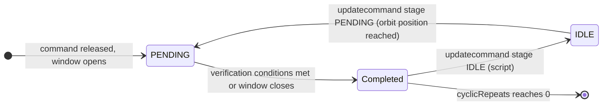

The two script-driven transitions are those of the paper; the other states are simplified for this
diagram.[^ar-cyc]

A **modelled** command (`isModelled` true, via `tcsend ... model` or `tcmodel`) is processed, verified
and archived like a real one but discarded at the moment of transmission. The paper's uses are system
validation tests where the MCS commands and the CCS listens, hot-redundant CCS servers that must take
over verification, and commands sent by other EGSE elements such as a CFDP front end. Command
sequences could be modelled in TOPE; OBCPs and event-action responses might need an external tool
such as MOIS or APEX, an operational simulator or an emulator, each with an efficient API.[^ar-model]
The paper warns against over-engineering: false timeouts confuse operators, network jitter rules out
millisecond windows, and modelling a fixed inter-command delay with a ground timer accumulates drift
from cycle to cycle.[^ar-caut]

In hindsight the authors would have scripted even more of the verifier. They criticise PUS as so
loosely defined and tailorable that ground applications cannot be moved between missions, and they
worried that EGS-CC, then about to start development, might prolong PUS without a plan to replace
it.[^ar-ll]

## Monitoring the EGSE itself as telemetry

Vitrociset's Health Monitoring system (HM) treats the checkout infrastructure as a monitored system.
It reports operating-system resources (disk, memory, CPU), process status, point-to-point connections
and time synchronisation of the EGSE machines, and models every monitored entity as a TM parameter in
the SCOS-2000 MIB inside ad hoc TM packets, so the data appears on normal SCOS-2000 displays and in
procedures.[^hm-intro][^hm-s2k]

It is built on Java's JMX MBean technology, which the paper describes as tooling for distributed,
modular management and monitoring of devices, applications and networks, and follows its three
levels:[^hm-arch]

| JMX level | HM component | Role |
|---|---|---|
| Instrumentation | MBean plug-ins | Make a resource (application, service, device, OS component) manageable; emit notifications |
| Agent | MBean server with services and at least one connector (RMI) | Runs on the monitored machine, or on a mediation element when the resource has no Java environment |
| Manager | Management client, handler, interpreter | Talks to agents through connectors, exposes their view, collects notifications |

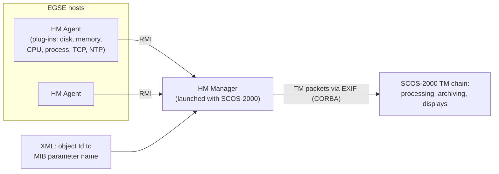

[^hm-dep][^hm-s2k][^hm-cfg]

Each agent mounts its plug-ins at start-up from an XML file of containers and managed objects (in
the VEGA example a resource sampler with disk, memory, CPU and process objects, a TCP monitor and an
NTP sampler). A second XML file maps object IDs to MIB parameter names; on the VEGA
launcher EGSE, client disk usage went to `HM_32_01`, free memory to `HM_16_01`, CPU to `HM_FL_01` and
process or connection status to `HM_1_01` and similar.[^hm-cfg] The manager injects the packets
through the EXIF interface, with a port to the newer SMF module foreseen, and the paper shows
SCOS-2000 mimic displays of the VEGA EGSE status built from these parameters. Deployment needs only
the XML configuration and the matching MIB entries.[^hm-s2k][^hm-concl]

!!! warning "Inference"
    The parameter names appear to encode the value type: `HM_32_` for disk, `HM_16_` for memory,
    `HM_FL_` for CPU load and NTP, `HM_1_` for statuses. The paper gives the mapping but not the
    naming rule.

## Displays and user interfaces: the EGOS User Desktop

The **EGOS User Desktop** (EUD) is ESA's framework for rich-client user interfaces in ground data
systems, in mission operation since 2013. It was motivated by obsolescence, removal of COTS
dependencies and cost reduction through reuse, with goals of open-source technology, Linux and
Windows support, shared implementations and a harmonised look and feel.[^eud-what][^eud-bg] It is
written in Java on Eclipse RCP, uses only open-source software, and integrates user-interface
components called *displays*, which are RCP views or editors; standard RCP views run unchanged, and an
extended view base class adds EUD facilities.[^eud-ov]

| Layer (slide 10) | Content |
|---|---|
| Custom EUD application | Application-specific displays, interfaces and configuration, with back-end-specific adapters |
| Generic displays | Parameter displays (alphanumeric, scrolling parameter, graph, XY graph, MIMIC, matrix), live and history message displays, action executor, system control and system explorer (slide 6 counts 11 commonly used displays) |
| EUD interfaces | `IEudParameter`, `IEudMessage`, `IEudScriptEngine`, `IEudSystemControl`, `IPersistentStorage`, `ISessionManager`, matched to back-end parameter, message, scripting, system control, storage and session services |
| Core | Core and utility libraries, UI widgets and composites, display management, session management |
| Eclipse framework | RCP, EMF, GEF, GMF, BIRT |

[^eud-ov][^eud-arch]

By 2014 most ESOC ground-system user interfaces were EUD based: it replaced the GUIs of SCOS-2000,
SIMSAT, NIS and FARC and underpinned new systems (ARES, GSMC, FIDES, GSSC, MPSF), with MATIS and
SPMON in development and GFTS, DARC and DABYS planned. Its telemetry desktop was in operation for
Gaia, and the slides show an Offline Display Development Environment (ODDE).[^eud-stat] One listed
benefit matters most for operations preparation: display definition files are cross-compatible
between ODDE, the MCS, SIMSAT, ARES and GSMC. The lessons were that consolidating functionality across domains
took much effort, agile development was crucial and adapters for legacy systems can be tedious; a web
version based on Eclipse RAP and use in EGS-CC were planned.[^eud-ben] For display definitions in the
MIB see [Display definitions in the MIB](../mib/displays.md).

## Operations preparation in practice: CHEOPS

CHEOPS, ESA's first small-class mission (launched 18 December 2019), is operated by its consortium:
a Mission Operations Centre (MOC) at INTA's CEIT near Madrid and a Science Operations Centre (SOC) in
Geneva. The 2025 paper describes a ground segment automated so that routine operations need no staff
outside working hours, with 3 to 4 people at the SOC and 5 at the MOC.[^ch-intro][^ch-concl]

The MOC control system is **SCOS-2000 version 5.4.2**, configured through environment variables and
the MIB, which defines every TC and TM packet. A Python module library gives automation access to the
MCS, and GMV's Flyplan orchestrates all automated MCS and flight-dynamics activities, with Jython
scripts and a data-driven `monitorCHEOPS` activity that watches directories for input files.[^ch-mcs][^ch-ap]

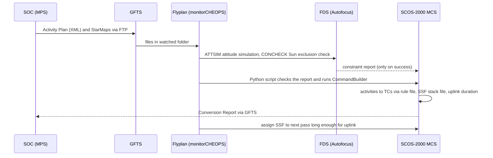

[^ch-ap][^ch-con][^ch-mcs][^ch-pass]

The **CommandBuilder** is the preparation step that turns plans into commands. It maps each activity
of the Activity Plan to one or more TCs through a configuration rule file and writes an **SSF** file,
an ASCII file that "can be read by any standard SCOS-2000 using the MIB". It also estimates the uplink
duration and writes a conversion report.[^ch-mcs] The same tool turns the ground-station availability
file into TC stacks that open and close the MCS-station link and start and stop recorded-TM downlinks,
one pass folder per pass.[^ch-pass]

!!! warning "Inference"
    Because the SSF stack files are generated against the MIB, they belong to one database version.
    The SCOS-2000 ICD says the `vdf` version name is used to ensure that a saved stack is loaded with
    the database version that generated it; whether CHEOPS relies on this check is not stated.[^icd-vdf][^ch-mcs]

During each of the 4 to 6 daily passes, Python scripts restart SCOS-2000 tasks as needed, load the
pass TCs into one of two Auto Stack instances, read TM values through SMON from the packet archive
(PARC, on MySQL), read and set MISC variables, switch to AD mode so that missing TCs are retransmitted
(see [COP-1](../ccsds/cop-1.md)), and run manufacturer health-check procedures written in Python. The
on-board time is a free-running oscillator, so the SCOS-2000 time-correlation feature updates the
linear OBT coefficients when accuracy degrades (see [Time correlation](time-correlation.md)).[^ch-during]
After the pass, the SCOS-2000 TM Processor splits the station file per virtual channel, the TM
Replayer ingests recorded housekeeping into PARC, gaps are found from jumps in the virtual-channel
frame counter (see [TM SDLP](../ccsds/tm-sdlp.md)), and RGTgenerator and the CHEOPS-specific
HKTMreporter produce TC and TM reports; a colour-coded PDF summary is e-mailed to the
operators.[^ch-post] The SOC decodes science and housekeeping TM "according to the spacecraft's MIB"
as well.[^ch-soc] A Simulus 5.4 / SIMSAT simulator validated operational procedures, and MUST/WebMUST,
fed with SCOS-2000 RAPID files, complements SCOS-2000 for trend analysis.[^ch-tools] For PARC see
[Mission archives](archives.md).

## Configuration control: the INTEGRAL model

INTEGRAL (launched 17 October 2002) split its ground segment into an operational part (stations,
MOC at ESOC, communications) and a science part (ISOC at ESTEC, ISDC at Versoix).[^int-sum] Its
configuration control has a ground-segment Configuration Control Board (CCB) chaired by the Project
Scientist with the SOM, the ISOC and ISDC operations managers, the Project Science Coordinator and the
MOC QA manager, plus local CCBs per centre.[^int-cm][^int-ccb] The CCB acts on change requests against
an agreed list of configuration items, recorded in a common tool, without necessarily meeting; it does
not handle time-critical issues and has no contractual power.[^int-ccb]

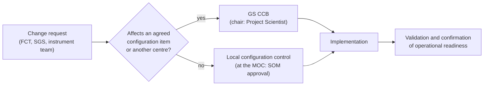

[^int-ccb][^int-fop][^int-odb]

On the space segment the MOC controls the spacecraft configuration: only approved FOP procedures are
applied, FOP and ODB changes follow their configuration control concepts and need SOM approval, the
timeline must be based on the latest EPOS and approved, and on-board software and parameters are
tracked with the OBSMS and the ODB.[^int-cm] Instrument configuration is shared: ISDC evaluates
performance, ISOC approves changes and passes them to the MOC as an observation plan (POS) or a
parameter change request, and the MOC converts instrument tables and software images into uplink
commands with the OBSM function of the IMCS. The ISGRI table, updated every revolution, had its own
interface based on Task Parameter Files processed directly by the IMCS.[^int-cm]

The configuration items fall into four areas: ground-segment set-up at interfaces (the INTEGRAL File
Transfer System, communication lines, ports and firewalls, interface hardware), operational tools
shared between centres, operational products and documentation. Products such as procedures and the
database can be changed locally, except for data of interest to other centres.[^int-ci] The database
fields under CCB control are listed below with, as this wiki's reading, the SCOS-2000 MIB tables that
hold the same information:

| INTEGRAL CCB item (FOP Vol. 1 §1.4.3.3.2) | Corresponding MIB tables (inference) |
|---|---|
| Instrument TM parameters: calibration curves | [`caf`](../mib/tables/caf.md)/[`cap`](../mib/tables/cap.md), [`mcf`](../mib/tables/mcf.md), [`lgf`](../mib/tables/lgf.md) |
| Instrument TM parameters: aliases | [`txf`](../mib/tables/txf.md)/[`txp`](../mib/tables/txp.md) (the ICD calls textual calibrations alias sets)[^icd-txf] |
| Instrument TM parameters: out of limits | [`ocf`](../mib/tables/ocf.md)/[`ocp`](../mib/tables/ocp.md) |
| Instrument TM parameters: packet structure | [`pid`](../mib/tables/pid.md), [`pic`](../mib/tables/pic.md), [`plf`](../mib/tables/plf.md), [`vpd`](../mib/tables/vpd.md), [`tpcf`](../mib/tables/tpcf.md) |
| Instrument TM parameters: new parameters | [`pcf`](../mib/tables/pcf.md) |
| Instrument TC parameters: default values | [`cpc`](../mib/tables/cpc.md) (`CPC_DEFVAL`), [`cdf`](../mib/tables/cdf.md) |
| Instrument TC parameters: calibration curves | [`cca`](../mib/tables/cca.md)/[`ccs`](../mib/tables/ccs.md), [`paf`](../mib/tables/paf.md)/[`pas`](../mib/tables/pas.md) |
| Event designators and related sequences | Sequences possibly in [`csf`](../mib/tables/csf.md)/[`css`](../mib/tables/css.md); event designators have no MIB counterpart named in the sources |
| Instrument flight procedures affecting science products; instrument OBS images, DPE CSSW images, instrument tables | Outside the MIB tables (FOP, OBSMS, instrument tables) |

[^int-ci]

!!! warning "Inference"
    The right-hand column maps INTEGRAL's wording onto SCOS-2000 MIB tables. The FOP names the fields
    but not the tables, and the INTEGRAL ODB format is not described in the available sources; ESA's
    2003 slide only shows the ODB between the satellite database import and the IMCS.[^peccia13]

The flight control team behind this was small: the SOM; five engineers (subsystem operations of
spacecraft and instruments, on-board software maintenance, mission-planning support, flight-dynamics
real-time operations); two analysts (database maintenance, operations-tools maintenance, support to
mission planning); six SPACONs for routine shift operations; and one mission-planning
engineer.[^int-team]
Reporting closed the loop: shift reports, revolution reports, and weekly, monthly and annual reports
(the annual one with trend analysis), plus an anomaly notification within one hour and a later
anomaly report.[^int-rep]

## Patterns across the sources

| Theme | Older practice | Newer practice |
|---|---|---|
| Database ownership | Manufacturer SDB frozen at launch, ODB maintained by FCT analysts (INTEGRAL) | Shared repositories for AIT, operations and system configuration (OPEN, MME); views by category flag (HPSDB, SRDB) |
| Versioning | Latest version only (HPSDB), `vdf` names per delivery | Attachment to former versions (SRDB), EMF models in distributed version control (OPEN), SVN sandboxes (ASTRAL-Prepare) |
| Procedures | Tabular Writer procedures, FOPGEN checks against the database | Model-first procedures (XPM) generating sequences, activity lists or scripts |
| Dynamic content | Packets defined in the database before service 3 commands (ICD) | Definitions derived from commands at run time (CCS5 DYNHK); verifier state changed by scripts |
| Requirements | Mission OIRDs derived from predecessors | One Generic OIRD with justified deltas; APID-per-data-type rules for ground processing |

[^int-odb][^oc-harm][^tas-intro][^tas-ver][^tri-impl][^rh-move][^int-fop][^rh-xpm][^icd-s3][^kz-ccs5][^go-gen][^gs-apid]

!!! warning "Inference"
    The table groups the sources by theme; it is this wiki's synthesis, not a statement made by any one
    of them, and it does not imply that every mission followed the same path.

## Not stated in the available sources

* The format of the INTEGRAL ODB and of FOPGEN's output, and the expansion of FOPGEN, EPOS, POS and
  CSSW.
* The conference and year of the Kazmirchuk, Armitage and Troso papers (none of the texts states
  them), and the version of SCOS-2000 used by the Vitrociset HM system. Kazmirchuk calls the 2016
  PUS-C "published last year", which points to 2017,[^kz-concl] and the source URLs on the library
  pages file his paper under the same ESA indico event (180) as the SESP 2017 Trifin paper, and
  Armitage's under the same event (93) as the SESP 2015 Thales Alenia Space slides. Neither
  observation is a statement of the venue.
* The width of the CCS5 command ID (only that the workstation ID occupies its upper 4 bits).
* The format of the CHEOPS SSF file and the content of the CommandBuilder rule file.
* Whether OPEN-M's SCOS-2000 converter handles MIB issues other than 6.9, and how individual MIB
  tables map to the EGS-CC CDM or TDM.
* The expansion of SAVOIR, and the content of the GOIRD spreadsheets themselves.
* Which missions, if any, apply PE-TN-ESA-GS-405 outside Earth observation.

## Related pages

* [SCOS-2000](index.md), [SCOS-2000 architecture](architecture.md),
  [SCOS-2000 as EGSE and central checkout](egse.md) and
  [Ancillary systems, MICONYS and the move to EGS-CC](ancillary-and-egs-cc.md)
* [The MIB](../mib/index.md), [MIB data model](../mib/data-model.md),
  [Mission tailoring of the MIB](../mib/tailoring.md), [MIB tooling](../mib/tooling.md),
  [Command verification](../mib/command-verification.md), [Command sequences](../mib/sequences.md),
  [Monitoring checks](../mib/monitoring-checks.md), [Displays](../mib/displays.md)
* [ST[03] Housekeeping](../ecss/pus/st03-housekeeping.md), [ST[11] Time-based scheduling](../ecss/pus/st11-time-based-scheduling.md),
  [ECSS-E-ST-70-11C](../ecss/e-st-70-11c.md), [ECSS-E-ST-70-31C](../ecss/e-st-70-31c.md),
  [ECSS-E-ST-70-32C](../ecss/e-st-70-32c.md), [ECSS-E-ST-70C](../ecss/e-st-70c.md)
* [Other missions](../missions/other-missions.md), [Herschel/Planck ground segment](herschel-planck-ground.md),
  [Solar Orbiter](../missions/solar-orbiter/index.md) and [the Solar Orbiter MIB](../missions/solar-orbiter/mib.md)
* [Glossary](../glossary.md), [References](../references/index.md) and the
  [MIB explorer](../explorer/index.md#/solo/search/Define%20HK)

??? example "SQL used"
    All queries ran read-only (`sqlite3 -readonly`) on `solo-2025-09-16.sqlite` unless stated.

    ```sql
    -- Science packets (category 12) and their identification
    -- (APID < 1792 excludes process IDs 112-127, which the SolO ICD assigns to EGSE)
    SELECT count(DISTINCT PID_APID), count(*), sum(CAST(PID_PI1_VAL AS int) <> 0)
      FROM pid WHERE CAST(PID_APID AS int) & 15 = 12 AND CAST(PID_APID AS int) < 1792;  -- 45 | 334 | 317
    SELECT PID_STYPE, count(*) FROM pid WHERE CAST(PID_APID AS int) & 15 = 12
      AND CAST(PID_APID AS int) < 1792 GROUP BY 1;            -- 3: 105, 5: 72, 6: 151, 7: 6
    SELECT * FROM pic WHERE PIC_TYPE = '21';
    SELECT count(*) FROM (SELECT PID_APID, count(*) n FROM pid
      WHERE CAST(PID_APID AS int) & 15 = 12 AND CAST(PID_APID AS int) < 1792
      GROUP BY 1 HAVING n > 1);                                                         -- 35

    -- Database version records (also on swa-idb.sqlite)
    SELECT * FROM vdf;

    -- Sequences
    SELECT count(*) FROM csf;  SELECT CSS_TYPE, count(*) FROM css GROUP BY 1;

    -- The DYNHK worked example
    SELECT * FROM ccf WHERE CCF_CNAME = 'ZCA2Z05B';
    SELECT * FROM cdf WHERE CDF_CNAME = 'ZCA2Z05B' ORDER BY CAST(CDF_BIT AS int);
    SELECT PCF_NAME, PCF_DESCR, PCF_PTC, PCF_PFC FROM pcf WHERE PCF_PID = '186653724';  -- etc.
    SELECT * FROM pid WHERE PID_SPID = '29530';
    SELECT * FROM pic WHERE PIC_TYPE = '3';
    SELECT PLF_NAME, PLF_OFFBY, PLF_OFFBI FROM plf WHERE PLF_SPID = '29530'
      ORDER BY CAST(PLF_OFFBY AS int);

    -- TC APID to TM APID: a short Python script (python3 -I, sqlite3 module) read every
    -- ccf row with CCF_TYPE = 3 and CCF_STYPE in (1, 2), took the first cdf element when it is a
    -- fixed area ('A') as the SID, and looked up
    SELECT PID_APID, PID_SPID FROM pid
      WHERE PID_TYPE = '3' AND PID_STYPE = :st AND CAST(PID_PI1_VAL AS int) = :sid;
    -- keeping rows whose APID >> 4 equals the command's APID >> 4 (same process ID).

    -- Verification and status consistency
    SELECT CVS_TYPE, CVS_SOURCE, count(*) FROM cvs GROUP BY 1, 2;
    SELECT count(*) FROM (SELECT p.CVP_TASK, sum(s.CVS_TYPE = 'C') c FROM cvp p
      JOIN cvs s ON s.CVS_ID = p.CVP_CVSID WHERE p.CVP_TYPE = 'C' GROUP BY p.CVP_TASK) WHERE c > 1;  -- 0
    SELECT OCP_NAME FROM ocp WHERE OCP_TYPE = 'C';
    SELECT count(*) FROM cve WHERE CVE_PARNAM IN (SELECT PCF_NAME FROM pcf WHERE PCF_USCON = 'Y');  -- 0
    SELECT CCF_SUBSCHEDID, count(*) FROM ccf GROUP BY 1;
    ```

## Sources and copies

Each footnote links the library page of its source, which gives the original URL, the SHA-256 of
the copy and the time of copy.

| Library page | Document | Original host | Copied (UTC) |
|---|---|---|---|
| [1400-trifin-paper](../library/1400-trifin-paper.md) | Trifin and Walsh, "The Next Generation Mission Operations Preparation Environment at ESOC", SESP 2017 | indico.esa.int | 2026-11-12 17:48:38 |
| [open-a-community-based-preparation-environment-for-egs-cc-based-system](../library/open-a-community-based-preparation-environment-for-egs-cc-based-system.md) | Trifin and Walsh, "OPEN: A community based preparation environment for EGS-CC based systems", SESP 2019 | airdrive.eventsair.com | 2026-11-12 17:49:16 |
| [spaceops-0415-challenges-in-operations-preparations-when-transit](../library/spaceops-0415-challenges-in-operations-preparations-when-transit.md) | Heinen et al. (RHEA), "Challenges in Operations Preparations when transitioning to EGS-CC based systems", SpaceOps 2023 #415 | publications.spaceops.org | 2026-11-12 17:49:18 |
| [02-sesp-2015-from-hpsdb-to-egs-cc-presentation](../library/02-sesp-2015-from-hpsdb-to-egs-cc-presentation.md) | Thales Alenia Space, "System Reference Data Base: From H/P to EGS-CC", SESP 2015 | indico.esa.int | 2026-11-12 17:49:15 |
| [15-05-generic-oird](../library/15-05-generic-oird.md) | I. Clerigo, "Generic Operations Interface Requirements Document (GOIRD)", 13th ESA Workshop on Avionics, Data, Control and Software Systems (2019) | indico.esa.int | 2026-11-12 17:49:13 |
| [pe-tn-esa-gs-405-gs-inputs-to-on-board-data-architecture-v2-6](../library/pe-tn-esa-gs-405-gs-inputs-to-on-board-data-architecture-v2-6.md) | M. Zundo, "GS inputs to on-board data architecture", PE-TN-ESA-GS-405 issue 2.6 (2026) | eop-cfi.esa.int | 2026-11-12 17:52:06 |
| [1530-kazmirchuk-paper](../library/1530-kazmirchuk-paper.md) | P. Kazmirchuk (Terma), "Managing Telemetry Definitions on the Fly" | indico.esa.int | 2026-11-12 17:48:37 |
| [1530-armitage](../library/1530-armitage.md) | Armitage and Kalicharan (Terma), "Advanced Telecommand Verification" | indico.esa.int | 2026-11-12 17:52:38 |
| [2009393-troso](../library/2009393-troso.md) | Izzo et al. (Vitrociset), "EGSE Health Monitoring as Plug-in for SCOS-2000" | indico.esa.int | 2026-11-12 17:52:40 |
| [2014s12b-schutz](../library/2014s12b-schutz.md) | J. Schütz, "EGOS User Desktop", GSAW 2014 | gsaw.org | 2026-11-12 17:52:54 |
| [cheops-ground-segment-systems-and-automation-for-mission-and-science-o](../library/cheops-ground-segment-systems-and-automation-for-mission-and-science-o.md) | Heitzmann et al., "CHEOPS Ground Segment: Systems and Automation for Mission and Science Operations", arXiv:2505.08352 (2025) | arxiv.org | 2026-11-12 17:52:36 |
| [fop-vol01](../library/fop-vol01.md) | ESOC, INTEGRAL Flight Operations Plan Vol. 1, INT-MOC-FOP-FOP-1001-TOS-OGI issue 2.0 (2003) | sigma2.irap.omp.eu | 2026-11-12 17:52:52 |
| [icd-7-0-final](../library/icd-7-0-final.md) | SCOS-2000 Database Import ICD, issue 7.0 (2017) | solarorbiter.irap.omp.eu | 2026-11-05 13:53:46 |
| [gsaw2003-peccia](../library/gsaw2003-peccia.md) | N. Peccia, "SCOS-2000, ESA's Spacecraft Control for the 21st Century", GSAW 2003 | gsaw.org | 2026-11-05 13:54:32 |
| [sol-s-astr-tn-00079-07](../library/sol-s-astr-tn-00079-07.md) | Solar Orbiter TM/TC and Packet Structure ICD, SOL.S.ASTR.TN.00079 issue 7 | solarorbiter.irap.omp.eu | 2026-11-05 14:15:48 |
| [mib-20250916m25925pfms001-sol](../library/mib-20250916m25925pfms001-sol.md) | Solar Orbiter MIB, release 2025-09-16 | solarorbiter.irap.omp.eu | 2026-11-05 14:24:03 |
| [swa-idb-ascii](../library/swa-idb-ascii.md) | Solar Orbiter SWA instrument database (ASCII tables) | solarorbiter.irap.omp.eu | 2026-11-05 14:26:47 |

[^tri-intro]: [Trifin and Walsh, SESP 2017](../library/1400-trifin-paper.md), "Introduction", PDF p. 1.
[^tri-sec]: [Trifin and Walsh, SESP 2017](../library/1400-trifin-paper.md), "Introduction" (secondary objective, openness and licensing), PDF p. 2.
[^tri-cc]: [Trifin and Walsh, SESP 2017](../library/1400-trifin-paper.md), "OPEN-CC based environments" (items i-iii: MICONYS-CC, GSMC-CC, simulators; FOP editor as re-engineered MOIS Writer; import of legacy SCOS MIB data), PDF p. 2.
[^tri-tab]: [Trifin and Walsh, SESP 2017](../library/1400-trifin-paper.md), "Data definitions", Table 1 "Currently planned or envisaged Data Definitions", PDF pp. 3-4.
[^tri-fun]: [Trifin and Walsh, SESP 2017](../library/1400-trifin-paper.md), "OPEN functionality", PDF p. 4.
[^tri-impl]: [Trifin and Walsh, SESP 2017](../library/1400-trifin-paper.md), "Implementation", PDF pp. 4-5.
[^oc-intro]: [Trifin and Walsh, SESP 2019](../library/open-a-community-based-preparation-environment-for-egs-cc-based-system.md), "Introduction", PDF p. 1.
[^oc-fw]: [Trifin and Walsh, SESP 2019](../library/open-a-community-based-preparation-environment-for-egs-cc-based-system.md), "OPEN - the framework", PDF p. 2.
[^oc-tool]: [Trifin and Walsh, SESP 2019](../library/open-a-community-based-preparation-environment-for-egs-cc-based-system.md), "OPEN - the tailoring data tool" and "OPEN - the model visualisation tool", PDF pp. 2-3.
[^oc-harm]: [Trifin and Walsh, SESP 2019](../library/open-a-community-based-preparation-environment-for-egs-cc-based-system.md), "OPEN - the basis for a collection of harmonised tools", PDF p. 3.
[^oc-conv]: [Trifin and Walsh, SESP 2019](../library/open-a-community-based-preparation-environment-for-egs-cc-based-system.md), "OPEN-M - a data converter from SCOS-2000 to EGS-CC", PDF p. 3.
[^oc-mkt]: [Trifin and Walsh, SESP 2019](../library/open-a-community-based-preparation-environment-for-egs-cc-based-system.md), "Raising the software stack - a market opportunity", PDF pp. 3-4.
[^oc-lic]: [Trifin and Walsh, SESP 2019](../library/open-a-community-based-preparation-environment-for-egs-cc-based-system.md), "Community", PDF p. 4.
[^oc-stat]: [Trifin and Walsh, SESP 2019](../library/open-a-community-based-preparation-environment-for-egs-cc-based-system.md), "Implementation status", PDF pp. 4-5.
[^rh-astral]: [Heinen et al., SpaceOps 2023 #415](../library/spaceops-0415-challenges-in-operations-preparations-when-transit.md), §2 "ASTRAL Overview" (ASTRAL-Prepare), PDF pp. 2-3.
[^rh-fw]: [Heinen et al., SpaceOps 2023 #415](../library/spaceops-0415-challenges-in-operations-preparations-when-transit.md), §3.1 "The ASTRAL-Prepare Framework", PDF pp. 3-4.
[^rh-mme]: [Heinen et al., SpaceOps 2023 #415](../library/spaceops-0415-challenges-in-operations-preparations-when-transit.md), §1 and §3.2 "The Mission Model Editor (MME)", PDF pp. 1, 4-5.
[^rh-pme]: [Heinen et al., SpaceOps 2023 #415](../library/spaceops-0415-challenges-in-operations-preparations-when-transit.md), §3.3 "The Procedure Model Editor (PME)", PDF pp. 5-6.
[^rh-xpm]: [Heinen et al., SpaceOps 2023 #415](../library/spaceops-0415-challenges-in-operations-preparations-when-transit.md), §3.3.1 "The Extensible Procedure Model", PDF p. 6.
[^rh-dsl]: [Heinen et al., SpaceOps 2023 #415](../library/spaceops-0415-challenges-in-operations-preparations-when-transit.md), §3.3.1.1 "Domain Specific Language for PME Procedures" and §3.3.1.2 "Executable Procedure DSL", PDF pp. 6-8.
[^rh-flow]: [Heinen et al., SpaceOps 2023 #415](../library/spaceops-0415-challenges-in-operations-preparations-when-transit.md), §3.3.1.3 "Flowchart Design", PDF p. 8.
[^rh-srv]: [Heinen et al., SpaceOps 2023 #415](../library/spaceops-0415-challenges-in-operations-preparations-when-transit.md), §3.4.1-3.4.2 (Procedure Data Server and Procedure Automation Server), PDF pp. 8-9.
[^rh-sched]: [Heinen et al., SpaceOps 2023 #415](../library/spaceops-0415-challenges-in-operations-preparations-when-transit.md), §3.5 "The ASTRAL-Schedule application", PDF pp. 10-11.
[^rh-conv]: [Heinen et al., SpaceOps 2023 #415](../library/spaceops-0415-challenges-in-operations-preparations-when-transit.md), §4.1 "Data Conversion", PDF p. 12.
[^rh-phase]: [Heinen et al., SpaceOps 2023 #415](../library/spaceops-0415-challenges-in-operations-preparations-when-transit.md), §4.2 "Phasing-in PME procedures for SCOS", PDF pp. 12-13.
[^rh-move]: [Heinen et al., SpaceOps 2023 #415](../library/spaceops-0415-challenges-in-operations-preparations-when-transit.md), §4.3 "Moving from SCOS to EGS-CC", PDF p. 13.
[^tas-intro]: [Thales Alenia Space, SESP 2015](../library/02-sesp-2015-from-hpsdb-to-egs-cc-presentation.md), slide 2 "Introduction", PDF p. 2.
[^tas-rules]: [Thales Alenia Space, SESP 2015](../library/02-sesp-2015-from-hpsdb-to-egs-cc-presentation.md), slide 3 "Rules", PDF p. 3.
[^tas-def]: [Thales Alenia Space, SESP 2015](../library/02-sesp-2015-from-hpsdb-to-egs-cc-presentation.md), slide 4 "Definitions: Object / item / pseudo-item", PDF p. 4.
[^tas-phys]: [Thales Alenia Space, SESP 2015](../library/02-sesp-2015-from-hpsdb-to-egs-cc-presentation.md), slide 5 "Physical instantiation", PDF p. 5.
[^tas-log]: [Thales Alenia Space, SESP 2015](../library/02-sesp-2015-from-hpsdb-to-egs-cc-presentation.md), slides 6-7 "Logical instantiation", "Physical and Logical instantiations", PDF pp. 6-7.
[^tas-gen]: [Thales Alenia Space, SESP 2015](../library/02-sesp-2015-from-hpsdb-to-egs-cc-presentation.md), slide 8 "Generic object", PDF p. 8.
[^tas-areas]: [Thales Alenia Space, SESP 2015](../library/02-sesp-2015-from-hpsdb-to-egs-cc-presentation.md), slide 9 "Areas", PDF p. 9.
[^tas-ver]: [Thales Alenia Space, SESP 2015](../library/02-sesp-2015-from-hpsdb-to-egs-cc-presentation.md), slide 10 "Object versionning", PDF p. 10.
[^tas-lev]: [Thales Alenia Space, SESP 2015](../library/02-sesp-2015-from-hpsdb-to-egs-cc-presentation.md), slide 11 "Configurable number of levels", PDF p. 11.
[^tas-res]: [Thales Alenia Space, SESP 2015](../library/02-sesp-2015-from-hpsdb-to-egs-cc-presentation.md), slide 12 "Resource", PDF p. 12.
[^tas-egs]: [Thales Alenia Space, SESP 2015](../library/02-sesp-2015-from-hpsdb-to-egs-cc-presentation.md), slide 13 "EGS-CC mapping", PDF p. 13.
[^tas-grp]: [Thales Alenia Space, SESP 2015](../library/02-sesp-2015-from-hpsdb-to-egs-cc-presentation.md), slide 14 "Groups", PDF p. 14.
[^tas-xml]: [Thales Alenia Space, SESP 2015](../library/02-sesp-2015-from-hpsdb-to-egs-cc-presentation.md), slide 15 "Full and flat XML views", PDF p. 15.
[^tas-concl]: [Thales Alenia Space, SESP 2015](../library/02-sesp-2015-from-hpsdb-to-egs-cc-presentation.md), slide 16 "Conclusion", PDF p. 16.
[^go-intro]: [Clerigo, Generic OIRD (2019)](../library/15-05-generic-oird.md), slides "Introduction" (operability requirements, the problem, GOIRD foundations, the goal), PDF pp. 3-5.
[^go-struct]: [Clerigo, Generic OIRD (2019)](../library/15-05-generic-oird.md), slides "Generic OIRD - Structure", "Format", "Content", PDF pp. 7-9.
[^go-gen]: [Clerigo, Generic OIRD (2019)](../library/15-05-generic-oird.md), slides "Mission OIRD generation", PDF pp. 10-11.
[^go-stat]: [Clerigo, Generic OIRD (2019)](../library/15-05-generic-oird.md), slide "Generic OIRD - Status", PDF p. 12.
[^go-func]: [Clerigo, Generic OIRD (2019)](../library/15-05-generic-oird.md), slides "Functional requirements - Content" and "Format", PDF pp. 14-16.
[^go-pusc]: [Clerigo, Generic OIRD (2019)](../library/15-05-generic-oird.md), slides "PUS-C requirements" and "PUS-C requirements - Format", PDF pp. 19-21.
[^go-class]: [Clerigo, Generic OIRD (2019)](../library/15-05-generic-oird.md), slides "PUS-C requirements - Classification", PDF pp. 23-27.
[^go-prob]: [Clerigo, Generic OIRD (2019)](../library/15-05-generic-oird.md), slides "PUS-C requirements - Problems" and "OBCP requirements", PDF pp. 28-29.
[^go-concl]: [Clerigo, Generic OIRD (2019)](../library/15-05-generic-oird.md), slide "Conclusions", PDF p. 31.
[^gs-hist]: [PE-TN-ESA-GS-405 issue 2.6](../library/pe-tn-esa-gs-405-gs-inputs-to-on-board-data-architecture-v2-6.md), title page and document change record, PDF pp. 1-5.
[^gs-scope]: [PE-TN-ESA-GS-405 issue 2.6](../library/pe-tn-esa-gs-405-gs-inputs-to-on-board-data-architecture-v2-6.md), §1 "Purpose and scope", PDF p. 7.
[^gs-acr]: [PE-TN-ESA-GS-405 issue 2.6](../library/pe-tn-esa-gs-405-gs-inputs-to-on-board-data-architecture-v2-6.md), §3.1 "Acronyms" and §3.2 "Glossary", PDF pp. 9-11.
[^gs-cat]: [PE-TN-ESA-GS-405 issue 2.6](../library/pe-tn-esa-gs-405-gs-inputs-to-on-board-data-architecture-v2-6.md), §4.1 "Data Categories" (R-001), PDF p. 12.
[^gs-apid]: [PE-TN-ESA-GS-405 issue 2.6](../library/pe-tn-esa-gs-405-gs-inputs-to-on-board-data-architecture-v2-6.md), §4.2.1.1 "Application Data Definition and Identification" (R-010 to R-050), PDF pp. 12-13.
[^gs-fmt]: [PE-TN-ESA-GS-405 issue 2.6](../library/pe-tn-esa-gs-405-gs-inputs-to-on-board-data-architecture-v2-6.md), §4.2.1.2 "Structure and format" (R-110 to R-160), PDF pp. 13-14.
[^gs-nav]: [PE-TN-ESA-GS-405 issue 2.6](../library/pe-tn-esa-gs-405-gs-inputs-to-on-board-data-architecture-v2-6.md), §4.2.1.3 "Navigation Data" (R-200 to R-270), PDF pp. 15-16.
[^gs-store]: [PE-TN-ESA-GS-405 issue 2.6](../library/pe-tn-esa-gs-405-gs-inputs-to-on-board-data-architecture-v2-6.md), §4.2.1.4 "Data availability and storage" (R-300 to R-321), PDF p. 16.
[^gs-link]: [PE-TN-ESA-GS-405 issue 2.6](../library/pe-tn-esa-gs-405-gs-inputs-to-on-board-data-architecture-v2-6.md), §4.2.2 "Space Data Link (Transfer Frames) and Physical Link" (R-400 to R-450), PDF p. 17.
[^gs-file]: [PE-TN-ESA-GS-405 issue 2.6](../library/pe-tn-esa-gs-405-gs-inputs-to-on-board-data-architecture-v2-6.md), §4.3 "File Operation" (R-500 to R-595), PDF pp. 17-19.
[^gs-oth]: [PE-TN-ESA-GS-405 issue 2.6](../library/pe-tn-esa-gs-405-gs-inputs-to-on-board-data-architecture-v2-6.md), §4.4 "Others" (R-600 to R-720), PDF p. 19.
[^kz-abs]: [Kazmirchuk, "Managing Telemetry Definitions on the Fly"](../library/1530-kazmirchuk-paper.md), "Abstract" and "Introduction", PDF p. 1.
[^kz-s3]: [Kazmirchuk](../library/1530-kazmirchuk-paper.md), "Housekeeping and diagnostic data reporting service", PDF pp. 1-2.
[^kz-ccs5]: [Kazmirchuk](../library/1530-kazmirchuk-paper.md), "Overview of the dynamic housekeeping implementation in CCS5" (including Fig. 1), PDF pp. 2-4.
[^kz-match]: [Kazmirchuk](../library/1530-kazmirchuk-paper.md), "Matching PUS to MIB tables", PDF p. 4.
[^kz-pic]: [Kazmirchuk](../library/1530-kazmirchuk-paper.md), "PIC Table", "PID Table" and "VPD Table", PDF pp. 4-5.
[^kz-concl]: [Kazmirchuk](../library/1530-kazmirchuk-paper.md), "Conclusions and future directions", PDF pp. 5-6.
[^ar-soa]: [Armitage and Kalicharan, "Advanced Telecommand Verification"](../library/1530-armitage.md), "Current state of the art", PDF pp. 1-2.
[^ar-lim]: [Armitage and Kalicharan](../library/1530-armitage.md), "Current limitations", PDF p. 2.
[^ar-gen]: [Armitage and Kalicharan](../library/1530-armitage.md), "Terma CCS5 general approach", PDF p. 2.
[^ar-impl]: [Armitage and Kalicharan](../library/1530-armitage.md), "Terma CCS5 implementation" (equation 1) and "Telecommand properties", PDF p. 3.
[^ar-sched]: [Armitage and Kalicharan](../library/1530-armitage.md), "Scheduled telecommands" and Table 1 "Mission Time Line Modification Commands", PDF pp. 3-4.
[^ar-cyc]: [Armitage and Kalicharan](../library/1530-armitage.md), "Cyclic telecommands & more", PDF pp. 4-5.
[^ar-model]: [Armitage and Kalicharan](../library/1530-armitage.md), "Modelling telecommands" and "Modelling spacecraft behaviour" (Table 2), PDF pp. 5-6.
[^ar-caut]: [Armitage and Kalicharan](../library/1530-armitage.md), "Notes of caution", PDF pp. 6-7.
[^ar-ll]: [Armitage and Kalicharan](../library/1530-armitage.md), "Lessons learned & future applications" and "Conclusions", PDF pp. 7-8.
[^hm-intro]: [Izzo et al., "EGSE Health Monitoring as Plug-in for SCOS-2000"](../library/2009393-troso.md), "Introduction", "Health Monitoring" and "Component Role", PDF pp. 1-2.
[^hm-arch]: [Izzo et al.](../library/2009393-troso.md), "Core Architecture" (Figs. 1-2), PDF pp. 2-3.
[^hm-dep]: [Izzo et al.](../library/2009393-troso.md), HM Agent and HM Manager (Fig. 3), PDF p. 4.
[^hm-s2k]: [Izzo et al.](../library/2009393-troso.md), "Interfaces with SCOS-2000" (Figs. 4-6), PDF pp. 4-5.
[^hm-cfg]: [Izzo et al.](../library/2009393-troso.md), "Component Configuration" (Figs. 7-8), PDF pp. 6-7.
[^hm-concl]: [Izzo et al.](../library/2009393-troso.md), "Conclusions", PDF p. 7.
[^eud-what]: [Schütz, "EGOS User Desktop", GSAW 2014](../library/2014s12b-schutz.md), slide 2 "What is EGOS User Desktop (EUD)", PDF p. 2.
[^eud-bg]: [Schütz, GSAW 2014](../library/2014s12b-schutz.md), slide 3 "Background", PDF p. 3.
[^eud-ov]: [Schütz, GSAW 2014](../library/2014s12b-schutz.md), slides 4-7 "EUD Overview" and "EUD Features", PDF pp. 4-7.
[^eud-arch]: [Schütz, GSAW 2014](../library/2014s12b-schutz.md), slide 10 "Architecture", PDF p. 10.
[^eud-stat]: [Schütz, GSAW 2014](../library/2014s12b-schutz.md), slides 11-17 "Current Status", "EUD Telemetry Desktop (EUD-TMD) in operation (GAIA)", "ARES", "Offline Display Development Env.", PDF pp. 11-17.
[^eud-ben]: [Schütz, GSAW 2014](../library/2014s12b-schutz.md), slides 18-21 "Benefits", "Future Plans", "Web-EUD", "Lessons Learned", PDF pp. 18-21.
[^ch-intro]: [Heitzmann et al., CHEOPS ground segment (2025)](../library/cheops-ground-segment-systems-and-automation-for-mission-and-science-o.md), Abstract and §1 "Introduction", PDF pp. 1-2.
[^ch-ap]: [Heitzmann et al.](../library/cheops-ground-segment-systems-and-automation-for-mission-and-science-o.md), §2.3 (end) and §3 "Activity Plan processing" (Figs. 3-4), PDF pp. 5-6.
[^ch-con]: [Heitzmann et al.](../library/cheops-ground-segment-systems-and-automation-for-mission-and-science-o.md), §3.1 "Operational Constraints Check", PDF pp. 5-6.
[^ch-mcs]: [Heitzmann et al.](../library/cheops-ground-segment-systems-and-automation-for-mission-and-science-o.md), §3.2 "TC Conversion and Pass Assignment", PDF p. 6.
[^ch-pass]: [Heitzmann et al.](../library/cheops-ground-segment-systems-and-automation-for-mission-and-science-o.md), §3.2 (pass assignment), §4 and §4.1 "Pre-pass activities", PDF p. 6.
[^ch-during]: [Heitzmann et al.](../library/cheops-ground-segment-systems-and-automation-for-mission-and-science-o.md), §4.2 "Pass activities" (§4.2.1-4.2.3), PDF pp. 7-8.
[^ch-post]: [Heitzmann et al.](../library/cheops-ground-segment-systems-and-automation-for-mission-and-science-o.md), §4.3 "Post-pass activities", PDF p. 8.
[^ch-soc]: [Heitzmann et al.](../library/cheops-ground-segment-systems-and-automation-for-mission-and-science-o.md), §5.4.1 "Preprocessing chain", PDF p. 10.
[^ch-tools]: [Heitzmann et al.](../library/cheops-ground-segment-systems-and-automation-for-mission-and-science-o.md), §6.1 "Parameter Archive and Plotting tool" and §6.2 "CHEOPS Spacecraft Simulator", PDF p. 12.
[^ch-concl]: [Heitzmann et al.](../library/cheops-ground-segment-systems-and-automation-for-mission-and-science-o.md), §7 "Conclusions", PDF p. 12.
[^int-sum]: [INTEGRAL FOP Vol. 1](../library/fop-vol01.md), Book 1 §1.1.1-1.1.4 (mission characteristics, ground segment set-up), PDF pp. 8-11.
[^int-team]: [INTEGRAL FOP Vol. 1](../library/fop-vol01.md), Book 2 §1.2.3 "MOC Team Structure", Figure 2 "FCT Organisation", PDF p. 19.
[^int-rules]: [INTEGRAL FOP Vol. 1](../library/fop-vol01.md), Book 3 §1.3.1, Mission Rules 1.4 "Applicable Procedures" and 1.5 "Mission Execution", PDF pp. 24-25.
[^int-cm]: [INTEGRAL FOP Vol. 1](../library/fop-vol01.md), Book 4 §1.4.1 "Overview", §1.4.2.1 "S/C Configuration Management" and §1.4.2.2 "Instrument Configuration Management", PDF pp. 31-32.
[^int-fop]: [INTEGRAL FOP Vol. 1](../library/fop-vol01.md), Book 4 §1.4.3.2.1 "Flight Operations Plan", PDF pp. 34-35.
[^int-odb]: [INTEGRAL FOP Vol. 1](../library/fop-vol01.md), Book 4 §1.4.3.2.2 "Operational Database", PDF p. 35.
[^int-tools]: [INTEGRAL FOP Vol. 1](../library/fop-vol01.md), Book 4 §1.4.3.2 "Operational Tools" and §1.4.3.2.3-1.4.3.2.6, PDF pp. 34, 36.
[^int-ccb]: [INTEGRAL FOP Vol. 1](../library/fop-vol01.md), Book 4 §1.4.3.3.1 "CCB Set-Up", PDF pp. 36-37.
[^int-ci]: [INTEGRAL FOP Vol. 1](../library/fop-vol01.md), Book 4 §1.4.3.3.2 "Configuration Items", PDF pp. 37-39.
[^int-rep]: [INTEGRAL FOP Vol. 1](../library/fop-vol01.md), Book 5 §1.5.2-1.5.3 (routine reports, Table 1; anomaly reporting), PDF pp. 43-45.
[^peccia13]: [GSAW 2003, Peccia](../library/gsaw2003-peccia.md), slide "An S2K based MCS in a GS Context" (INTEGRAL: satellite DB import, ODB, IMCS, operational DB export), PDF p. 13.
[^icd-s3]: [SCOS-2000 Database Import ICD, issue 7.0](../library/icd-7-0-final.md), Appendix C §3.3 "Service 3: Housekeeping and diagnostic data reporting service", PDF pp. 238-239.
[^icd-vdf]: [SCOS-2000 Database Import ICD, issue 7.0](../library/icd-7-0-final.md), §3.3.1.1 "Database version: vdf", PDF p. 37.
[^icd-txf]: [SCOS-2000 Database Import ICD, issue 7.0](../library/icd-7-0-final.md), §3.3.2.2.4 "Textual calibrations: txf", PDF p. 69.
[^icd-pic]: [SCOS-2000 Database Import ICD, issue 7.0](../library/icd-7-0-final.md), §3.3.2.4.2 "Packets identification criteria: pic", PDF pp. 91-93.
[^icd-pid]: [SCOS-2000 Database Import ICD, issue 7.0](../library/icd-7-0-final.md), §3.3.2.4.1 "Packets identification: pid" (PID_TPSD, PID_DFHSIZE, PID_TIME, PID_INTER, PID_VALID, PID_CHECK), PDF pp. 87-89.
[^icd-sum]: [SCOS-2000 Database Import ICD, issue 7.0](../library/icd-7-0-final.md), §3.2 "Summary of the ASCII tables" (pcf, pid, plf, display and sequence tables), PDF pp. 30-33.
[^icd-vpd]: [SCOS-2000 Database Import ICD, issue 7.0](../library/icd-7-0-final.md), §3.3.2.5.2 "Variable packet definition: vpd" (VPD_GRPSIZE, VPD_FIXREP), PDF pp. 100-101.
[^solo-apid]: [Solar Orbiter TM/TC and Packet Structure ICD, SOL.S.ASTR.TN.00079 issue 7](../library/sol-s-astr-tn-00079-07.md), §3.2.1.1 "TC Packet ID" (TC packet category fixed to 12), PDF p. 15, §4.2.1.1 "TM Packet ID" (APID = process ID and packet category), PDF p. 24, and Annex 8 §13.1 "Application Process ID Assignment" (packet categories), PDF p. 272.
[^mib-sci]: [Solar Orbiter MIB, release 2025-09-16](../library/mib-20250916m25925pfms001-sol.md), tables `pid` and `pic`; this wiki's queries (see "SQL used").
[^mib-vdf]: [Solar Orbiter MIB, release 2025-09-16](../library/mib-20250916m25925pfms001-sol.md), table `vdf`; this wiki's query.
[^swa-vdf]: [SWA instrument database, ASCII tables](../library/swa-idb-ascii.md), table `vdf` (70 records); this wiki's query.
[^mib-seq]: [Solar Orbiter MIB, release 2025-09-16](../library/mib-20250916m25925pfms001-sol.md), tables `csf` and `css`; this wiki's queries.
[^mib-dyn]: [Solar Orbiter MIB, release 2025-09-16](../library/mib-20250916m25925pfms001-sol.md), tables `ccf`, `cdf`, `pcf`, `pid`, `pic` and `plf` for command `ZCA2Z05B` and SPID 29530; this wiki's queries.
[^mib-apid]: [Solar Orbiter MIB, release 2025-09-16](../library/mib-20250916m25925pfms001-sol.md), tables `ccf`, `cdf` and `pid` (159 TC(3,1)/TC(3,2) commands, 138 with a fixed-area SID); this wiki's script and queries.
[^mib-ver]: [Solar Orbiter MIB, release 2025-09-16](../library/mib-20250916m25925pfms001-sol.md), tables `cvs`, `cvp`, `cve`, `ocp`, `pcf` and `ccf`; this wiki's queries.
