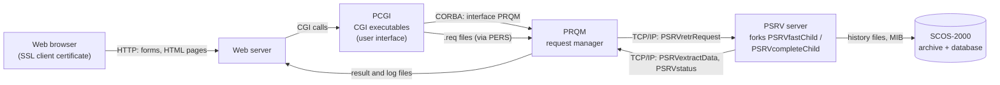
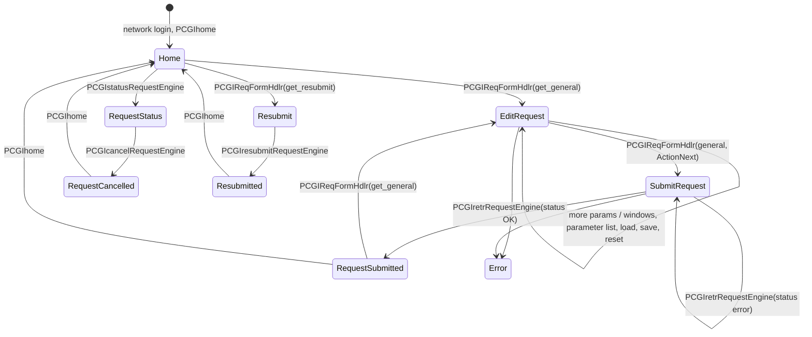
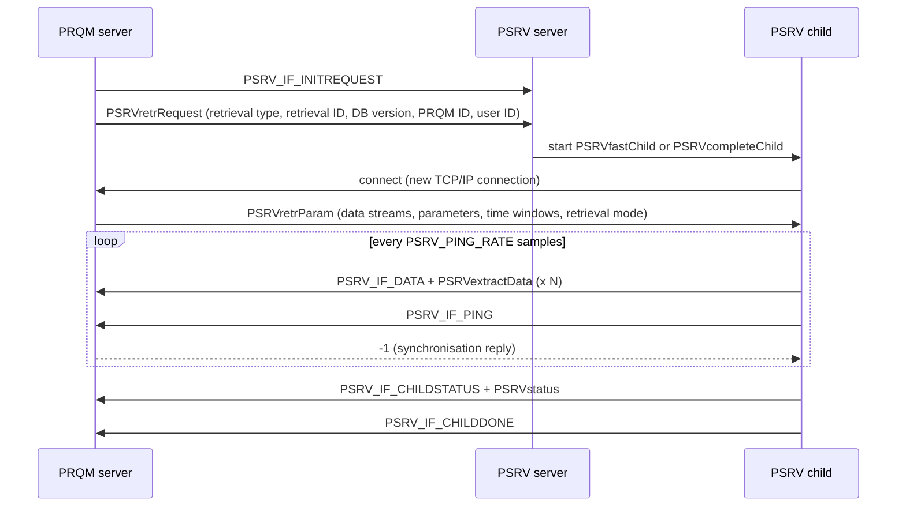
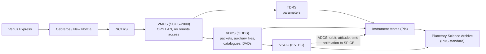

# TDRS: Telemetry Data Retrieval Service

The **TDRS** is the SCOS-2000 add-on that let authorised users outside the operations room
retrieve **telemetry parameter values** from a mission's archive over the web. A user described
a retrieval in a small text file or a web form: which parameters, which time windows, raw or
calibrated values, which filters. The TDRS read the packets from the
[SCOS-2000](index.md) history files and extracted and optionally calibrated the parameters. It
returned the result as MVDA binary files or as tab-separated spreadsheet files, by web
download, e-mail or FTP.[^srs-pred][^vex-tdrs][^icd-req] Venus Express, for example, used it
for parameter access, and its functions were later absorbed into the
[EGOS Data Dissemination System (EDDS)](edds.md).[^vex-tdrs][^srs-pred]

The main source is the "SCOS-2000 TDRS-External Interfaces Control Document"
(EGOS-MCS-S2K-ICD-0017, issue 5.1, 22 August 2008). It was prepared by the TDRS team at
LogicaCMG and approved by ESOC.[^icd-title] It defines the retrieval request file, the result
files and the user log. It also defines the internal interfaces between the web server and the
three TDRS subsystems.[^icd-abstract][^icd-scope]

!!! info "System or Services?"
    The EDDS SRS and the Venus Express paper call it the "Telemetry Data Retrieval System".[^srs-acr][^vex-tdrs]
    Its requirements document is titled "SCOS-2000 TM Data Retrieval Services Software
    Requirements Document" (S2K-MCS-SRD-0004-TOS-GIC). A 2005 ESOC talk lists it as "Telemetry
    Data Retrieval Services (TDRS)".[^icd-ad][^gsaw05-infra] This wiki keeps the abbreviation
    TDRS for all three names.

## At a glance

| Aspect | TDRS |
|---|---|
| Data | TM parameter samples extracted from fixed-length packets in the SCOS-2000 history file archive[^srs-pred][^vex-tdrs] |
| Users | Authorised users on the ESOC Intranet and the public Internet, through a web browser and e-mail[^srs-pred] |
| Input | Retrieval request file (`.req`), written by hand or generated by the web forms[^icd-abstract] |
| Retrieval types | `FAST` (raw values), `FAST_ENG` (raw and calibrated), `COMPLETE` (also validity and out-of-limit state)[^icd-req] |
| Outputs | MVDA (`Header.dat`, `TimeNNNN.dat`, `DataNNNN.dat`), spreadsheet (`.fst`, `.fen`, `.cmp`), column-organised spreadsheet (`.col`), user log (`.log`)[^icd-files] |
| Architecture | Web server → PCGI (CGI programs) → PRQM (CORBA and files) → PSRV (TCP/IP) → SCOS-2000[^icd-pcgi][^icd-prqm][^icd-psrv] |
| Security | SSL certificates at the web interface; limits on parallel requests, archive requests and result size[^icd-access] |
| Documented releases | ICD issues 1.0 (Feb 2000) to 5.1 (Aug 2008), covering SCOS-2000 release 3.1 and TDRS releases 2.0.1, 2.1 and 3.1[^icd-status] |
| Successor | EDDS parameter retrieval with the "TDRS spreadsheet" output format[^srs-appb][^eu-m] |

## Role in the ground segment

The EDDS requirements describe TDRS as one of three SCOS-2000 subsystems that gave local and
remote users access to MCS data, next to WebRM and GDDS.[^srs-pred]

* TDRS handled **telemetry only**. It provided a retrieval interface that extracts TM parameter
  values from the history-file archive and presents them as MVDA or spreadsheet files. The
  parameters come from fixed-length TM packets.[^srs-pred]
* The user interface and web handling were kept **separate from the retrieval itself**. The
  SRS says this division let security and performance responsibilities be distributed.[^srs-pred]

The Venus Express paper describes the same service from the user side. TDRS retrieves the
telemetry packets that contain the requested parameters, extracts the parameters, and
optionally calibrates them and evaluates their validity and out-of-limit status. It cannot read
variable-length packets.[^vex-tdrs] The spreadsheet files hold a raw value and a time stamp for
each occurrence of each requested parameter. A complete retrieval adds validity and
out-of-limit status.[^vex-tdrs]

On Venus Express the two external doors were therefore split by data type. **Packets and
auxiliary files** came through the DDS (based on the [GDDS](gdds-and-ddids.md)), and
**parameters** came through the TDRS.[^vex-dissem]

## Architecture

The ICD describes TDRS as a chain of three subsystems behind a standard web server. A
persistence layer, PERS, centralises writing and parsing of request files.[^icd-pcgi][^icd-file]



| Subsystem | Responsibility | Integrity check it performs | How it reports errors |
|---|---|---|---|
| PCGI | Web user interface: CGI executables that build HTML pages | Values received from HTML forms | An error HTML page |
| PRQM | Request management: validation, scheduling, collecting results, writing files | Received CORBA requests | A `PRQMvalidationInfo` structure |
| PERS | Common persistence layer for request files | Contents of request files | An error flag per operation |
| PSRV | Retrieval back end inside SCOS-2000: extraction, calibration, checks | Received TCP/IP data | A `PSRVstatus` structure |

The table follows ICD §5.6 and §5.8.[^icd-access] The expansions of PCGI, PRQM, PSRV and PERS
are not stated in the available sources.

All TDRS files are stored only on the web-server machine: temporary and regular request files,
log files and result files. PSRV writes only the usual SCOS-2000 trace file.[^icd-access] The
system can limit the number of parallel retrieval requests, the number of archive requests and
the size of result files.[^icd-detail] Each interface synchronises differently. The web browser
blocks until the CGI program returns. CORBA calls block until the operation completes. PRQM
and PSRV can be started in either order and handshake through command codes.[^icd-detail]

The files are "Unix ASCII or binary Solaris format". The ICD states that binary MVDA files will
not be transferred from Solaris to Linux, because MVDA is deprecated for future TDRS
installations.[^icd-detail]

### The web interface (PCGI)

The ICD describes the user interface as "a big state machine". The states are HTML pages, and
the transitions are runs of PCGI executables.[^icd-states]

| HTML page | Purpose | Produced by |
|---|---|---|
| Welcome, Home | Entry after login; top-level menu | `PCGIhome` |
| Request Specification, Submit Request | Enter and submit a retrieval | `PCGIReqFormHdlr` (actions: more windows, more repeated windows, more parameters, next, reset) |
| Request Submitted | Confirmation | `PCGIretrRequestEngine` |
| Request Status, Request Cancelled | Status of running and finished requests; cancel | `PCGIstatusRequestEngine`, `PCGIcancelRequestEngine` |
| Resubmit Request, Request Resubmitted | Resubmit a request stored on the client's disk | `PCGIresubmitRequestEngine` |
| Load / Save Request | Requests stored on the server | `PCGIloadRequestEngine`, `PCGIsaveRequestEngine` |
| Parameter List | Parameter chooser | `PCGIparamIterator` |
| Error | General errors | any |

The pages and programs are listed in ICD §13.1–§13.2.[^icd-pcgi] The main state machine, as
drawn in ICD §13.3 (simplified by this wiki):[^icd-states]



### PCGI to PRQM: the CORBA interface

PRQM exposes a single CORBA interface, `PRQM`. The request details travel in a request file;
the CORBA call carries only key information.[^icd-prqm]

| Operation | Purpose |
|---|---|
| `newRequest(PRQMrequestInfo, ignorevaliddatefail)` | Issue a retrieval. `PRQMrequestInfo` holds the user ID, the path of the request file and the execution time (seconds since 1970). The flag says whether to ignore a validation failure. |
| `getStatus(userid)` | Status of all requests of a user |
| `cancelRequest(userid, exeid)` | Cancel a request |
| `getDBInfo()` | List the available MIB databases with their validity begin and end times |
| `getParameterCount()`, `getParameters(from, to)` | Size of the parameter list and a slice of names and descriptions (`to` = 0 returns all) |

The result of `newRequest` is a `PRQMvalidationInfo`. It holds `isok` (validated and
scheduled), `ismaxreg` (maximum number of requests exceeded), `info` (for example syntax
errors) and the new execution ID. A `PRQMstatusInfo` gives the execution ID, state, execution
time, description, and links to the request, result, header, timer and log files, with a flag
for MVDA output.[^icd-prqmtypes]

### PRQM to PSRV: the retrieval protocol

PRQM and PSRV talk over TCP/IP. A retrieval is sent in **two phases**. The PSRV server receives
the direct attributes of the request and then starts a child process of the right kind, a fast
child or a complete child. The child opens its own TCP/IP connection back to PRQM and receives
the parameter details on it.[^icd-psrv]



The diagram combines ICD §15.1 and §15.2.[^icd-psrv][^icd-psrvback] The data types on this
interface mirror the request file.

| Type | Content |
|---|---|
| `PSRVclientCommand` | `PSRV_IF_INITREQUEST` (new retrieval follows), `PSRV_IF_CANCEL` (request ID follows) |
| `PSRVretrType` | `FAST` (raw values only), `FAST_ENG` (raw, calibrated and units), `COMPLETE` (also validity and status), `GETPARAMS` (names and descriptions only) |
| `PSRVretrParam` | data streams, parameter list, extraction time windows, retrieval mode (0 packet by packet, 1 interval by interval) and its interval |
| `PSRVparam` | name, SPID (0 = all), retrieval filter, occurrence start and interval for supercommutated parameters, sampling (every Nth packet, -1 none), sampling interval, only-when-valid, only-when-not-nominal, minimum and maximum threshold |
| `PSRVretrievalFilter` | `VALUE_AFTER`, `VALUE_BEFORE`, `VALUE_BEFORE_AFTER`, `ON_OCCURRENCE`, `NO_FILTERING` |
| `PSRVcmd` | `NO_CMD`, `EXECUTE_CMD`, `EXECUTE_IF_VALID_CMD`, `VALIDATE_CMD` |
| `PSRVtimeWindow` and subclasses | sorted start and stop time lists; repeated and irregular windows are expanded into these lists |
| `PSRVserverCommand` | `VALIDATION`, `IF_DATA`, `IF_CHILDSTATUS`, `IF_CHILDDONE`, `IF_PARAMETERS`; also states computed on the PRQM side such as `IF_CHILDDEAD` and `IF_SERVERDEAD` |
| `PSRVextractData` | name, sample time, source value (raw, or the synthetic value of a derived parameter), value format, validity, OOL state; optional engineering value, its validity and unit |
| `PSRVdataFormat` | `S8`, `U8`, `S16`, `U16`, `S32`, `U32`, `S64`, `U64`, `FLOAT`, `DOUBLE`, `QUADRUPLE` (Sun formats), `ASCII`, `RIEEE` (32-bit IEEE), `RMIL` (32-bit MIL-STD-1750A), `UNDEFINED` |
| `PSRVool` | `UNDEF`, `NOMINAL`, `LOW_LOW` (low alarm), `LOW` (low warning), `HIGH`, `HIGH_HIGH`, `SCC_FAIL` |
| `PSRVstatus` | log time, error code, text, retrieval ID (-1 = general message) |
| `PSRVerrorCode` | 27 codes, from `PSRV_OK` through `PSRV_PARAM_NOTFOUND`, `PSRV_CANNOT_LOADDB`, `PSRV_NO_CALIBRATION` and `PSRV_STORE_FULL` to `PSRV_MAX_REQUESTS` |

The table summarises ICD §15.1.1–§15.2.4.[^icd-psrv][^icd-psrvback] Values travel as strings,
whatever their internal format.[^icd-psrvback] The ICD itself marks `PSRV_IF_SERVERSTATUS` and
`PSRV_IF_NETPROBLEM` as "seems not to be used".[^icd-psrvback]

## The retrieval request file (.req)

A retrieval request file completely describes one retrieval: parameters, time intervals,
database version, filter options and output format. The TDRS syntax-checks it and rejects it on
any error. Missions may extend the format if their TDRS installation supports the
extensions.[^icd-req]

**Syntax.** The file is ASCII. Each field is a name, a colon and a value, and fields are
separated by carriage returns. Names are case-insensitive. A `#` starts a comment that runs to
the end of the line. Optional fields may be omitted. Text with spaces goes in double
quotes.[^icd-req] Internally, the request is stored under a unique name
`<retrieval ID>_<execution ID>_<user ID>_<expiration day>.req`. The ICD's example is
`0_1_SMITH_038.req`, where 038 is the expiration date.[^icd-req][^icd-naming]

### Fields

| # | Field | Type | Values and rules | M/O |
|---|---|---|---|---|
| 1 | `RetrievalDesc` | Char | Free description in quotes | O |
| 2 | `RetrievalType` | Number | 0 `FAST`, 1 `FAST_ENG`, 2 `COMPLETE` | M |
| 3 | `OutputFormat` | Number | 0 `MVDA`, 1 `SPREADSHEET`, 2 `COLUMNMODE_SPREADSHEET` (default) | O |
| 4 | `DataOrStatistics` | Number | Column mode only: 0 `DATA`, 1 `STATISTICS`, 2 `DATA_AND_STATISTICS` (default) | O |
| 5 | `TimeFormat` | Number | 0 ASD `yyyy.ddd.hh.mm.ss[.mmm]` (default), 1 CCSDS ASCII A `yyyy-mm-ddThh:mm:ss.mmm`, 2 both. Ignored for MVDA. | O |
| 6 | `Dbversion` | Char | Name of the MIB database version to use | M |
| 7–8 | `EmailAddr`, `AttachSize` | Char, Number | Results by e-mail; attachment limit in kbytes (0 = no attachment; the server limit always wins) | O |
| 9–12 | `FTPaddr`, `FTPuser`, `FTPpassword`, `FTPdirName` | Char | Automatic FTP transfer of the results; an anonymous account is recommended | O (M if `FTPaddr`) |
| 13 | `Log` | Number | 0 off, 1 on (default) | O |
| 14 | `Datastream` | Number | 1–65535, repeatable, at most 4 | M |
| 15 | `TimeWindow` | Number | 0 `SINGLE`, 1 `REPEATED`, 2 `IRREGULAR` | M |
| 16–17 | `StartTime`, `StopTime` | Char(21) | Single window. `StopTime` is absolute, or relative `[+][ddd.]hh.mm.ss.mmm`, and not before the start. | M |
| 18–21 | `OverallStartTime`, `OverallStopTime`, `WinLength`, `RepeatPer` | Char | Repeated windows: `WinLength` and `RepeatPer` are `[ddd.]hh.mm.ss`, with `RepeatPer` > `WinLength` | M |
| 22–23 | `StartTime`, `StopTime` | Char(21) | Irregular windows, repeatable. Each start must be after the previous stop. | M |
| 24 | `ParamName` | Char(8) | Parameter name; starts a per-parameter block | M |
| 25 | `SPID` | Number(10) | Use only samples from this packet, 1 to 2<sup>31</sup>−1. Default: all packets. Ignored for synthetic parameters. | O |
| 26 | `RetrievalFilter` | Number | 0 `VALUE_AFTER`, 1 `VALUE_BEFORE`, 2 `VALUE_BEFORE_AFTER`, 3 `ON_OCCURRENCE`, 4 `NO_FILTERING` (default) | O |
| 27–28 | `OccurrenceStart`, `OccurrenceInterval` | Number | With `ON_OCCURRENCE`: first occurrence (1–65535) and number of occurrences (0–65535) | M |
| 29 | `SamplingN` | Number | Use every Nth packet (1–65535); `COMPLETE` only | O |
| 30 | `OnlyWhenValidityOK` | Number | 1 = use the sample only if the parameter is valid | O |
| 31 | `OnlyWhenNotNominal` | Number | 1 = use the sample only if its OOL state is not nominal (see note) | O |
| 32–33 | `MinThresholdValue`, `MaxThresholdValue` | Number/Char | Keep values ≥ min and/or ≤ max. `FAST` compares the raw view, the others the default view. | O |
| 34 | `RetrievalMode` | Number | 0 packet per packet, 1 interval per interval | – |
| 35 | `IntervalRetrievalTime` | Char(12) | Step time for interval mode | – |

The field list is ICD §8.6.[^icd-req]

!!! warning "Inference: inconsistencies in the ICD"
    * Field 31 is described as "use the sample only when the parameter has no OOL nominal
      state", while PSRV describes the same flag as "only when OOL is not nominal". Both
      readings say the filter keeps out-of-limit samples.[^icd-req][^icd-psrv]
    * Fields 19 and 23 refer to the format "of the StopTime in field 12". Field 12 is
      `FTPdirName`, so field 17 is meant.[^icd-req]
    * `OccurrenceInterval` is defined as the number of occurrences to extract, yet the same
      entry says that `OccurrenceStart` = 1 with `OccurrenceInterval` = 1 retrieves all samples
      in the packet.[^icd-req]
    * The `ON_OCCURRENCE` rule says that for a non-supercommutated parameter with
      `OccurrenceStart` ≠ 1 nothing is extracted. `OccurrenceStart` = 1 with
      `OccurrenceInterval` = 0 switches supercommutation off.[^icd-req]

### Retrieval types

| Type | What PSRV returns | Spreadsheet extension |
|---|---|---|
| `FAST` | Raw values only | `.fst` (or MVDA) |
| `FAST_ENG` | Raw values, calibrated (engineering) values and units | `.fen` |
| `COMPLETE` | Everything: raw and calibrated values, units, validity and status (OOL) information | `.cmp` |

The table combines ICD §8.6, §10.4 and §15.1.2.1.[^icd-req][^icd-ss][^icd-psrv] The calibration
is the one defined for the parameter in the database version named in the request: see
[calibration in the MIB](../mib/calibration.md). The OOL states are those of the
[monitoring checks](../mib/monitoring-checks.md).

### Thresholds

ICD Appendix B fixes how the two threshold fields combine.[^icd-thr]

| Thresholds given | Textual value | Numerical value |
|---|---|---|
| Only minimum | Must match exactly | Keep values ≥ min |
| Only maximum | Not allowed (validation error) | Keep values ≤ max |
| Both, min < max | Not allowed | Keep min ≤ value ≤ max |
| Both, min = max | Not allowed | Keep only that value |
| Both, min > max | Not allowed | Not allowed |

### An illustrative request

The ICD's own example asks for three invented parameters over three irregular windows.[^icd-req]
The file below is **illustrative**. It was written by this wiki using real parameter names from
the September 2025 [Solar Orbiter MIB](../missions/solar-orbiter/mib.md), but Solar Orbiter was
never served by TDRS.

```text
RetrievalDesc:"IMU temperature and one PCDU snapshot channel"
RetrievalType:2              # COMPLETE: raw, engineering, validity, OOL
OutputFormat:1               # SPREADSHEET -> .cmp file
TimeFormat:1                 # CCSDS ASCII A
Dbversion:25925PFM           # database name; see note below
Log:1
Datastream:1000
TimeWindow:1                 # REPEATED: 10 minutes every hour
OverallStartTime:2025.244.00.00.00
OverallStopTime:2025.245.00.00.00
WinLength:00.10.00
RepeatPer:01.00.00
# temperature, only from one of its two packets
ParamName:NMUD1113
SPID:29534
OnlyWhenValidityOK:1
# supercommutated current: occurrences 1 and 2 of 1024
ParamName:NPWX2502
SPID:66686
RetrievalFilter:3
OccurrenceStart:1
OccurrenceInterval:2
RetrievalMode:0
```

[`NMUD1113`](../explorer/index.md#/solo/param/NMUD1113) ("IMU11 SIA temperature", degC) is
placed in two fixed TM(3,25) packets, SPIDs [29517](../explorer/index.md#/solo/packet/29517) and
[29534](../explorer/index.md#/solo/packet/29534). [`NPWX2502`](../explorer/index.md#/solo/param/NPWX2502)
("LCL1_01 RWAB-1 SnapS", A) occurs 1,024 times in SPID
[66686](../explorer/index.md#/solo/packet/66686), a TM(131,2) PCDU snapshot packet.[^mib]

!!! warning "Inference"
    The ICD only says `Dbversion` is the "name of the database version". Using the MIB's
    [`VDF_NAME`](../mib/tables/vdf.md) (`25925PFM` for this release) is this wiki's assumption.
    TDRS could list the available databases and their validity periods with the CORBA call
    `getDBInfo`.[^icd-prqm][^mib]

## Result files

All TDRS output files except fast MVDA files carry the retrieval ID, execution ID, user ID and
an expiration day (`ddd`) in their names. The expiration day is computed from the request and a
configurable expiration period.[^icd-naming]

| File | Content | Produced for |
|---|---|---|
| `xxxxxx.req` | The retrieval request | input, kept by TDRS |
| `Header.dat`, `TimeNNNN.dat`, `DataNNNN.dat` | MVDA header, time and value files | `FAST` with MVDA output |
| `Res<ids>.fst`, `.fen`, `.cmp` | Spreadsheet | fast, fast with engineering values, complete |
| `Res<ids>.col` | Column-organised spreadsheet | column mode |
| `<ids>.log` | User log | when `Log` is on |

The file table is ICD §4.3; the `.log` name is from §12.4.[^icd-files][^icd-log]

### MVDA files

A fast retrieval without engineering values produces exactly the output of **MVDA**
(the SRS expands it as Mission Visual Data Analysis). That output is one ASCII header file,
and one binary data file and one binary time file per parameter.[^icd-mvda][^srs-acr] Header
lines are space-separated, one per parameter. The ICD notes that one line per time window for
repeated or irregular windows is a future extension.[^icd-mvda]

| # | Header field | Content |
|---|---|---|
| 1 | Param. Id. | Parameter name |
| 2–3 | Start Time, Stop Time | `yyyy-mm-ddThh:mm:ss.mmmmmm` |
| 4 | Data pointer | The number used in the names of the data and time files |
| 5 | Nsamples | Samples retrieved |
| 6 | DataFormat | `S8`, `U8`, `U16`, `S16`, `U32`, `S32`, `U64`, `S64`, `F`, `D`, `Q` (Sun float, double, quadruple), `A#####` (ASCII, `\0`-separated), `RIEEE`, `RMIL`. The ICD describes `S32` as "signed integers of 16 bit", evidently a slip. |
| 7 | Eng | 0 = no engineering values, 1 = included |

Each time file holds 8 octets per sample: 4 octets of seconds since 1970 and 4 octets of
microseconds. A data file holds one value per sample in the declared format. In the ICD's U32
example the sizes are 4 × Nsamples and 8 × Nsamples.[^icd-mvda]

<div class="bitfield" data-title="MVDA time file record (64 bits per sample)" data-width="32" data-caption="TDRS ICD issue 5.1 §9.5" data-fields='[{"n":"Seconds since 1970","b":32,"d":"Integer"},{"n":"Microseconds","b":32,"d":"Integer"}]'></div>

### Spreadsheet files (.fst, .fen, .cmp)

One ASCII file per request, with a header line of column names, then one tab-separated row per
sample. It is meant for import into MS Excel, and missions may append columns.[^icd-ss]

| # | Column | Content | Filled for |
|---|---|---|---|
| 1 | `Time1` | ASD time `yyyy.ddd.hh.mm.ss.mmmmmm` | all (one of the two time columns) |
| 2 | `Time2` | CCSDS ASCII A `yyyy-mm-ddThh:mm:ss.mmmmmm` | all (one of the two) |
| 3 | `Parameter` | Name | all |
| 4 | `Raw` | Raw value as text. For a synthetic parameter this is the source value, and may be text. | all |
| 5 | `RawValidity` | Validity text as in the SCOS-2000 telemetry desktop | `COMPLETE` |
| 6 | `EngineeringUnit` | Unit from the MCS database | `FAST_ENG`, `COMPLETE` |
| 7 | `Engineering` | Calibrated value (number or text) | `FAST_ENG`, `COMPLETE` |
| 8 | `EngValidity` | Validity of the engineering value | `COMPLETE` |
| 9 | `OOL` | `NOM`, `LL`, `L`, `H`, `HH`, `SCC_UNIT`, `SCC_F`, `UDEF`, delta states (`MIN_D_LOW`, `MIN_D_HIGH`, `MAX_D_LOW`, …), `D_EQUAL`, `VIOL` | `COMPLETE` |

The columns are ICD §10.6.[^icd-ss] `VIOL` marks a parameter that is outside its limits but
whose number of violations has not reached the maximum number of violations (see
[monitoring checks](../mib/monitoring-checks.md)).
The ICD's delta list names `MIN_D_HIGH` twice; the second entry, described as "high limit OOL
for positive delta", is presumably `MAX_D_HIGH`.[^icd-ss] Rows for a parameter without
calibration leave the engineering columns empty.[^icd-ss]

### Column-organised files (.col)

The column mode is designed to be more readable than the plain spreadsheet. It has one
common column of labels and **one column per parameter**.[^icd-col]

1. **Retrieval header data**: retrieval start and stop, retrieval ID, execution ID, user,
   expiration day and count of samples.
2. **Per-parameter header rows**: name, description, view (`RAW` or `CAL`), unit, first and
   last sample time. With statistics requested, also the minimum and its time, maximum and its
   time, average, standard deviation, sample count, and the minimum and maximum thresholds used.
3. **Data rows**: one per distinct sample time, with each parameter's value in its column, or
   empty if that parameter has no sample at that time. `FAST` reports raw values; `FAST_ENG`
   and `COMPLETE` report engineering values.

The ICD example shows three gyro parameters over 16 s, with each parameter's statistics and five
data rows.[^icd-col] The naming paragraph of this chapter repeats the `.cmp` example of the
spreadsheet chapter, although the extension is `.col`.[^icd-col]

### Value formats

Values in the spreadsheet files are text, with one format per SCOS-2000 internal type.[^icd-val]

| Data type | Internal encoding | Text format |
|---|---|---|
| Unsigned integer, natural | 32-bit signed integer | Integer up to 2<sup>31</sup>−1, no sign |
| Integer | 32-bit signed integer | Minus sign only for negative values |
| Boolean | 32-bit signed integer | `1`, `0`, `TRUE` or `FALSE` |
| Logical | 32-bit signed integer | Up to 8 binary digits followed by `b` or `B`, e.g. `10101b` |
| Real | Double precision | Fixed or scientific notation, e.g. `3.5e-2` |
| String | Character string | In double quotes |
| Absolute time | `TDSsunTime` | ASD `yyyy.ddd.hh.mm.ss[mmm]`, ASCII A `yyyy-mm-ddThh:mm:ss.[uuuuuu]` or ASCII B `yyyy-dddThh:mm:ss.[uuuuuu]` |
| Delta time | `TDSsunTime` | `ddd.hh.mm.ss[mmm]`, at most `365.23.59.59.999` |

These text forms relate to the MIB's [parameter types](../mib/parameter-types.md). The CCSDS
ASCII time codes are on the [time codes page](../ccsds/time-codes.md).

### The user log

The log is ASCII with `name: value` fields, several to a line, separated by commas.[^icd-log] It
records:

* the execution start time, the total duration and the retrieval type;
* per parameter: the sample count, the time of the first retrieval and the duration;
* log entries, each with a time stamp, a severity (`Warning` or `Error`) and a message.

The ICD's example warns that a requested parameter does not exist and that an occurrence start
does not match, and ends with "Result data size exceeds limit".[^icd-log]

## WebRM

WebRM (Web Remote Monitoring) was the live counterpart of TDRS. It let users monitor a
spacecraft without physical access to the MCS, over the Intranet or the public Internet.[^srs-pred]
It had two parts.

1. **External interface servers.** Injection servers sent data to the SCOS-2000 kernel.
   Provision servers collected monitoring data and distributed it to all active clients. Both
   used CORBA and were built for SCOS-2000.
2. **The WebRM client.** A Java application (Java 2, JRE 1.4) with displays that look like the
   SCOS-2000 ones. It supported monitoring only, although the CORBA interfaces also allowed
   injection.

A 2005 ESOC talk groups "Telemetry Data Retrieval Services (TDRS) and WebRM" as web interfaces
that give external users, such as payload owners, live telemetry and command verification,
telemetry retrieval and statistics.[^gsaw05-infra] No WebRM interface document is in the
library. Its requirements baseline (WEB-RM User & Software Requirements Baseline, issue 1.4,
2003) is cited by the EDDS SRS.[^srs-refs]

## How TDRS fed the EDDS

The EDDS requirements were built from TDRS, WebRM and GDDS.[^srs-pred] For TDRS the trail is
visible in three places.

1. **Requirements.** The SRS cites the TDRS requirements document as [RD-3] and the TDRS ICD
   (issue 4.3) as [RD-11]. Twenty-nine EDDS requirements cite [RD-3] in their "Source:" field.
   Among them is the list of TM packet filter attributes (type, subtype, APID, PI1, PI2, VC,
   domain, on-board or reception time, every Nth packet, maximum data volume, quality flag,
   database version, ground station, SPID, SSC, spacecraft ID).[^srs-refs][^srs-tm] This wiki
   counted the "Source:" fields. A further 25 requirements cite [RD-4] with `SR-TMDR-`
   identifiers; the SRS lists [RD-4] as the GDDS requirements document, so whether these
   also trace to TM data retrieval requirements is unclear (see the
   [EDDS page](edds.md#timeline)).[^srs-tm]
2. **Backward compatibility.** SRS Appendix B lists exactly one TDRS item. The EDDS lets a
   mission define an XSLT that turns TM parameter data into the TDRS spreadsheet format
   (requirement EDDS-SR-00640).[^srs-appb] A related requirement says the spreadsheet format
   shall be tab-delimited ASCII following the TDRS ICD.[^srs-ssreq]
3. **Implementation.** EDDS ships `Param.xsl`, which converts the XML parameter response into a
   TDRS-like spreadsheet, and a native `TDRS` output format for large volumes. The TDRS
   retrieval ID, execution ID and expiration day columns are mandatory in the TDRS ICD but have
   no EDDS equivalent, so they are filled with 0. The native formatter writes the EDDS request
   ID as the retrieval ID.[^eu-m] EUICD issue 24.0 cites TDRS ICD issue 5.1 for the
   format.[^eu-refs]

!!! warning "Inference: concept mapping"
    | TDRS concept | Closest EDDS concept |
    |---|---|
    | `.req` retrieval request file | XML `RequestMessagePart` with a `Param` or `SmonParam` request ([formats](edds-formats.md#the-batch-request)) |
    | `FAST` / `FAST_ENG` / `COMPLETE` | Representation selection `RAW`/`ENG` (DARC) or `RAW`/`ENG`/`ALL` (SMON), with OOL data from SMON |
    | Single / repeated / irregular windows | `TimeRange` plus a `ScheduleRepeating` with a cron expression |
    | Retrieval filters, sampling | `ParamTmFilter` with `OnChange`, `DeliveryRange` and `ParamFilterList` (semantics not detailed in the EUICD) |
    | E-mail / FTP results | `AckDelivery` / `FileServerDelivery` |
    | Retrieval ID, execution ID | Request ID and job IDs |
    | Expiration day | Response retention set by the mission administrator |
    | User log | Acknowledgement and historical log |

    The EDDS element names are from the EUICD schema appendices.[^eu-schema] The pairing is
    this wiki's reading; no source gives such a table.

## Why the MIB matters to a TDRS retrieval

A retrieval names parameters and packets, so TDRS depends on the [MIB](../mib/index.md):
parameter names from [`pcf`](../mib/tables/pcf.md), packet positions from
[`plf`](../mib/tables/plf.md), SPIDs from [`pid`](../mib/tables/pid.md) and calibrations from
the calibration tables. The September 2025 Solar Orbiter MIB shows how the TDRS limits would
apply to a modern mission.[^mib]

| Check | Solar Orbiter MIB (Sep 2025) | TDRS rule |
|---|---|---|
| Parameter names | 126,745 parameters; the longest name has 8 characters (126,502 have exactly 8) | `ParamName` is `Char(8)`[^icd-req] |
| Fixed versus variable packets | 9,087 packet definitions with `PID_TPSD` = −1 (fixed) and 2,063 variable | Only fixed-length packets are processed[^srs-pred][^vex-tdrs] |
| Parameters reachable | 107,792 distinct parameters placed by `plf`, all of them in fixed packets; 2,305 others defined only in variable-packet structures (`vpd`) | The 2,305 would be out of reach |
| Supercommutation | 725 `plf` placements in 257 packets with more than one occurrence | `ON_OCCURRENCE` with `OccurrenceStart` and `OccurrenceInterval` |
| Synthetic parameters | 1,582 parameters with `PCF_NATUR` = `D` (dynamic OL synthetic) and 2 with `S` (saved synthetic) | `SPID` is ignored for synthetic parameters[^icd-req][^icd-natur] |

`PID_TPSD` = −1 marks packets not processed through the variable-packet tables.[^icd-tpsd]

!!! warning "Inference"
    Treating "fixed-length packets" in the TDRS descriptions as SCOS-2000 packets with
    `PID_TPSD` = −1 is this wiki's interpretation. The counts themselves are query results.

??? example "SQL used"
    Run against `solo-2025-09-16.sqlite` on 2026-11-12.

    ```sql
    SELECT count(*), max(length(PCF_NAME)), sum(length(PCF_NAME) = 8) FROM pcf;
    -- 126745 | 8 | 126502
    SELECT count(*) FROM pid WHERE CAST(PID_TPSD AS int) = -1;   -- 9087
    SELECT count(*) FROM pid WHERE CAST(PID_TPSD AS int) <> -1;  -- 2063
    SELECT count(DISTINCT PLF_NAME) FROM plf;                    -- 107792
    SELECT count(DISTINCT p.PLF_NAME) FROM plf p JOIN pid d ON d.PID_SPID = p.PLF_SPID
     WHERE CAST(d.PID_TPSD AS int) <> -1;                        -- 0
    SELECT count(*) FROM (SELECT DISTINCT VPD_NAME FROM vpd
                          WHERE VPD_NAME NOT IN (SELECT PLF_NAME FROM plf));  -- 2305
    SELECT count(DISTINCT PLF_SPID), count(*) FROM plf
     WHERE CAST(PLF_NBOCC AS int) > 1;                           -- 257 | 725
    SELECT PCF_NATUR, count(*) FROM pcf GROUP BY 1;             -- D 1582, R 125161, S 2
    SELECT VDF_NAME, VDF_COMMENT FROM vdf;            -- 25925PFM | 20250916-CSW3.1.2_MAS7.33
    -- the example parameters
    SELECT p.PLF_NAME, p.PLF_SPID, d.PID_TYPE, d.PID_STYPE, d.PID_TPSD, p.PLF_NBOCC
    FROM plf p JOIN pid d ON d.PID_SPID = p.PLF_SPID
    WHERE p.PLF_NAME IN ('NMUD1113', 'NPWX2502');
    ```

## Venus Express: the ground segment around TDRS

The Venus Express data-handling paper (ESA SP-1295) shows where TDRS sat in a real planetary
mission. The control concept was inherited from Rosetta and Mars Express: a single control
centre at ESOC and the deep-space antennas at New Norcia and Cebreros. The data systems were a
"delta development" of the systems built jointly for Rosetta and Mars Express.[^vex-gs] See
[Rosetta, Mars Express and Venus Express](../missions/rosetta-mex-vex.md).

| Component | Role in the paper |
|---|---|
| VMCS (Venus Express Mission Control System) | SCOS-2000 based. Real-time housekeeping processing, command verification, out-of-limit detection, OBT-to-UTC time-stamping better than 2 ms, calibration, command history, operational database and on-board software maintenance. The paper describes the TDRS as part of it. |
| VDDS (Venus Express Data Disposition System) | Based on the GDDS: remote near-real-time and offline access, daily raw data media production, DVDs for the science operations centre |
| MPS (Mission Planning System) | Offline, mission-specific planning from PI, VSOC and ESOC inputs; produces command and station schedules |
| FOP system | Offline preparation of flight operations procedures and command sequences for import into the operational database |
| NCTRS | Receives telemetry from the stations (time-stamped with earth reception time) and forwards telecommands; also collects tracking data for flight dynamics and PIs |

The components are described in §2.1–§2.2 of the paper.[^vex-gs][^vex-collect] The paper
expands NCTRS as "Network Controller and Telemetry Receiver System". The 2005 ESOC talk says
"Network Control and TM/TC Router System"; see [NCTRS and NIS](nctrs-nis.md).[^vex-collect][^gsaw05-infra]



The figure is this wiki's summary of §2.3, §3 and §4 of the paper.[^vex-dissem][^vex-psa][^vex-adcs]

The paper defines the processing levels of the data flow.[^vex-levels]

| Level | Content | Produced by |
|---|---|---|
| 0 | Raw telemetry as received at the station | spacecraft |
| 1 | Cleaned, merged, time-ordered data in frame format | NCTRS and telemetry receiver |
| 1a | Level 1 separated by instrument, as requested through the DDS | not stated |
| 1b | Sorted by data type and mode, in scientifically useful form, uncalibrated | instrument team |
| 2 | Calibrated, in scientific units | instrument team |
| 3 | Higher-level products | instrument teams and others |

Other points from the paper:

* The VMCS is reachable only by operations staff. External access goes through the VDDS and the
  TDRS, which bridge the external world and the protected operational LAN.[^vex-dissem]
* VDDS requests are expressed in a recursive XML query language. They come from standing
  orders, the web interface or FTP-submitted files, and are delivered online, by FTP or on
  DVD. Online previews embed the data as a byte stream in an XML response.[^vex-gdds]
* The DVDs use the CCSDS Standard Formatted Data Unit concept, so that the science community can
  find and decode data without prior knowledge of the file structure. ESOC keeps all Level 1
  data for 10 years after the end of the mission.[^vex-dissem]
* Science archiving follows the NASA Planetary Data System (PDS) standard in ESA's Planetary
  Science Archive. Data collection phases of 3 months are followed by 6 months of archive
  preparation, with peer review for the first and last deliveries. The first data were
  released in May 2007.[^vex-psa]
* The Auxiliary Data Conversion System, a set of Perl scripts, polls the ESOC DDS several times
  a day for orbit, attitude and time correlation data. It converts them into SPICE kernels,
  including SCLK clock kernels from the time correlation packages.[^vex-adcs] See
  [time correlation in SCOS-2000](time-correlation.md).

## Mission families: the setting

The 2005 ESOC talk explains why generic tools such as TDRS existed. ESOC's strategy was to
reuse software, procedures and operations concepts across missions. Mission control
requirements were written as a "delta" against SCOS-2000, and missions with similar profiles
shared a "family kernel" on top of SCOS-2000.[^gsaw05-delta] The families named are Earth
Explorer (low orbit, short passes), planetary (long propagation delay, on-board autonomy) and
observatory (long visibility, proposal-based observations). For the Earth Explorer family, the
talk counts the requirements at definition phase per mission: Cryosat 406 kernel and 35
mission-specific, GOCE 129 and 62, Aeolus 57 and 115.[^gsaw05-fam] TDRS and WebRM appear in
that talk as part of the shared infrastructure next to SCOS-2000, NCTRS and GDDS.[^gsaw05-infra]

## Gaps in the available sources

* The TDRS SRD, the TDRS Architectural Design Document and the TDRS Operator User Manual (issue
  2.0, July 2000) are cited but not in the library.[^icd-ad][^vex-refs]
* The meaning of the abbreviations PCGI, PRQM, PSRV, PERS and ASD, and the "PAS application"
  that stores request files, are not stated in the available sources.[^icd-req]
* The MVDA retrieval and programmer's guides, and the WebRM interface documents, are not
  available.[^icd-ad]
* When TDRS was retired is not stated in the available sources. Issue 18.0 of the EDDS SRS
  (2018) still refers to it in the present tense.[^srs-pred]

## Related pages

* [EDDS](edds.md) and [EDDS request and data formats](edds-formats.md): the successor.
* [GDDS and mission DDIDs](gdds-and-ddids.md): the packet-dissemination sibling.
* [SCOS-2000 architecture](architecture.md): history files, parameter processing and OOL checks.
* [Monitoring in the MIB](../mib/monitoring.md): how parameters are placed in packets.

[^srs-pred]: [EDDS SRS issue 18.0](../library/srs.md), §4.2 Relationship to Predecessor and Successor Projects, PDF p. 13.
[^vex-tdrs]: [Delhaise et al., Venus Express "Spacecraft and Payload Data Handling" (ESA SP-1295)](../library/vex-delhaise-web.md), §2.3.2 Dissemination of the raw data via the TDRS, PDF p. 6, and §2.1, PDF p. 3.
[^icd-title]: [TDRS External Interfaces ICD, EGOS-MCS-S2K-ICD-0017 issue 5.1](../library/icd-0017-tdrs-5-1.md), title page and approval sheet, PDF pp. 1–2.
[^icd-abstract]: [TDRS ICD issue 5.1](../library/icd-0017-tdrs-5-1.md), Abstract, PDF p. 5.
[^icd-scope]: [TDRS ICD issue 5.1](../library/icd-0017-tdrs-5-1.md), §1.1–§1.3, PDF p. 11.
[^srs-acr]: [EDDS SRS issue 18.0](../library/srs.md), §3.1 Acronyms (TDRS, MVDA), PDF pp. 10–11.
[^icd-ad]: [TDRS ICD issue 5.1](../library/icd-0017-tdrs-5-1.md), §1.6 References (AD-1, RD-2, RD-3, RD-7), PDF p. 12.
[^gsaw05-infra]: [Guerrucci et al., GSAW 2005](../library/gsaw2005-guerrucci.md), slide "ESOC Software Infrastructure", PDF p. 5.
[^icd-req]: [TDRS ICD issue 5.1](../library/icd-0017-tdrs-5-1.md), §8 Retrieval Request File Specification (§8.1–§8.7), PDF pp. 20–27.
[^icd-files]: [TDRS ICD issue 5.1](../library/icd-0017-tdrs-5-1.md), §4.3 Data Source, Destination and Transfer Mechanism, PDF p. 15.
[^icd-pcgi]: [TDRS ICD issue 5.1](../library/icd-0017-tdrs-5-1.md), §13 Interface between Web Server and PCGI, §13.1–§13.2, PDF pp. 42–44.
[^icd-prqm]: [TDRS ICD issue 5.1](../library/icd-0017-tdrs-5-1.md), §14.1.1 Interface PRQM, PDF pp. 48–49.
[^icd-psrv]: [TDRS ICD issue 5.1](../library/icd-0017-tdrs-5-1.md), §15.1 Communication from PRQM to PSRV (§15.1.1–§15.1.2.8), PDF pp. 54–60.
[^icd-access]: [TDRS ICD issue 5.1](../library/icd-0017-tdrs-5-1.md), §5 Access (§5.4 Storage, §5.5 Security, §5.6 Data Integrity, §5.8 Error Handling), PDF pp. 16–17.
[^icd-status]: [TDRS ICD issue 5.1](../library/icd-0017-tdrs-5-1.md), §0.1 Document Status Sheet, PDF p. 3.
[^srs-appb]: [EDDS SRS issue 18.0](../library/srs.md), Appendix B Backwards Compatibility, PDF pp. 123–124.
[^eu-m]: [EDDS EUICD issue 24.0](../library/euicd-v25.md), §6.5 TDRS Spreadsheet and Appendix M.1 TDRS like SpreadSheet, PDF pp. 51 and 355.
[^vex-dissem]: [Delhaise et al. (SP-1295)](../library/vex-delhaise-web.md), §2.3 Dissemination of raw data, PDF p. 4.
[^icd-file]: [TDRS ICD issue 5.1](../library/icd-0017-tdrs-5-1.md), §14.2 File Interface from PCGI to PRQM, PDF p. 53.
[^icd-detail]: [TDRS ICD issue 5.1](../library/icd-0017-tdrs-5-1.md), §6 Detailed Interface Specifications (§6.1, §6.4, §6.5), PDF p. 18.
[^icd-states]: [TDRS ICD issue 5.1](../library/icd-0017-tdrs-5-1.md), §13.3 PCGI state machine (§13.3.1–§13.3.5), PDF pp. 44–47.
[^icd-prqmtypes]: [TDRS ICD issue 5.1](../library/icd-0017-tdrs-5-1.md), §14.1.2 Types used by the interface, PDF pp. 50–52.
[^icd-psrvback]: [TDRS ICD issue 5.1](../library/icd-0017-tdrs-5-1.md), §15.2 Communication from PSRV back to PRQM (§15.2.1–§15.2.4), PDF pp. 61–67.
[^icd-naming]: [TDRS ICD issue 5.1](../library/icd-0017-tdrs-5-1.md), §5.3 File Naming Convention, PDF p. 16.
[^icd-thr]: [TDRS ICD issue 5.1](../library/icd-0017-tdrs-5-1.md), §17 Appendix B: Threshold, PDF pp. 70–71.
[^mib]: [Solar Orbiter MIB release MIB__20250916M25925PFMS001_SOL](../library/mib-20250916m25925pfms001-sol.md), tables [`pcf`](../mib/tables/pcf.md), [`plf`](../mib/tables/plf.md), [`pid`](../mib/tables/pid.md), [`vpd`](../mib/tables/vpd.md) and [`vdf`](../mib/tables/vdf.md), queried by this wiki on 2026-11-12 (SQL block below).
[^icd-mvda]: [TDRS ICD issue 5.1](../library/icd-0017-tdrs-5-1.md), §9 MVDA Result Data File Specification (§9.1–§9.7), PDF pp. 28–30.
[^icd-ss]: [TDRS ICD issue 5.1](../library/icd-0017-tdrs-5-1.md), §10 Spreadsheet Result Data File Specification (§10.1–§10.9), PDF pp. 31–34.
[^icd-col]: [TDRS ICD issue 5.1](../library/icd-0017-tdrs-5-1.md), §11 Column Organised Result Data File Specification (§11.1–§11.9), PDF pp. 35–39.
[^icd-val]: [TDRS ICD issue 5.1](../library/icd-0017-tdrs-5-1.md), §16 Appendix A: Value format in Output Files, PDF pp. 68–69.
[^icd-log]: [TDRS ICD issue 5.1](../library/icd-0017-tdrs-5-1.md), §12 User Log File Specification (§12.1–§12.7), PDF pp. 40–41.
[^srs-refs]: [EDDS SRS issue 18.0](../library/srs.md), §2.2 Reference documents [RD-3], [RD-5], [RD-11], PDF p. 8.
[^srs-tm]: [EDDS SRS issue 18.0](../library/srs.md), requirement EDDS-SR-00320 (source "[RD-3] Section 3.3.1.1"), PDF p. 36; the counts of 29 and 25 are this wiki's per-requirement counts of "Source:" fields citing [RD-3] and [RD-4] (including wrapped lines), PDF pp. 33–123.
[^srs-ssreq]: [EDDS SRS issue 18.0](../library/srs.md), §5.1.2.5 Spreadsheet requirement, PDF p. 61.
[^eu-refs]: [EDDS EUICD issue 24.0](../library/euicd-v25.md), §2.2 Reference documents [RD-14], PDF p. 19.
[^eu-schema]: [EDDS EUICD issue 24.0](../library/euicd-v25.md), Appendix G.36 ParamTmFilter, G.56–G.57 representation selections, J Schedule Data Type and E Delivery Data Type, PDF pp. 246–249, 269, 279 and 328–331.
[^icd-natur]: [SCOS-2000 Database Import ICD issue 7.0](../library/icd-7-0-final.md), §2 MIB items table (dynamic OL synthetic parameters, `PCF_NATUR` = 'D'), PDF p. 26, and §3.3.2.1.1 pcf, field `PCF_PTC` (saved synthetic parameters, `PCF_NATUR` = 'S'), PDF p. 43.
[^icd-tpsd]: [SCOS-2000 Database Import ICD issue 7.0](../library/icd-7-0-final.md), §3.3.2.4.1 pid, field `PID_TPSD`, PDF p. 87.
[^vex-gs]: [Delhaise et al. (SP-1295)](../library/vex-delhaise-web.md), §2.1 Overview, PDF pp. 2–4.
[^vex-collect]: [Delhaise et al. (SP-1295)](../library/vex-delhaise-web.md), §2.2 Collection of telemetry, PDF p. 4.
[^vex-psa]: [Delhaise et al. (SP-1295)](../library/vex-delhaise-web.md), §3 Scientific Processing and Data Archiving, PDF pp. 7–11.
[^vex-adcs]: [Delhaise et al. (SP-1295)](../library/vex-delhaise-web.md), §4 The Auxiliary Data Conversion system, PDF p. 11.
[^vex-levels]: [Delhaise et al. (SP-1295)](../library/vex-delhaise-web.md), §1 Introduction and Fig. 1, PDF p. 2.
[^vex-gdds]: [Delhaise et al. (SP-1295)](../library/vex-delhaise-web.md), §2.3.1 Dissemination of the mission raw data via the DDS, PDF pp. 5–6.
[^gsaw05-delta]: [Guerrucci et al., GSAW 2005](../library/gsaw2005-guerrucci.md), slides "Reuse Strategy at ESOC", "The Delta Approach" and "Delta Approach applied to Mission Families", PDF pp. 3, 7 and 9.
[^gsaw05-fam]: [Guerrucci et al., GSAW 2005](../library/gsaw2005-guerrucci.md), slides "Mission Families at ESOC" and "The EE Mission Family Requirements Definition", PDF pp. 10 and 13.
[^vex-refs]: [Delhaise et al. (SP-1295)](../library/vex-delhaise-web.md), References, PDF p. 12.
