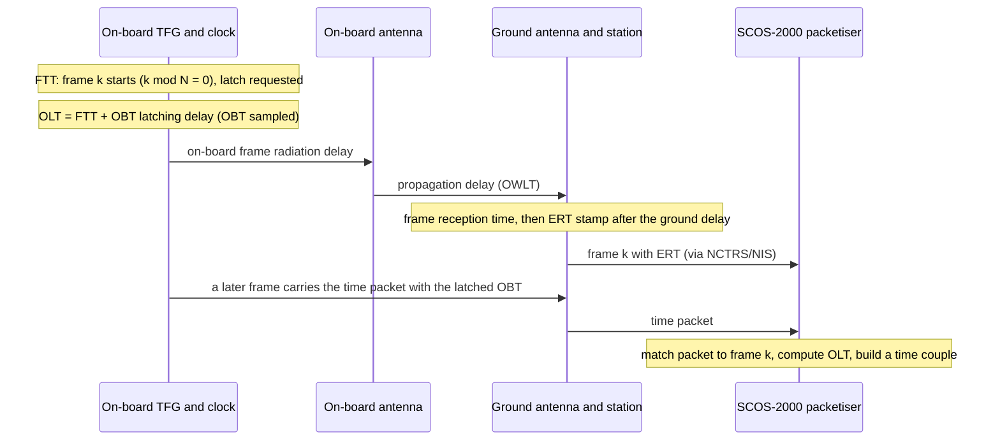
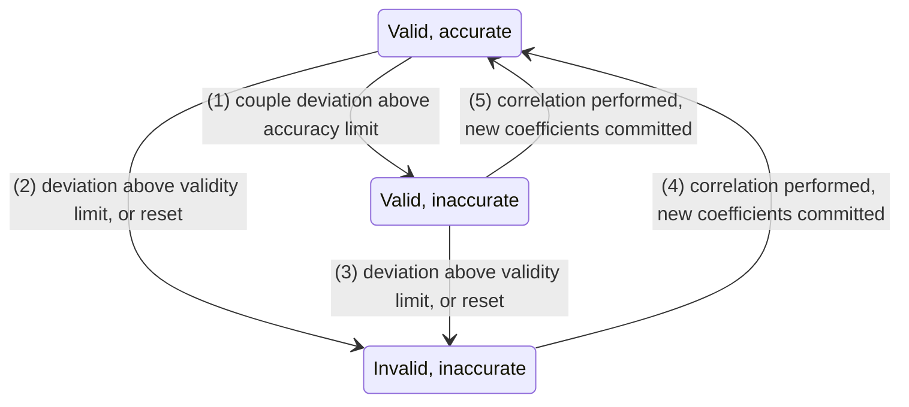
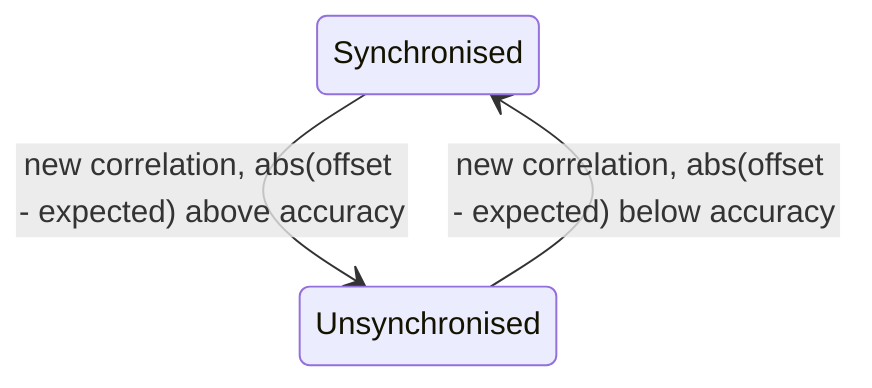
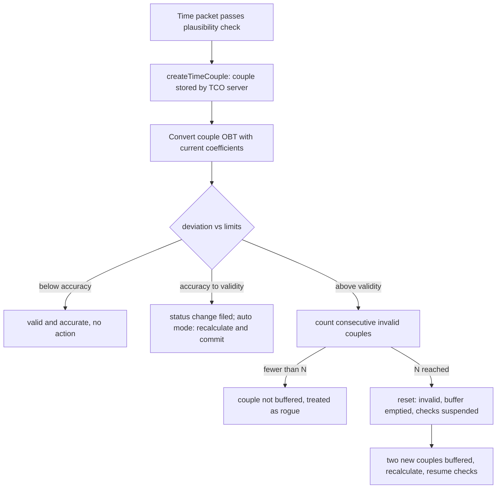
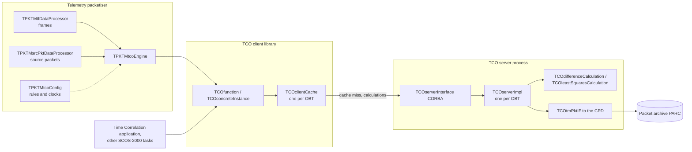

# Time correlation in SCOS-2000

A spacecraft keeps its own clock, the **on-board time (OBT)**. The ground keeps UTC. The two are
different clocks with different epochs, rates and drifts, and the spacecraft cannot simply be told
"the time": every packet it sends is stamped with OBT, and every time-tagged command it executes
waits for an OBT. **Time correlation** is the ground function that measures the relation between
the two clocks and converts between them. In [SCOS-2000](index.md) it is needed mainly by the
telemetry packetiser, to time-stamp packets in UTC, and by the releaser, to encode time-tagged
commands in OBT.[^tn-ctx]

This page explains the mechanism end to end: what the spacecraft sends, which delays the ground
removes, how pairs of times become coefficients, how the coefficients are monitored, and how the
SCOS-2000 software (the "TCO" subsystem) is built. It then shows what three generations of ESA
missions did with it: Rosetta, Mars Express and Venus Express, and Solar Orbiter, whose MIB still
defines the internal time correlation packets. The on-board side of the story (the
[ST[09] time management](../ecss/pus/st09-time-management.md) service) and the time code formats
([CCSDS 301.0-B-4](../ccsds/time-codes.md)) have their own pages.

## The documents

The main source is the **SCOS-2000 Time Correlation Technical Note**, EGOS-MCS-S2K-TN-1030,
version 1.0, dated 2018-10-31 and prepared by the SCOS-2000 GIMUS team. Its change log says it was
created for S2K-7699: chapters 1 to 3 are mostly new, chapter 4 is taken from the EUD4S2K
software user manual, section 5.2 from a Gaia time correlation document, and the rest refers to the
TM Packetiser and Packet Displays ADD (EGOS-MCS-S2K-ADD-0017).[^tn-title][^tn-refs] Read with the
body numbering, chapter 4 is "Time Correlation Mechanisms" and section 5.2 "Time Correlation
Packets"; with the (different) numbering of the table of contents they would be the packetiser
chapter and "Methods of Time Correlation", so the attribution is not fully certain (see the note
below). Neither the EUD4S2K manual nor ADD-0017 is in this wiki's library.

!!! note "Section numbers in TN-1030"
    The table of contents of TN-1030 numbers its chapters one lower than the headings in the body
    (for example "3 Time Correlation Mechanisms" in the contents is "4 TIME CORRELATION
    MECHANISMS" in the text).[^tn-toc] This page cites the numbers printed in the body.

Other sources fill in context: the SCOS-2000 Database Import ICD issue 7.0 (how parameters are
correlated), the Rosetta/Mars Express/Venus Express Data Delivery Interface Document (the earlier,
manual time correlation of those missions), the Solar Orbiter Data Delivery ICD, the Solar Orbiter
packet structure ICD, and the public Solar Orbiter [MIB](../mib/index.md).

## Why the ground needs it

The standards ask for it at every level:

* [ECSS-E-ST-50C](../ecss/e-st-50-communications.md) requires the space link to provide a time
  correlation capability that lets the on-board time be correlated with the time kept on the
  ground.[^e50]
* [ECSS-E-ST-70-11C](../ecss/e-st-70-11c.md) (§5.4 "Datation and synchronization") requires the
  space segment to provide timing information so that the ground can maintain the OBT-to-UTC
  correlation better than a mission constant `<TIME_CORREL_ACCUR>` over a period
  `<TIME_CORREL_PERIOD>`; to let the ground set the OBT by telecommand; to keep the OBT
  monotonic and free of wrap-around for the mission lifetime; to limit the on-board time system's
  contribution to `<ONBOARD_STABILITY>` ms per day; and to document every on-board delay that
  contributes to the correlation. For GNSS-disciplined clocks it adds an on-board GNSS/OBT
  correlation reported in housekeeping telemetry.[^e11][^e11-annex]
* The [PUS](../ecss/pus/index.md) time management service supplies the raw material: time reports
  that sample the spacecraft time reference at a precisely defined instant, so that the ground
  "can perform a correlation" between spacecraft time and UTC.[^pus-91]

SCOS-2000 itself treated time correlation as mission-specific code until release 5.2; from R5.2 a
generic implementation supporting both free-running and synchronised clocks is part of the
kernel.[^icd-s9] Earlier still, Earth Explorer missions contributed pieces: GOCE is listed as
having contributed a "Time Correlator" to the Earth Explorer mission family kernel built on top of
SCOS-2000.[^gsaw05]

## Two clocks and their time codes

**On-board time.** The OBT is usually a binary counter of seconds and sub-seconds, encoded in the
CCSDS Unsegmented time Code (**CUC**): a T-field of coarse octets (seconds) and fine octets
(binary fractions), with an optional P-field that says how many of each there are and whether the
epoch is the CCSDS epoch of 1958 January 1 TAI (level 1, code `0b001`) or an agency-defined epoch
(level 2, code `0b010`).[^ccsds-cuc] A clock synchronised to an external reference may instead use
the CCSDS Day Segmented code (**CDS**: day count, milliseconds of day, optional sub-milliseconds),
which is UTC-based and therefore subject to leap seconds.[^ccsds-cds] PUS reflects this split:
CUC suits spacecraft time measurement, while CDS is typically used for an on-board time already
synchronised with a ground reference such as TAI or UTC.[^pus-91]

**Ground time.** Inside SCOS-2000, times are held in the Unix-like `TDSsunTime` structure (4
octets of seconds and 4 of microseconds) or `TDSsunTime_pico` (plus 4 octets of picoseconds),
counted from an epoch given by the MISC variable `TCO_ESA_EPOCH`; if that variable cannot be read,
a `DEFAULT_ESA_EPOCH` hard-coded in the software is used.[^tn-pkts][^tn-tcp]

**Which telemetry is correlated.** In the [MIB](../mib/index.md), each absolute-time parameter
([PTC 9](../mib/parameter-types.md)) carries two fields in [pcf](../mib/tables/pcf.md):
`PCF_CORR` (`Y`, the default, applies the time correlation when the raw value is interpreted;
`N` extracts the time as is) and `PCF_OBTID`, which selects one of the mission's on-board clocks.
A mission with N clocks numbers them 1 to N; when `PCF_OBTID` is empty the MISCconfig variable
`TCO_DEFAULT_OBT_ID` applies, and an uncorrelated parameter without an OBT ID takes its epoch from
`TCO_ESA_EPOCH`. Relative times (PTC 10) must set `PCF_CORR = N`.[^icd-corr] SCOS-2000 supports
CUC formats with 1 to 4 coarse and 0 to 3 fine octets (PFC 3 to 18), CDS without and with
microseconds (PFC 1 and 2; the PFC 2 row adds that CDS is supported only for command parameters,
not monitoring parameters), and an 8-octet Unix time (PFC 30); the self-describing form with a
P-field (PFC 0) is not supported.[^icd-ptc9]

The Solar Orbiter MIB shows how this is used in practice. Of its 126,745 monitoring parameters,
3,796 are absolute times. The 3,793 on-board times in CUC form (2,116 with 4 coarse octets, PFC 15,
and 1,677 with 4 coarse and 2 fine octets, PFC 17) all leave `PCF_CORR` empty and therefore take
the default `Y`. The three exceptions explicitly set `N`: two Unix-format times (PFC 30), "Period
From" and "Period To" of the ground-generated time correlation report, and one CDS time with
microseconds, "GS Acceptance Time" of the ground station response packet, which the ICD's remark
on PFC 2 would not allow for a monitoring parameter. No parameter sets `PCF_OBTID`, so the mission
uses a single default clock.[^mib][^icd-ptc9]

## The measurement: what the spacecraft sends

The spacecraft samples its clock when a particular telemetry frame starts to leave. In TN-1030's
words the trigger is the transmission of a frame whose frame counter is a multiple of N, where N
is a power of 2 between 1 and 256; the sampled time is "latched" and sent to the ground in a time
packet carried by a *later* frame.[^tn-mech] The ground, knowing N, can work out which frame
triggered the sample.

PUS defines the same rule precisely. The time reporting subservice samples the spacecraft time
reference for each virtual channel 0 frame whose frame count modulo the time report generation
rate is zero, and it samples at the leading edge of the first bit of that frame's attached
synchronisation marker. The rate is one of 1, 2, 4, ... 256 and can be changed by
TC[9,1].[^pus-923][^pus-944] Time reports are spacecraft time packets: APID 0, no secondary
header, message type TM[9,2] (CUC) or TM[9,3] (CDS).[^pus-89]

!!! info "Solar Orbiter's time packet"
    Solar Orbiter's packet structure ICD defines the Standard Spacecraft Time Source Packet as an
    APID 0 packet with no data field header and 8 data octets: an S-field whose bits 4 to 7 give
    the generation frequency, a P-field fixed at `0b00101110` (CUC, agency-defined epoch, 4 coarse
    and 2 fine octets; the ICD states the octet counts, and the epoch code `0b010` is decoded here
    with CCSDS 301.0-B-4[^ccsds-cuc]) and a 6-octet T-field holding the spacecraft elapsed time. The
    T-field relates to the leading edge of the first ASM bit of the VC 0 frame with frame count
    0.[^astr-a4] The MIB defines it as [SPID 9999](../explorer/index.md#/solo/packet/9999) "Time
    Report" (type 9, subtype 2, APID 0) with the parameters
    [NCD09021](../explorer/index.md#/solo/param/NCD09021) (S-field, offset 6),
    [NCD09022](../explorer/index.md#/solo/param/NCD09022) (P-field, offset 7) and
    [NCD09023](../explorer/index.md#/solo/param/NCD09023) "OBCHP_OBT" (PTC 9, PFC 17, offset
    8).[^mib] The decoding is worked through on the
    [ST[09] page](../ecss/pus/st09-time-management.md#102-the-time-packet).

## The delays: from Earth reception back to the latch

The frame that triggered the sample reaches the ground station some time later and is stamped
there with its **Earth Reception Time (ERT)**. The ERT arrives at the MCS in the header with which
the network interface ([NCTRS/NIS](nctrs-nis.md)) delivers the frame.[^tn-mech] Between the
on-board trigger and the ERT stamp lie four delays, defined in TN-1030 §6.1:[^tn-times]

| # | Instant or interval | Definition |
|---|---|---|
| a | Frame Transmission Time (FTT) | When the Transfer Frame Generator (TFG) on board starts transmitting the frame; for time correlation frames the TFG signals this instant to request the OBT sample |
| b | OBT Latching Time (OLT) | When the OBT corresponding to that FTT is sampled and stored in the on-board register |
| c | Frame Radiation Time | When the leading edge of the first bit of the ASM preceding the frame is at the phase centre of the on-board antenna |
| d | Frame Reception Time | When the same edge is at the phase centre of the ground antenna (definition taken from SLE) |
| e | Earth Reception Time (ERT) | The UTC time stamp that the ground station equipment gives the frame; for SLE service providers it must equal the frame reception time |
| f | On-board frame radiation delay | From the latch request to the start of radiation: frame radiation time minus FTT |
| g | OBT latching delay | From the latch request to the actual latch: OLT minus FTT |
| h | Propagation delay | One-way light time (OWLT) from on-board antenna to ground antenna |
| i | Ground delay | ERT minus frame reception time; zero by definition for SLE providers, which correct the time stamp themselves |
| j | UTC Time of Transmission (UTT) | The UTC corresponding to a given OBT; the name assumes a zero latching delay and is, TN-1030 notes, misleading but common |



The arithmetic is simple:[^tn-mech][^tn-times]

$$
\mathrm{FTT} = \mathrm{ERT} - \text{ground delay} - \text{propagation delay} - \text{on-board frame radiation delay}
$$

$$
\mathrm{OLT} = \mathrm{FTT} + \text{OBT latching delay}
$$

The pair (OBT from the time packet, OLT in UTC) describes one physical event, the latching of the
clock, seen by two clocks. It is called a **time couple**, and SCOS-2000 stores each one in a
telemetry packet of its own.[^tn-mech] Where the delays come from is mission configuration: the
`propagationDelay` API returns a light-time delay, an on-board delay and a station delay for a
given UTC and an optional auxiliary identifier (for example a ground station), and its default
implementation simply returns a value set with `setPropagationDelay`.[^tn-api] For Rosetta and
Mars Express, Flight Dynamics supplied the propagation delay routine, to be embedded in the
R(ME)MCS time correlation component, computing the downlink delay as a function of UTC at reception from
per-station One-Way Light Time (OWLT) files.[^fds-owlt]

### Matching the time packet to its frame

Because the time packet arrives after the frame it refers to, the packetiser remembers the frame
time of every candidate frame and opens an interval in which a time packet is expected. A packet
outside the interval is ignored and no couple is made.[^tn-mech] Formally, the candidate FTT must
satisfy[^tn-engine-steps]

$$
\mathrm{FTT}_{report} - \mathit{FarLimit} \le \mathrm{FTT}_{obt} \le \mathrm{FTT}_{report} - \mathit{CloseLimit}
$$

where $\mathrm{FTT}_{report}$ is the FTT of the frame carrying the time report and the two limits
are the MISCdynamic variables `TCO_FAR_FTT_PLAUSIBILITY_LIMIT` and
`TCO_CLOSE_FTT_PLAUSIBILITY_LIMIT`. Whether the check is applied at all is a MISC variable set per
OBT from the Time Correlation application.[^tn-engine-steps]

!!! example "A time couple (illustrative numbers)"
    | Quantity | Value |
    |---|---|
    | ERT of the triggering VC 0 frame | 12:10:00.250 000 UTC |
    | Ground delay | 0.000 120 s |
    | Propagation delay | 480.000 000 s |
    | On-board frame radiation delay | 0.000 050 s |
    | OBT latching delay | 0.000 010 s |
    | FTT | 12:02:00.249 830 UTC |
    | OLT | 12:02:00.249 840 UTC |
    | OBT in the time packet | 811 339 200.500 000 s |

    The formulas are TN-1030's; the numbers are invented by this wiki.[^tn-times]

## From couples to coefficients

SCOS-2000 fits a straight line through the couples. Two algorithms exist and can be switched at
run time:[^tn-alg][^tn-methods]

| Clock | Algorithm (TN-1030 name) | Couples needed | Coefficients |
|---|---|---|---|
| Free-running | Least squares ("free running clock") | A buffer of recent couples | Gradient and offset of the best-fit line |
| Synchronised to an external source such as GPS | Difference ("synchronised on-board clock") | The last couple | Offset only; gradient fixed to 1 |

To keep resolution, the conversion is written relative to the last couple used in the
calculation, $(\mathrm{OBT}_N, \mathrm{UTC}_N)$:[^tn-alg][^tn-tcc]

$$
\mathrm{UTC}(\mathrm{OBT}) = \mathrm{UTC}_N + \mathit{Gradient}\,(\mathrm{OBT} - \mathrm{OBT}_N) + \mathit{Display\ Offset}
$$

The older absolute form $\mathrm{UTC} = \mathit{Gradient}\cdot\mathrm{OBT} + \mathit{Offset}$ is
kept in the coefficient packet but marked obsolete; the two offsets are related by
$\mathit{Offset} = \mathrm{UTC}_N - \mathit{Gradient}\cdot\mathrm{OBT}_N + \mathit{Display\ Offset}$.
TN-1030 Figure 4 shows the two coordinate systems.[^tn-alg][^tn-tcc]

!!! warning "Inference: sign conventions"
    TN-1030 prints the relative relation with a plus sign before the gradient term in the
    description of the Gradient field, and with a minus sign in the description of the Display
    Offset field; the difference algorithm is printed as
    $\mathrm{UTC}_N + \mathrm{OBT} - \mathrm{OBT}_N - \mathit{Offset}$.[^tn-alg][^tn-tcc] Only the
    plus form is consistent with a gradient near 1, so this page uses it. The sign of the offset in
    the difference algorithm cannot be settled from the available sources.

!!! example "A least-squares correlation (illustrative numbers)"
    Four couples taken every 15 minutes; OBT is shown relative to 811 339 200 s, UTC relative to
    12:00:00 on the day of the pass:

    | Couple | OBT − 811 339 200 (s) | OLT (s after 12:00:00) |
    |---|---|---|
    | 1 | 0 | 0.250 010 |
    | 2 | 900 | 900.250 210 |
    | 3 | 1 800 | 1 800.250 455 |
    | 4 | 2 700 | 2 700.250 675 |

    An ordinary least-squares fit gives Gradient = 1.000 000 249 (the on-board clock runs about
    0.25 ppm slow against UTC) and, relative to couple 4 ($\mathrm{OBT}_N$ = 2 700,
    $\mathrm{UTC}_N$ = 2 700.250 675), a Display Offset of −0.000 001 5 s. The residuals are 8.5,
    −15.5, 5.5 and 1.5 µs. One hour later a couple with OBT 6 300 and OLT 6 300.251 875 is
    received; the coefficients predict 6 300.251 570, so its deviation is +0.000 305 s. The
    numbers are constructed by this wiki to illustrate TN-1030's equations.[^tn-alg]

## Monitoring the correlation: deviation, accuracy, validity

Every new couple tests the coefficients in force. The **deviation** is the UTC of the couple (its
OLT) minus the UTC obtained by converting the couple's OBT with the current coefficients. Two
configurable limits, the tighter **accuracy** limit and the looser **validity** limit, classify
it:[^tn-mech][^tn-ctx]

| Condition | Status |
|---|---|
| deviation ≤ accuracy | valid and accurate |
| accuracy ≤ deviation ≤ validity | valid but inaccurate |
| validity ≤ deviation | invalid (and inaccurate) |

In the engine the limits are the MISCdynamic variables `TCO_ACCURACY_INTERVAL` and
`TCO_VALIDITY_INTERVAL`; in the coefficient packet "inaccurate" means the user-controlled soft
threshold was exceeded and "invalid" the hard one.[^tn-engine-steps][^tn-tcc] The validity limit
is meant to catch coefficients that no longer apply at all, for example after a jump of the
on-board clock.[^tn-methods]



The diagram is TN-1030 Figure 6.[^tn-methods] A status change is filed by
`setCorrelationStatus`, which also raises an alarm or an information message depending on the
direction of the transition.[^tn-engine-steps]

**Synchronisation status.** For a clock disciplined by an external source, the expected offset
between OBT and UTC is known: GPS time, for instance, ignores leap seconds, so it differs from UTC
by a known number of seconds. If the computed offset is within the accuracy limit of the expected
value, the coefficients are *synchronised*; otherwise *unsynchronised*. Unlike accuracy and
validity, synchronisation is assessed only when new coefficients are generated, not on each
couple. Coefficients can therefore be valid and accurate yet desynchronised: usable for
conversion, while the clock has lost its time source.[^tn-mech][^tn-methods] The server's
`checkSynchronised` computes the expected TAI/UTC difference (`TCO_TAI_UTC_DIFFERENCE`) minus the
current correction and compares its absolute value with the accuracy interval.[^tn-server-ops]



## Automatic and manual operation

**Manual mode.** The operator asks for a calculation. In the simplest case it uses the live
buffer, as the automatic mode does, but the result is an intermediate set of coefficients that
become active, and whose packet is archived, only when confirmed (`confirmTCOparameters`). The
operator may instead give an end time (the configured number of couples before it is used) or an
end and a start time (all couples in the archive between them); such calculations use a dedicated
buffer so that the live one is untouched, and in difference mode only the last couple before the
end time matters. When confirming, the operator can set the validity time, which becomes the
filing time of the coefficient packet; in automatic mode it is "now". Validity and accuracy are
always checked in manual mode.[^tn-server][^tn-engine-steps]

**Automatic mode** (`TCO_AUTO_UPDATE`) adds two rules, applied only while the MISCdynamic flag
`TCO_SUSPEND_VALIDITY_CHECK` is false:[^tn-engine-steps]

1. **Auto-update.** If the deviation is above the accuracy interval but not above the validity
   interval, the engine asks the TCO server to recompute the coefficients from the latest couples
   and to store a new coefficient packet.
2. **Auto-reset.** If the deviation exceeds the validity interval for N consecutive couples
   (`TCO_AUTORESET_INVALID_DEVIATIONS`), the couples are still evaluated but kept out of the
   buffer, treated as rogues; after the N-th, the server resets the correlation
   (`resetTCOparameters`): the status becomes invalid, the buffer is emptied, the validity check is
   suspended, and as soon as two new couples are in the buffer the coefficients are recomputed
   automatically.



!!! warning "Inference: three statements of the update trigger"
    Sections 4 and 6.2 of TN-1030, and the summary paragraph that closes §6.3.2, say the automatic
    recalculation happens whenever the deviation exceeds *half* the accuracy limit, and the sequence
    diagram (Figure 9) is annotated "If 1/2 accuracy limit is exceeded"; step (6) of the engine
    description in §6.3.2 uses the accuracy interval itself; and the overview in §3.1 speaks of the
    deviation exceeding the thresholds "for the validity".[^tn-ctx][^tn-mech][^tn-methods][^tn-engine-steps][^tn-seq]
    The available sources do not say which threshold the released software applies, or whether it
    is configurable. This page follows step (6), the most detailed statement.

The MISC variables named in TN-1030 are listed below. TN-1030 notes that each is duplicated per
on-board clock, the server using the suffix `_n` for the n-th OBT.[^tn-engine-steps][^tn-server-ops]

| Variable | Kind (as printed) | Role |
|---|---|---|
| `TCO_ESA_EPOCH` | MISC | Epoch of the Unix-like time fields; fallback `DEFAULT_ESA_EPOCH` in code |
| `TCO_DEFAULT_OBT_ID` | MISCconfig | Clock used when `PCF_OBTID` is empty (from the ICD) |
| `TCO_FAR_FTT_PLAUSIBILITY_LIMIT`, `TCO_CLOSE_FTT_PLAUSIBILITY_LIMIT` | MISCdynamic | Window in which a time packet is matched to its frame |
| `TCO_ACCURACY_INTERVAL`, `TCO_VALIDITY_INTERVAL` | MISCdynamic | Soft and hard limits on the deviation |
| `TCO_AUTO_UPDATE` | MISCconfig | Enables automatic update and reset |
| `TCO_SUSPEND_VALIDITY_CHECK` | MISCdynamic | Set during a reset until two new couples are buffered |
| `TCO_AUTORESET_INVALID_DEVIATIONS` | (not stated) | Consecutive invalid couples that trigger a reset |
| `TCO_TAI_UTC_DIFFERENCE` | (not stated) | Expected offset used for the synchronisation check |

`TCO_DEFAULT_OBT_ID` comes from the import ICD;[^icd-corr] the others from TN-1030.[^tn-pkts][^tn-engine-steps][^tn-server-ops]

## Software architecture

The time correlation function has three parts: an **engine** inside the telemetry packetiser, a
**client library** used by every application that converts times, and a **TCO server** that
owns the calculations and the time correlation packets. There is no access to the server other
than through the client library; the operators' Time Correlation application also goes through
the library.[^tn-struct]



The diagram condenses TN-1030 Figures 8, 10, 11 and 12.[^tn-engine][^tn-client][^tn-server]

### The TCO engine in the packetiser

The engine has two jobs: detect the frames whose transmission triggers an on-board sample, and
turn the subsequent time packets into couples. The engine class is assisted by a rule class and a
clock class, and a configuration class ties them together; a mission normally replaces only the
configuration class:[^tn-engine]

| Class | Purpose |
|---|---|
| `TPKTMtcoTimePktRule` | Rule recognising trigger frames: virtual channel IDs, data stream types and sampling frequency (TN-1030's example: real-time VC 0 data with VCFC % 32 = 0). Can be subclassed |
| `TPKTMtcoObt` | Describes an on-board clock: its time format and where its time lies in the time packet. Can be subclassed, for example when each clock has its own time packet |
| `TPKTMtcoConfig` | Singleton that creates rules and clocks and maps them: each clock has exactly one rule, a rule may serve several clocks |
| `TPKTMtcoEngine` | Singleton that applies the rules to every frame (`processTF`) and every time packet (`processSrcPkt`) |

For each time packet that matches a rule, the engine performs seven steps for every clock mapped
to the rule: (1) plausibility check of the candidate FTT; (2) if it fails, nothing else happens;
(3) extract the OBT in the configured format (CUC or CDS) and call `createTimeCouple`, the server
storing the couple packet; (4) convert the OBT with `obtUtt` locally, without the server;
(5) compare with the OLT and file any status change; (6) apply the auto-update rule; (7) apply the
auto-reset rule.[^tn-engine-steps] Figure 9 of TN-1030 shows the calls crossing from the engine
through `TCOconcreteInstance` and `TCOclientCache` to the CORBA `TCOserverInterface` and
`TCOserverImpl`, which sends packets to `PDSpktSource`.[^tn-seq]

An engine can also be created in **offline** mode: frame detection and couple creation work, but
everything that depends on the current coefficients (counting deviations, automatic reset) is
disabled. TN-1030 expects it to be used on historical telemetry, for example to regenerate more
accurate couples with better propagation delays.[^tn-engine]

### The client library

`TCOfunction` is the abstract interface for conversions; `TCOconcreteInstance` is the SCOS-2000
implementation, a singleton used by the classes that take part in correlation, while ordinary
users of conversions hold a `TCOfunction` obtained through `TCOfactory::createTCO`. A mission with
a different strategy writes its own `TCOfunction` subclass and makes the factory return
it.[^tn-client] `TCOconfig` creates one `TCOobt` per on-board clock (format and location of the
OBT in time packets), each with a `TCOtimeFormat`; the library provides `TCOtimeFormatCUC`
(parameterised by the PFC) and `TCOtimeFormatCDS`, and missions may add formats.[^tn-ctx][^tn-client]
For each monitored clock the instance creates a `TCOclientCache`, which keeps the last and the
last "next valid" coefficients with their validity intervals, so that a conversion for a time
inside the interval of the last coefficients is answered without asking the server, a measure
TN-1030 calls necessary for performance.[^tn-client]

The public operations, all keyed by the OBT identifier `obtId`, are:[^tn-api][^tn-client]

| Operation | What it does |
|---|---|
| `instance()`, `destroyInstance()`, `isTcoServerAvailable()` | Singleton handling; server availability |
| `obtUtt` | OBT to ground time with the current coefficients; false if none are set |
| `obtUttAccuracy` | Same, optionally for a reference UTC (`refUtt`), returning the accuracy flag of the coefficients used |
| `obtUttValid` | Uses the OBT to find the applicable coefficients; if they are invalid, uses the next valid ones and returns false |
| `uttObt` | UTC to OBT (listed in the class diagrams) |
| `propagationDelay`, `setPropagationDelay` | Delay model; the default returns the value set |
| `createTimeCouple` | Creates a couple packet from OBT, FTT, ERT, filing time, light time, on-board and station delays, auxiliary ID and deviation; `updateBuffer` controls use in the live buffer |
| `setCorrelationStatus` | Files validity, accuracy and synchronisation status with a message severity |
| `calculateTCOparameters`, `confirmTCOparameters`, `resetTCOcalculation` | Calculation life cycle, optionally with time limits or a validity time |
| `checkTAIsynchronised` | Synchronisation status of the current coefficients |
| `getTCOcoefficients`, `setTcoCoefficients`, `injectTCOcoefficients`, `deleteTimeCouple(s)`, `updateTCOtimes` | Listed in the class diagram of the client side |

### The TCO server

The server is a resident process with a CORBA interface (`TCOserverInterface`); like the client,
it creates one `TCOserverImpl` per on-board clock and delegates to it.[^tn-server] It produces
and distributes the couple packets, calculates and confirms current or historical coefficients,
deletes coefficients that are no longer valid, injects coefficients and retrieves them, and it
converts times for historical data, which needs coefficients from the archive.[^tn-server]
Notable operations of `TCOserverImpl`:[^tn-server-ops]

* `initialiseTCOparameters(cacheInit)` restores at start-up the current and last valid
  coefficients and their status, from the cache and history files or from MISCconfig variables.
* `obtUttReference` finds, through `TCOtmPktIF`, the coefficients valid at a reference UTC,
  searching by filing or creation time, backwards only if the earliest known coefficients precede
  the current time; it converts even with invalid coefficients (returning false) and returns zero
  when none are found. `obtUttValid` looks forward for the next valid coefficients instead.
* `calculateTCOparameters` computes new coefficients from the buffer filled by
  `createTimeCouple`, marks them valid and accurate, and stores them in MISCconfig variables and
  a local cache; `confirmTCOparameters` activates manually calculated ones and archives their
  packet.
* `createTimeCouple(..., inPast)` with a filing time in the past creates the packet without
  touching the live buffer, for reprocessing.
* `deleteTimeCouple(from, to)` asks the [PARC](archives.md) to delete couple packets;
  `findEarliestTime` returns the earliest valid OBT and UTC coefficients retrievable from PARC.

Historical look-ups are keyed on OBT, which fails when the OBT is reset (for instance in
simulations) and many coefficient packets cover similar OBT ranges. The server therefore deletes,
whenever it creates a coefficient packet, all archived coefficient packets relating to an OBT
within the period in which the previous coefficients were valid.[^tn-server] `TCOtmPktIF` talks to
the CPD, the Client Packet Distributor,[^sdd-cpd] using filters built from SPIDs held in MISCconfig
variables; `TCOcalculation` is the abstract calculator with the two specialisations for the
difference and least-squares methods.[^tn-server-cls]

## Time-stamping telemetry

Every frame and source packet that SCOS-2000 files or distributes has a time stamp that is the
prime filing key of the archive. The packetiser offers three policies, one of which the mission
selects:[^tn-pkt]

1. the time when the SCOS-2000 packet is filed (useful when replaying old frames in tests);
2. the FTT of the frame that carried the packet header, computed from the ERT minus the ground,
   propagation and on-board processing delays;
3. the on-board generation time, converted from the OBT in the packet with the TCO API.

The Solar Orbiter DDID shows the result in the SCOS-2000 packet header: a 2-bit *Timestamp* field
(0 = packet reception "PR", 1 = frame transmission "FT", 2 = correlated SCET "PG") and a 2-bit
*Time Quality* field (0 good, 1 inaccurate, 2 bad), meaningful when Timestamp = 2. The filing time
(the EDDS "generation time") is then the correlated on-board generation time; reception time
stamping is used only when the user explicitly selects it, for example to bypass time
correlation.[^solo-hdr] Superseded TCO coefficient packets are filed on the internal stream 65535,
which external users should ignore.[^solo-hdr]

The Rosetta/Mars Express/Venus Express DDID gives the time quality algorithm of that
generation:[^ro-tq]

| Time quality | Condition | Time stamp |
|---|---|---|
| 0 good | OBT valid (top bit of the OBT not set) | OBT converted with the applicable correlation |
| 1 inaccurate | OBT invalid, packet received on VC 0 | ERT of the VC 0 frame minus propagation, on-board and ground delays |
| 2 bad | OBT invalid, packet received on VC 1 | ERT of the VC 1 frame minus the same delays |

A plausibility check followed: a correlated VC 0 time stamp may be no more than a configurable
number of seconds (usually 2) ahead of, nor (usually 15) behind, the corrected reception time of
its frame; for VC 1 (playback) only the "ahead" check applies. With autocorrection enabled a
failure sets the quality to bad and replaces the time stamp with the corrected frame time;
otherwise only a warning is logged.[^ro-tq] Because stored data are dumped later, a packet is
time-stamped with the correlation valid for *its* OBT, not with the current one.[^ro-tc]

## The time correlation packets

The TCO subsystem keeps its products as SCOS-2000 telemetry packets, so they are archived,
distributed and retrievable like any other telemetry.[^tn-pkts]

### Time couple packet (TN-1030 Table 1)

The "Position" column of TN-1030 gives octet offsets; the fields total 88 octets.[^tn-tcp]

<div class="bitfield" data-title="TN-1030 time couple packet, data part (704 bits)" data-width="32"
     data-fields='[{"n":"OBT seconds","b":32,"g":"OBT (TDSsunTime)"},{"n":"OBT microseconds","b":32,"g":"OBT (TDSsunTime)"},
                   {"n":"OLT s","b":32,"g":"OLT"},{"n":"OLT us","b":32,"g":"OLT"},{"n":"OLT ps","b":32,"g":"OLT"},
                   {"n":"FTT s","b":32,"g":"FTT"},{"n":"FTT us","b":32,"g":"FTT"},{"n":"FTT ps","b":32,"g":"FTT"},
                   {"n":"ERT s","b":32,"g":"ERT"},{"n":"ERT us","b":32,"g":"ERT"},{"n":"ERT ps","b":32,"g":"ERT"},
                   {"n":"Light time delay (double, s)","b":64},{"n":"On-board frame radiation delay (double, s)","b":64},
                   {"n":"OBT latching delay (double, s)","b":64},{"n":"Ground station delay (double, s)","b":64},
                   {"n":"Ground station ID","b":32},{"n":"Deviation (double, s)","b":64}]'></div>

| Field | Bits | Octet | Meaning |
|---|---|---|---|
| OBT | 64 | 0 | On-board time as `TDSsunTime`, used internally by the MCS |
| OLT | 96 | 8 | OBT latching time (`TDSsunTime_pico`): the UTC paired with the OBT, the "points" of the least-squares fit |
| FTT | 96 | 20 | Frame transmission time |
| ERT | 96 | 32 | Earth reception time; equals the frame reception time for SLE providers |
| Light time delay | 64 | 44 | One-way light time, IEEE double, seconds |
| On-board frame radiation delay | 64 | 52 | FTT to frame radiation, seconds |
| OBT latching delay | 64 | 60 | FTT to OLT, seconds |
| Ground station delay | 64 | 68 | Station processing delay, seconds |
| Ground station ID | 32 | 76 | Integer |
| Deviation | 64 | 80 | OLT minus the UTC computed from the OBT with the current coefficients |

### Time correlation (coefficient) packet (TN-1030 Table 2)

<div class="bitfield" data-title="TN-1030 time correlation packet, data part (416 bits)" data-width="32"
     data-fields='[{"n":"Version","b":8,"v":"1"},{"n":"Algorithm","b":32,"d":"1 = DIFFERENCE, 2 = LEAST SQUARE"},{"n":"Sync check","b":8},{"n":"Validity","b":8},{"n":"Accuracy","b":8},{"n":"Sync","b":8},{"n":"Spare","b":24},
                   {"n":"Gradient (double)","b":64},{"n":"Offset (double, obsolete)","b":64},{"n":"OBT_N (double)","b":64},{"n":"UTC_N (double)","b":64},{"n":"Display offset (double)","b":64}]'></div>

| Field | Bits | Octet | Values and meaning |
|---|---|---|---|
| Version | 8 | 0 | Structure version, 1 in the original implementation |
| Algorithm | 32 | 1 | 1 = DIFFERENCE (synchronised clock), 2 = LEAST SQUARE (free-running clock) |
| Synchronisation check | 8 | 5 | 1 = synchronisation status checked, 0 = not |
| Validity | 8 | 6 | 0 = INVALID, 1 = VALID (hard threshold) |
| Accuracy | 8 | 7 | 0 = INACCURATE, 1 = ACCURATE (soft threshold) |
| Synchronisation | 8 | 8 | 0 = DESYNCHRONISED, 1 = SYNCHRONISED |
| Spare | 24 | 9 | Padding |
| Gradient | 64 | 12 | UTC seconds per OBT second; 1 for the difference algorithm |
| Offset | 64 | 20 | Offset of the absolute form; obsolete |
| OBT_N | 64 | 28 | OBT seconds since the epoch of the last couple used |
| UTC_N | 64 | 36 | UTC seconds since the epoch of the last couple used |
| Display offset | 64 | 44 | Offset of the relative form |

All rows are from TN-1030 Table 2.[^tn-tcc] The 32-bit Algorithm field starting at octet 1 means
the doubles are not 8-octet aligned relative to the start of the data (they start at octets 12,
20, ...); this is as printed.

### Testing without a spacecraft

TN-1030 explains how to exercise the chain without real data: in the TM-TC Test Tool's simulation
tab, the TM Packet Injector can add packets by SPID, and three SPIDs matter, time report 1000005,
time couple 1000098 and time coefficients 1000099.[^tn-ctx]

!!! warning "Inference"
    These SPIDs are those of TN-1030's test or reference configuration. A mission chooses its own:
    Solar Orbiter uses 9999 for the time report and 66840 to 66842 for the ground products (next
    section).[^tn-ctx][^mib] The server reads the SPIDs from MISCconfig variables.[^tn-server-cls]

## Rosetta, Mars Express and Venus Express: manual correlation

The common DDID of the three planetary missions documents the time correlation of the generation
before TN-1030, which was part of the mission control systems rather than the
kernel.[^ro-tc][^icd-s9]

* **Sampling.** Following the ESA Packet Telemetry Standard, the spacecraft elapsed time clock is
  sampled at the first ASM bit of the VC 0 frame with frame count 0 and sent in the standard
  spacecraft time source packet before 255 more VC 0 frames have been counted; intervals of 128
  down to 1 frame may be chosen instead. The ground stamps the reception of the same bit with a
  CDS-coded UTC and extracts the CUC time sample. On Rosetta, Mars Express and Venus Express the
  rate is selectable among every 256, 128, 64, 32 or 16 VC 0 frames.[^ro-tc]
* **Delays.** The packetiser takes the ERT of each "zeroth" VC 0 frame and removes three
  corrections: the station delay (a fixed, measured part per station plus a bit-rate-dependent
  part common to all stations), the propagation delay from the Flight Dynamics OWLT file, and the
  on-board processing delay (fixed plus bit-rate-dependent). With the next time source packet it
  creates a "Time Telemetry" packet (type 190, subtype 0, APID 0) holding the spacecraft time and
  its generation UTC.[^ro-tc]
* **Coefficients.** The Flight Control Team triggered each correlation manually, choosing the time
  range of Time Telemetry packets for a least-squares fit, then accepted or rejected the result and
  gave a validity start time. A correlation stayed valid until the next coefficient packet. The
  gradient was nominally 1, and the DDID warns users to treat any packet with a gradient
  substantially different from 1 with caution.[^ro-tc]

The Time Correlation Coefficient Packet was an MCS-generated packet (APID 1966, type 190, subtype
40), not a spacecraft packet, stored big-endian after the SCOS-2000 TM header.[^ro-int][^ro-tcp]

<div class="bitfield" data-title="Rosetta/MEX/VEX time correlation coefficient packet data field (240 bits)" data-width="16"
     data-fields='[{"n":"Gradient (IEEE double)","b":64},{"n":"Offset (IEEE double)","b":64},{"n":"Std (IEEE double)","b":64},{"n":"Gen time coarse (CUC)","b":32,"g":"Generation time"},{"n":"Gen time fine","b":16,"g":"Generation time"}]'></div>

The generation time is CUC without P-field, 4 coarse and 2 fine octets; in the DDS header of a
delivered coefficient packet, the SCET field holds the time from which the correlation became
valid, and the ground station ID of these packets is 0 because the couples can come from several
stations.[^ro-tcp][^ro-hdr] Flight Dynamics extracted these "Time Coefficient History packets", with the telemetry, from
the MCS data archive system (DAS) using its own SCOS-2000/ORATOS Data Access (SoDA) software.[^fds-pkts] The mission papers state the achieved result: the Mars Express and Venus
Express control systems time-stamp telemetry by converting OBT to UTC with an accuracy of better
than 2 ms.[^sp1291][^vex-mcs] Downstream, the Venus Express science operations centre converted
the time correlation packets into SPICE spacecraft clock (SCLK) kernels for the instrument
teams.[^vex-sclk]

## Solar Orbiter: the kernel implementation on a current mission

The Solar Orbiter DDID tells external users that the MCS files internal packets on APID 1966 that
they should normally ignore, with one exception, the time correlation packets, which are
available from the data dissemination system ([EDDS](edds.md)):[^solo-tco]

| SPID | PUS type, subtype | Name in the DDID | Name in the MIB |
|---|---|---|---|
| [66840](../explorer/index.md#/solo/packet/66840) | 164, 1 | Time Correlation Report packet | Time Correlation Report |
| [66841](../explorer/index.md#/solo/packet/66841) | 164, 2 | Time Couple packet | TCO Time_Couples OBT |
| [66842](../explorer/index.md#/solo/packet/66842) | 164, 3 | Time Correlation Coefficient packet | TCO_Coefficients OBT |

The DDID defers the content of all three to the Solar Orbiter/BepiColombo Packetiser ICD
(BC-ESC-IF-22002, chapter 3.6.2) and, for the report, to the BepiColombo MCS SDD; its own appendix
on time correlation was removed in issue 1 revision 2 in favour of the BepiColombo "Time
Correlation Approach and Accuracy" note (BC-ESC-TN-05004).[^solo-tco][^solo-log] None of these
is public, but the MIB defines the packets, so their layouts can be read from
[plf](../mib/tables/plf.md) and [pcf](../mib/tables/pcf.md):[^mib]

| SPID 66841 field | Octet | PTC/PFC | TN-1030 Table 1 counterpart (octet + 16) |
|---|---|---|---|
| SCET or OBT TDSsunTime | 16 | 7/8 (8 octets) | OBT (0 + 16) |
| OBT Latching Time | 24 | 7/12 (12 octets) | OLT (8 + 16) |
| Frame Transmission Time | 36 | 7/12 | FTT (20 + 16) |
| Earth Reception Time | 48 | 7/12 | ERT (32 + 16) |
| Light Time Delay (unit "nsec") | 60 | 5/2 (double) | light time delay (44 + 16) |
| OB Frame Rad Delay | 68 | 5/2 | radiation delay (52 + 16) |
| Ground Stat Delay | 76 | 5/2 | ground station delay (68 + 16 = 84) |
| Groundstation ID | 84 | 3/14 (32 bits) | ground station ID (76 + 16 = 92) |
| TC Deviation | 88 | 5/2 | deviation (80 + 16 = 96) |
| Frame Counter RefFrame, Frame Counter OBTFrm | 96, 97 | 3/4 each | none |
| OBT Size | 98 | 3/4 | none |
| Raw OBT | 99 | 9/17 | none |

| SPID 66842 field | Octet | PTC/PFC |
|---|---|---|
| TCO VALIDITY, TCO ACCURACY | 16, 17 | 3/4 each |
| TCO GRADIENT, TCO OFFSET | 18, 26 | 5/2 each |
| TCO OBT_N, TCO UTC_N | 34, 42 | 5/2 each |
| TCO STD, TCO STE (standard deviation and error) | 50, 58 | 5/2 each |

The [tpcf](../mib/tables/tpcf.md) sizes are 105 octets (couple), 66 (coefficients) and 173
(report), consistent with the last field of each packet.[^mib] The report packet holds the period
covered (two Unix-format times), the numbers of packets and bad packets received, the bit rate and
encoding scheme, the time generation rate, offset and gradient (each with an "HL" flag octet),
standard deviation and error, the deviation, and a 70-character dump file path.[^mib]

!!! warning "Inference: one lineage, two dialects"
    The Solar Orbiter couple packet is TN-1030's layout shifted by 16 octets but **without** the
    OBT latching delay field, so from the ground station delay onwards its offsets are 8 octets
    smaller, and it appends the two frame counters, the OBT size and the raw 6-octet OBT. The
    coefficient packet does not follow TN-1030 Table 2 at all (no version, algorithm or
    synchronisation fields; standard deviation and error added); it is closer to the
    Rosetta-era packet (gradient, offset, standard deviation). The constant 16-octet shift matches
    `PID_DFHSIZE` = 16 of these packets, suggesting the MIB counts a 16-octet header before the
    data, as for a PUS packet; but the releaser's ground station response packet (SPID 66850, same
    APID and the same `PID_DFHSIZE`) has offsets starting at 0, so the MIB is not consistent on
    this point (see [NCTRS, NIS](nctrs-nis.md#ground-station-responses-as-telemetry)). The "nsec" unit of the light time delay contradicts TN-1030's
    seconds. All of this is deduced from the MIB and is not stated by any public document.[^mib][^tn-tcp][^tn-tcc]

Both MIB releases (2020-04-16 and 2025-09-16) define the three packets with the same parameter
counts and sizes.[^mib][^mib20] The DDID also explains where the data end up for the science
ground segment: time packets and coefficient packets are ordinary telemetry in the RAPID files
forwarded to it.[^solo-rapid]

## Accuracy: what the sources say

TN-1030 gives no numbers: accuracy and validity limits are configuration. The error sources are
nevertheless visible in the equations. Every delay subtracted from the ERT, the time-tagging
accuracy of the station, the latching delay and the on-board sampling accuracy all add to the
deviation, and PUS asks the mission to declare the sampling accuracy and the accuracy of the time
difference between the reference frame's transmission and the sampled time.[^tn-times][^pus-923]
ECSS-E-ST-70-11C asks for a correlation better than `<TIME_CORREL_ACCUR>` over
`<TIME_CORREL_PERIOD>`, with an on-board contribution below `<ONBOARD_STABILITY>` ms per day, all
mission constants.[^e11][^e11-annex] For Mars Express and Venus Express the published figure is
better than 2 ms.[^sp1291][^vex-mcs]

!!! warning "Inference: the error budget"
    The propagation delay dominates in size (minutes for interplanetary missions) but is predicted
    precisely by Flight Dynamics, so its *error* is small; ground and on-board delays are small but
    must be calibrated per station and per bit rate, as the Rosetta-era corrections show.[^ro-tc]
    The least-squares fit averages random errors over the buffer, while the difference algorithm
    takes each couple at face value. This qualitative reading is the wiki's, not TN-1030's.

## Open points

* TN-1030 does not say whether the Table 1 and Table 2 layouts (taken, per its change log, from
  a Gaia document) are the kernel default or Gaia-specific, and it gives neither the size of the
  couple buffer nor the configuration of the least-squares window.
* The update threshold (accuracy limit or half of it) is stated inconsistently (see above).
* The signs in the relative and difference formulas are printed inconsistently.
* The Solar Orbiter packets' exact semantics depend on the non-public Packetiser ICD
  BC-ESC-IF-22002 and the BepiColombo time correlation note BC-ESC-TN-05004.

## Related pages

* [ST[09] Time management](../ecss/pus/st09-time-management.md): time reports, TC[9,1] and Solar
  Orbiter's private subtypes.
* [Time code formats (CCSDS 301.0-B-4)](../ccsds/time-codes.md): CUC, CDS and the P-field.
* [TM Space Data Link Protocol](../ccsds/tm-sdlp.md) (frame counts) and
  [TM synchronization and channel coding](../ccsds/tm-coding.md) (the ASM).
* [NCTRS, NIS and the ground station interface](nctrs-nis.md) (where the ERT comes from),
  [Mission archives](archives.md) (where couples and coefficients are filed),
  [EDDS](edds.md) and [GDDS and the DDIDs](gdds-and-ddids.md) (how users receive them).
* [MIB parameter types](../mib/parameter-types.md) and [Monitoring in the MIB](../mib/monitoring.md).

## SQL used

??? example "SQL used"
    ```sql
    -- solo-2025-09-16.sqlite (MIB__20250916M25925PFMS001_SOL)
    SELECT count(*) FROM pcf;                                         -- 126745
    SELECT PCF_PTC, PCF_PFC, PCF_CORR, PCF_OBTID, count(*)
      FROM pcf WHERE PCF_PTC IN (9, 10) GROUP BY 1, 2, 3, 4;
    -- 9/15 '' '' 2116; 9/17 '' '' 1677; 9/2 N 1; 9/30 N 2; 10/x N 47
    SELECT PCF_NAME, PCF_DESCR, PCF_PTC, PCF_PFC, PCF_CORR
      FROM pcf WHERE PCF_PTC = 9 AND PCF_PFC IN (2, 30);           -- NYG02101, NYG02102, NYG02204
    SELECT * FROM pid WHERE PID_APID = 0 OR PID_TYPE = 9;            -- SPID 9999 Time Report
    SELECT l.*, p.PCF_DESCR, p.PCF_PTC, p.PCF_PFC FROM plf l
      JOIN pcf p ON p.PCF_NAME = l.PLF_NAME WHERE PLF_SPID = 9999;
    SELECT * FROM pid WHERE PID_APID = 1966;                          -- internal packets incl. 66840..66842
    SELECT l.PLF_SPID, l.PLF_NAME, l.PLF_OFFBY, p.PCF_DESCR, p.PCF_PTC, p.PCF_PFC, p.PCF_UNIT
      FROM plf l JOIN pcf p ON p.PCF_NAME = l.PLF_NAME
     WHERE PLF_SPID IN (66840, 66841, 66842)
     ORDER BY 1, CAST(PLF_OFFBY AS INT);
    SELECT * FROM tpcf WHERE TPCF_SPID IN (9999, 66840, 66841, 66842);  -- 14, 173, 105, 66
    -- solo-2020-04-16.sqlite (MIB__20200416M10720PFMS001_SOL): same three packets
    SELECT PLF_SPID, count(*), max(CAST(PLF_OFFBY AS INT)) FROM plf
     WHERE PLF_SPID IN (66840, 66841, 66842) GROUP BY 1;             -- 16/103, 13/99, 8/58
    ```

[^tn-title]: [EGOS-MCS-S2K-TN-1030, SCOS-2000 Time Correlation Technical Note, version 1.0](../library/tn-1030-time-correlation.md), title page and document change log, PDF pp. 1–2.
[^tn-refs]: [TN-1030](../library/tn-1030-time-correlation.md), §2.4.1 Applicable Documents and §2.5 Reference Documents, PDF p. 9.
[^tn-toc]: [TN-1030](../library/tn-1030-time-correlation.md), table of contents, PDF pp. 5–6, compared with the body headings.
[^tn-ctx]: [TN-1030](../library/tn-1030-time-correlation.md), §3.1 General Context, PDF pp. 10–11.
[^tn-struct]: [TN-1030](../library/tn-1030-time-correlation.md), §3.2 General Structure, PDF pp. 11–12.
[^tn-mech]: [TN-1030](../library/tn-1030-time-correlation.md), §4 Time Correlation Mechanisms, PDF pp. 13–15.
[^tn-alg]: [TN-1030](../library/tn-1030-time-correlation.md), §4.1 Algorithm and Figure 4, PDF p. 16.
[^tn-pkt]: [TN-1030](../library/tn-1030-time-correlation.md), §5 Time Correlation Packetizer, PDF p. 17.
[^tn-api]: [TN-1030](../library/tn-1030-time-correlation.md), §5.1 Time Correlation Access Classes, PDF pp. 17–20.
[^tn-pkts]: [TN-1030](../library/tn-1030-time-correlation.md), §5.2 Time Correlation Packets, PDF p. 20.
[^tn-tcp]: [TN-1030](../library/tn-1030-time-correlation.md), §5.2.1 Time Couple Packet, Table 1, PDF pp. 21–22.
[^tn-tcc]: [TN-1030](../library/tn-1030-time-correlation.md), §5.2.2 Time Correlation Packet, Table 2, PDF pp. 23–25.
[^tn-times]: [TN-1030](../library/tn-1030-time-correlation.md), §6.1 Times and Delays Used in Time Correlation and Figure 5, PDF pp. 26–27.
[^tn-methods]: [TN-1030](../library/tn-1030-time-correlation.md), §6.2 Methods of Time Correlation, Figures 6 and 7, PDF pp. 27–29.
[^tn-engine]: [TN-1030](../library/tn-1030-time-correlation.md), §6.3 TCO Engine and §6.3.1 System Design, PDF pp. 29–30.
[^tn-engine-steps]: [TN-1030](../library/tn-1030-time-correlation.md), §6.3.2 Component Description, TPKTMtcoEngine processing steps (1) to (7), PDF pp. 31–33.
[^tn-seq]: [TN-1030](../library/tn-1030-time-correlation.md), Figure 9 TCO Engine & TCO Server Sequence Diagram, PDF p. 34.
[^tn-client]: [TN-1030](../library/tn-1030-time-correlation.md), §6.4 Time Correlation Client (Library), §6.4.1 to §6.4.2.6, Figures 10 and 11, PDF pp. 35–38.
[^tn-server]: [TN-1030](../library/tn-1030-time-correlation.md), §6.5 Time Correlation Server, §6.5.1 to §6.5.2.2, PDF pp. 39–41.
[^tn-server-ops]: [TN-1030](../library/tn-1030-time-correlation.md), §6.5.2.2 TCOserverImpl operations, PDF pp. 42–43.
[^tn-server-cls]: [TN-1030](../library/tn-1030-time-correlation.md), §6.5.2.3 TCOtmPktIF to §6.5.2.5, PDF p. 43.
[^sdd-cpd]: [EDDS Software Design Document EGOS-GEN-EDDS-SDD-1001, version 15.0](../library/sdd.md), acronym list (CPD), PDF p. 11.
[^ccsds-cuc]: [CCSDS 301.0-B-4, Time Code Formats](../library/ccsds-301-0-301x0b4e1.md), §3.2 CCSDS Unsegmented Time Code (CUC), PDF p. 15.
[^ccsds-cds]: [CCSDS 301.0-B-4](../library/ccsds-301-0-301x0b4e1.md), §3.3 CCSDS Day Segmented Time Code (CDS), PDF p. 16.
[^pus-91]: [ECSS-E-ST-70-41C](../library/ecss-e-st-70-41c-15april2016.md), §6.9.1 Scope of ST[09] time management, PDF p. 160.
[^pus-923]: [ECSS-E-ST-70-41C](../library/ecss-e-st-70-41c-15april2016.md), §6.9.2.3 Application process and §6.9.3 Spacecraft time reference, PDF pp. 161–162.
[^pus-944]: [ECSS-E-ST-70-41C](../library/ecss-e-st-70-41c-15april2016.md), §6.9.4.4 Time report generation process, PDF pp. 164–165.
[^pus-89]: [ECSS-E-ST-70-41C](../library/ecss-e-st-70-41c-15april2016.md), §8.9.1 General and §8.9.2.2–8.9.2.3, PDF pp. 493–494.
[^e11]: [ECSS-E-ST-70-11C Rev.1](../library/ecss-e-st-70-11c-rev-1-15october2025.md), §5.4 Datation and synchronization, requirements a to x, PDF pp. 32–34.
[^e11-annex]: [ECSS-E-ST-70-11C Rev.1](../library/ecss-e-st-70-11c-rev-1-15october2025.md), Annex A Mission constants (`<ONBOARD_STABILITY>`, `<TIME_CORREL_ACCUR>`, `<TIME_CORREL_PERIOD>`), PDF pp. 82–83.
[^e50]: [ECSS-E-ST-50C Rev.1](../library/ecss-e-st-50c-rev-1-1march2021.md), §5.6.14.6 Time correlation, PDF p. 50.
[^icd-corr]: [SCOS-2000 Database Import ICD issue 7.0](../library/icd-7-0-final.md), §3.3.2.1.1 pcf, fields 20 `PCF_CORR` and 21 `PCF_OBTID`, PDF pp. 53–54.
[^icd-ptc9]: [ICD 7.0](../library/icd-7-0-final.md), Appendix A SCOS-2000 Parameter Types, PTC 9 rows, PDF pp. 219–221.
[^icd-s9]: [ICD 7.0](../library/icd-7-0-final.md), Appendix C, §3.8 Service 9: Time Management Service, PDF p. 240.
[^gsaw05]: [Guerrucci et al., Mission Families, GSAW 2005](../library/gsaw2005-guerrucci.md), slide "Missions contribution to the EE Kernel (2)", PDF p. 16.
[^astr-a4]: [SOL.S.ASTR.TN.00079 issue 7, Solar Orbiter TM-TC and Packet Structure ICD](../library/sol-s-astr-tn-00079-07.md), Annex 4 §9.1 Standard Spacecraft Time Source Packet, PDF pp. 265–266.
[^solo-hdr]: [Solar Orbiter Data Delivery ICD SOL-ESC-IF-05011 issue 1 revision 2](../library/solo-ddid-i1r2.md), §7.1.1 SCOS-2000 Common Packet Header Structure (FT secs, Timestamp, Time Quality, Stream ID), PDF pp. 20–21.
[^solo-tco]: [Solar Orbiter DDID](../library/solo-ddid-i1r2.md), §8.1 Packetised Data and §8.1.1 to §8.1.3, PDF pp. 26–27.
[^solo-log]: [Solar Orbiter DDID](../library/solo-ddid-i1r2.md), document change record (issue 1 revision 2) and §1.3.1 applicable documents A-3, A-6 and A-8, PDF pp. 3 and 7–8.
[^solo-rapid]: [Solar Orbiter DDID](../library/solo-ddid-i1r2.md), §10.4 RAPID File Naming Convention, PDF p. 34.
[^ro-tc]: [RO-ESC-IF-5003/MEX-ESC-IF-5003/VEX-ESC-IF-5003 DDID issue C2](../library/ro-esc-if-5003-ddid-c2.md), Appendix K §18.1.2.1.1 Spacecraft Time Correlation Procedures and §18.1.2.1.2 Rosetta/MEX/VEX Implementation, PDF pp. 135–136.
[^ro-tcp]: [DDID issue C2](../library/ro-esc-if-5003-ddid-c2.md), Appendix K §18.1.2.1.3 Time Correlation Packet Structure, PDF pp. 136–137.
[^ro-tq]: [DDID issue C2](../library/ro-esc-if-5003-ddid-c2.md), Appendix K §18.1.2.1.4 Meanings of Time Quality Flag, PDF pp. 137–138.
[^ro-hdr]: [DDID issue C2](../library/ro-esc-if-5003-ddid-c2.md), §7.6.2 Header Records (ground station ID of time correlation packets), PDF p. 65.
[^ro-int]: [DDID issue C2](../library/ro-esc-if-5003-ddid-c2.md), Appendix K §18.1.1 and §18.1.2, internal packet tables, PDF pp. 134–135.
[^fds-owlt]: [RO-ESC-ID-5003 issue B1, Rosetta and Mars Express FDS-MCS ICD](../library/mex-esc-id-5003-fds-icd.md), §1.3.2 (One-Way Light Time File), §1.3.3 (Propagation Delay software), §1.5 (A-16 TIC-TN), PDF pp. 12–14, and §5.1 Interface Utility Software, PDF p. 21.
[^fds-pkts]: [FDS-MCS ICD](../library/mex-esc-id-5003-fds-icd.md), §1.3.1 Data from MCS to FDS (packetised data), PDF p. 9.
[^sp1291]: [Zender et al., Spacecraft and Payload Data Handling, ESA SP-1291](../library/sp-1291-data-handling.md), §2.1 Overview, PDF p. 5.
[^vex-mcs]: [Delhaise et al., Spacecraft and Payload Data Handling (Venus Express, SP-1295)](../library/vex-delhaise-web.md), §2.1 Overview, PDF p. 3.
[^vex-sclk]: [Delhaise et al. (Venus Express)](../library/vex-delhaise-web.md), §4 The Auxiliary Data Conversion system, PDF p. 11.
[^mib]: [Solar Orbiter MIB release MIB__20250916M25925PFMS001_SOL](../library/mib-20250916m25925pfms001-sol.md), tables `pcf`, `pid`, `plf` and `tpcf`, queried by this wiki on 2026-11-12 (see "SQL used").
[^mib20]: [Solar Orbiter MIB release MIB__20200416M10720PFMS001_SOL](../library/mib-20200416m10720pfms001-sol.md), tables `pid`, `plf` and `tpcf`, queried by this wiki on 2026-11-12.
