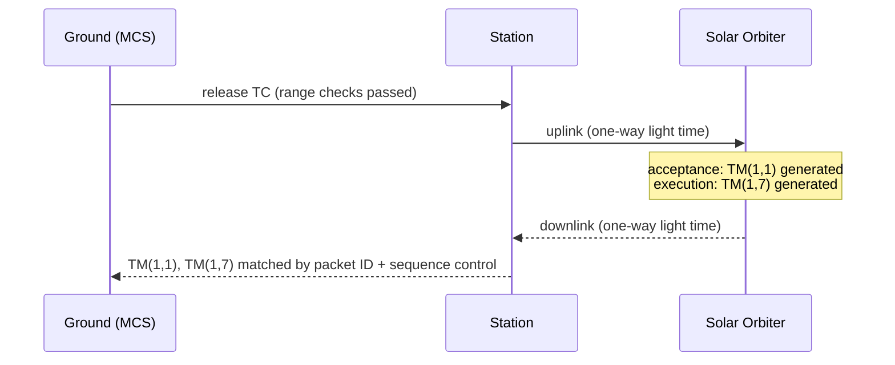

# Solar Orbiter simulator

This page flies Solar Orbiter along its real trajectory and lets you operate it the way a
[SCOS-2000](../scos2000/index.md) operator would. The positions of the spacecraft, Earth, Venus and
Mercury come from JPL Horizons.[^hz] Every telemetry packet, parameter, calibration curve, limit,
synthetic parameter and telecommand is taken from the public Solar Orbiter
[MIB](../mib/index.md) release of 16 September 2025.[^mib] What the spacecraft *does* (temperatures,
solar-array steering, wheel speeds, power, data volume) is a set of simple models written for this
wiki and labelled as such below.

<noscript>The simulator needs JavaScript. Its data files are plain JSON under <code>simulator/data/</code>.</noscript>

<link rel="stylesheet" href="../assets/stylesheets/simulator.css">

!!! warning "A teaching simulator"
    This is an independent educational tool. It is not affiliated with ESA or the Solar Orbiter project,
    it is not an operational simulator, and its spacecraft behaviour is approximate. The MIB definitions
    and the trajectory are real; the numbers they carry are produced by the models described below.

## What is real and what is modelled

| Element | Source | Status |
|---|---|---|
| Positions and velocities of Solar Orbiter, Earth, Venus and Mercury, daily from 2020-02-11 to 2030-11-19 | JPL Horizons vectors, ecliptic of J2000, TDB[^hz] | real data |
| Heliographic latitude of the spacecraft | Horizons sub-observer latitude of the Sun seen from Solar Orbiter[^hz] | real data |
| Gravity-assist closest approaches | Horizons 5-minute planet-centred vectors[^hz] | real data |
| Packet layouts: APID, service type and subtype, SID, parameter offsets | MIB tables `pid`, `pic`, `plf`[^mib] | real definitions |
| Parameter types, calibration curves, limits, validity and relevance conditions | MIB tables `pcf`, `caf`/`cap`, `txf`/`txp`, `ocf`/`ocp`[^mib] | real definitions |
| Synthetic parameters (Sun distance in km and au, wheel speeds in rpm) | MIB OL sources[^mib] | real formulas |
| Telecommands, their parameters, range checks and calibrations | MIB tables `ccf`, `cdf`, `cpc`, `prf`/`prv`, `pas`, `cca`/`ccs`, `tcp`/`pcdf`[^mib] | real definitions |
| Packet headers, on-board time and TC checksum | Solar Orbiter TM/TC packet ICD[^icd-tmdfh][^icd-obt][^icd-pec] | real formats |
| Ground stations and pass lengths | Red Book §7.1.1[^rb-gs]; station coordinates from public web pages[^web-st] | real sites, modelled passes |
| Spacecraft behaviour: temperatures, steering, wheels, power, link budget, data volume | this wiki's models, anchored on the Red Book and Müller et al. where possible | **modelled** |

The simulator generates five housekeeping reports: *AOCS Dynamics FAST* (SPID 29500) and *AOCS Dynamics SLOW*
(29516) on APID 178, and *PLF Summary Thermal* (33501), *PLF Comms Summary* (33580) and *PLF SADE HK* (33582) on
APID 210. It also produces the TM(1,1) and TM(1,7) verification reports (14181, 14182) and the TM(17,2)
connection-test report (14178).[^mib] It models 274 of the 479 distinct parameters in those packets. The rest
keep their real position in the packet but are left at zero and shown as "not simulated". Most of them are
octet-string containers, the fields of the redundant SADE B, and AOCS quantities without a model. Every name
links to its entry in the [MIB Explorer](../explorer/index.md).

## How to use it

* **Time.** The clock runs at the chosen speed, from real time up to five days per second. *Go to* jumps to any
  perihelion, aphelion, latitude extreme, solar conjunction or gravity assist found in the Horizons data, or to
  today's date. The URL keeps a shareable state, for example
  [`#t=2027-02-07T08:00&speed=600&view=craft`](#t=2027-02-07T08:00&speed=600&view=craft).
* **Passes.** Telemetry reaches the ground only while a ground station tracks the spacecraft. When there is no
  pass, *Next pass ▸* jumps to the next acquisition of signal (AOS). Malargüe is the default station; New Norcia
  and Cebreros can be added under *Failures & log*.
* **Light time.** The 3D view and the state panel show where the spacecraft is now. Telemetry generated on board
  arrives one light time later, and a telecommand takes the same time to arrive. Its TM(1,1) acceptance report
  therefore appears about two light times after release.
* **Tabs.** *Telemetry* is an alphanumeric display of a packet, with raw and engineering values and limit status.
  *Plots* shows strip charts (☆ adds a parameter). *Mission profile* has 2020-2030 charts; click one to jump to
  that date. *Packets* decodes headers and hex dumps. *Commanding* holds the command stack and the command
  history. *Failures & log* has failure injection, ground stations and the event log.

## Things to try

1. **See the light time.** During a pass, send `ZCD01101` *Perform Connection Test*. The TM(17,2) report and the
   TM(1,1)/TM(1,7) verification reports arrive about two one-way light times later; the
   [command verification](../mib/command-verification.md) stages fill in the history.
2. **Trip a real limit.** Go to a perihelion minus about 20 days and send `ZCSD0003` *Disable SA Steering*.
   The MIB expects `NCFT2PZ0` *SASteeringEnabled* to read `TRUE`, so it raises a soft alarm at once. As the
   spacecraft nears the Sun, `NRU02263` *SA PY Wing* passes its soft (160 °C) and hard (165 °C)
   limits.[^mib-lim] `ZCSD0004` re-enables steering.
3. **Break a thermistor.** Inject *Battery thermistor open circuit*. The raw value goes to full scale (32767).
   That lies outside calibration curve `COMB000001` (raw 376 to 30353), and the parameter's `PCF_INTER` flag is
   `F`, so the engineering value becomes invalid instead of being extrapolated.[^icd70-inter][^mib-lim]
4. **Overheat the battery.** Inject *Battery heater stuck on*. The battery thermistors cross their soft (37 °C)
   and hard (40 °C) limits about two and three hours later.
5. **Lose the link.** Send `ZCSD1013` *TWTA Power Down* with `TWTA_A`. The TM(1,7) report for that command still
   arrives, but nothing after it. `ZCSD1012` brings the transmitter back. Its TM(1,1) report is lost, because it
   is generated while the TWTA is still off.
6. **Stop a housekeeping report.** Send `ZCF00306` *Disable HK Para Rpt Gen* with SID 2. *PLF Summary Thermal*
   stops arriving one light time after the command executes; `ZCF00305` restarts it.
7. **Visit a solar conjunction.** Go to 2025-08-15. Seen from Earth, the spacecraft is almost behind the Sun
   (Sun-Earth-probe angle 0.0° in the Horizons data), and the simulated link is down.

## How the telemetry chain works

On board, the model produces engineering values. The simulator converts each to raw form with the inverse of
the parameter's MIB calibration. It writes the value into the packet at the `PLF_OFFBY`/`PLF_OFFBI` position,
with the width that the PTC/PFC pair implies (see [parameter types](../mib/parameter-types.md)). Then it adds
the 6-octet [space packet](../ccsds/space-packet.md) header and the 10-octet PUS-A data field header. That
header holds the service type and subtype, a destination ID of 0 (ground) and a CUC time stamp of 4 coarse
and 2 fine octets.[^icd-tmdfh][^icd-dest] The time is counted from 00:00 on 1 January 2000, the Solar Orbiter
zero time reference.[^icd-obt]

On the ground, the packet is identified the way SCOS-2000 does it. APID, type, subtype and the SID read at
octet 16 (the `pic` rule for TM(3,25)) select one `pid` row and so one SPID.[^i70-pid][^mib] Each parameter is
then decoded and [calibrated](../mib/calibration.md). Next come the [validity condition](../mib/monitoring.md)
(`PCF_VALID`/`PCF_VALPAR`) and the [monitoring checks](../mib/monitoring-checks.md) (`OCP`). A check applies
only when its relevance parameter (`OCP_RLCHK`) has the value `OCP_VALPAR`.[^icd70-valid][^icd70-rlchk]
Finally, the [synthetic parameters](../mib/synthetic-parameters.md) are evaluated from their published OL
source. For example, the source of `NCASX003` *SpacecraftSun Dist AU* is
`(NCAT6M70 * 6.6845871226706E-12);`, which converts the on-board ephemeris distance from metres to
au.[^mib]

Telecommands follow the reverse path. The `NOM_TC` header comes from `tcp`/`pcdf`. The parameters come from
`cdf`/`cpc`. Textual values are encoded through `pas`, numerically calibrated ones through `cca`/`ccs`, and
`prf`/`prv` range-check every value before release. Fixed areas such as the function identifier `482A` of
`ZCAD482A` are raw hexadecimal values.[^icd70-cdf][^mib] The packet ends with the 16-bit packet error
control.[^icd-pec] The TM(1,1) and TM(1,7) reports carry the packet ID and sequence control of the command
(`NCD01011`, `NCD01012`), which is how the ground matches them to the command history.[^mib][^a-s1]

!!! warning "Inference"
    To enable or disable a housekeeping report, the simulator maps telecommand APID 188 to telemetry APID 178
    (AOCS) and telecommand APID 220 to telemetry APID 210 (platform). The mapping is deduced from the subsystem
    names in the MIB; the MIB does not state it.

## The models and their assumptions

| Topic | What the simulator does | Basis |
|---|---|---|
| Interpolation and time | Cubic Hermite interpolation of the daily Horizons positions and velocities; TDB = UTC + 69.184 s | Horizons file header[^hz]; leap-second offset assumed constant |
| Attitude | +X points to the Sun (heat shield); +Z towards the projection of ecliptic north; the roll of the real spacecraft is not modelled. Body rates come from the rotation of this frame; the quaternion is relative to EME2000, scalar last | **assumption** |
| Ground stations | Malargüe (baseline), New Norcia and Cebreros (backups); a station tracks above 10° elevation, at most 9 hours per pass centred on culmination | stations and 9-hour passes: Red Book §7.1.1[^rb-gs]; 10° mask: **assumption** |
| Downlink rate | 150 kbit/s × (1 au / Earth distance)², capped at 1 Mbit/s; no link when the Sun-Earth-probe angle is below 2°; telemetry lost when the HGA points more than 1° away from Earth | 150 kbit/s at 1 au: Red Book and Müller et al.[^rb-sum][^mu-t1]; cap, conjunction and beam limits: **assumptions** |
| Mass memory | 549 Gbit; in-situ data 12 kbit/s from the Earth gravity assist on; remote-sensing data 70 kbit/s more in three 10-day windows per orbit (perihelion and both latitude extremes) | capacity: Red Book §5.3.6[^rb-arch]; windows: Red Book §7.2.3[^rb-win]; rates: **assumptions** |
| Solar flux | 1361 W/m² × (1 au / r)² | IAU 2015 nominal solar constant[^iau]; the Red Book quotes up to 12.7 solar constants at perihelion[^rb-chal] |
| Solar arrays | Wing temperature 325 K × (flux factor × cos tilt)^¼; on-board steering tilts the arrays about their long axis so the wings stay below 130 °C (at most 85°, 0.2°/s) | tilting about the long axis for temperature control: Red Book §5.6 and Müller et al. §3[^rb-chal][^mu-sc]; numbers: **assumptions** |
| Power | Available power 974 W at 630 W/m² for a cold array, scaled with flux, cos tilt and −0.45 %/K; load 760 W platform + up to 160 W heaters (919 W far from the Sun) + 180 W payload | 974 W, 919 W at 630 W/m², 180 W: Red Book §5.3.6 and §5.5.2[^rb-arch][^rb-pwr]; split and coefficient: **assumptions** |
| Thermistors | Each `NRU…` temperature follows a first-order lag (time constants of 10 min to 3 h) towards an equilibrium placed inside its MIB soft limits, rising with the logarithm of the solar flux; the HGA also heats when it faces the Sun | limits: MIB[^mib-lim]; everything else **assumption** (real temperatures are not in the sources) |
| Wheels | Four wheels in a pyramid absorb a solar-radiation-pressure torque of 1.2 × 10⁻⁵ N m at 1 au scaled with flux; above 2,500 rpm, or on `ZCAD482A`, a 20-minute off-loading returns them to ±955 rpm | four wheels and thruster off-loading: Red Book §5.3.6[^rb-arch]; torque drives off-loading frequency: Red Book §5.4.1[^rb-cfg]; numbers: **assumptions** |
| HGA | Azimuth = atan2(Y, X) and elevation = −(angle from +Z) of the Earth direction in the body frame, which puts Earth inside the MIB command ranges (−179.5…179.5°, −180…0°); mechanism speed 0.05°/s | ranges: MIB `prf`/`prv` VCD00348, VCD00349[^mib]; convention: **inference**; speed: **assumption** |
| Transmitter | TWTA A in use; 180 s warm-up after power-up; EPC-1 helix current 0.35 mA and anode voltage 3300 V when on | limits of `NRU02141`/`NRU02142`: MIB[^mib-lim]; values: **assumptions** |
| Equipment status | Side A in use: RIU A on and in use, RIU B on but not in use, SADE A on, SADE B off, TWTA A in use. These status parameters drive the validity and relevance checks | **assumption** |
| Report rates | AOCS FAST every 4 s, AOCS SLOW every 32 s, thermal and comms every 16 s, SADE every 32 s | **assumption** (the MIB does not give rates) |
| On-board time | Seconds since 2000-01-01 00:00 counted in UTC, with no time correlation | epoch: ICD §5.10[^icd-obt]; no correlation: simplification (see [time correlation](../scos2000/time-correlation.md)) |

The heat shield is the spacecraft's defining feature. Its front reaches about 500 °C at perihelion, and the
remote-sensing instruments look through feed-throughs in it.[^mu-sc] None of the five packets carries a
heat-shield temperature, so the simulator does not show one.

## Limitations

* Daily positions smooth out the geometry within a few hours of a gravity assist. The closest-approach times and
  distances listed under *Go to* come from separate 5-minute files.[^hz]
* After 2026-11-03 the Horizons trajectory is a prediction, not a fit to tracking data.[^hz]
* Not modelled: safe modes and on-board FDIR, eclipses during flybys, manoeuvres, instrument operations, the
  roll of the spacecraft, and the transfer-frame, CLTU and COP-1 layers. For those, see the
  [downlink](../overview/downlink.md) and [uplink](../overview/uplink.md) walkthroughs.
* Telemetry generated outside a pass is discarded. On the real spacecraft, housekeeping is stored on board and
  dumped later.

## Observations from the data

* The Horizons trajectory reaches the latitudes that Müller et al. planned in 2020 on the same days. The
  heliographic latitude first reaches −23.5° on 2027-01-28 and −33.0° on 2029-07-24. The paper lists 24° first
  reached on 28 January 2027 and 33° on 24 July 2029.[^hz][^mu-t1]
* The refined Earth gravity assist is closest at 04:31 UTC on 2021-11-27, 6,835 km from Earth's centre. Horizons'
  object notes give about 454 km altitude at 04:30:31 UTC.[^hz]
* Calibration curve `COMB000001`, used by most platform thermistors, is not monotonic near its hot end. Raw 817
  gives 99.99 °C, 869 gives 90.00 °C and 939 gives 94.98 °C. Whether this is intended is not stated in the
  available sources.[^mib]
* `NCFT2PY0` *SADE INUSE Profile type* is expected to read `NOMINAL` only while `NCFT2PZ0` *SASteeringEnabled* is
  1. This is a relevance-checked status consistency check of the kind described on the
  [monitoring checks](../mib/monitoring-checks.md) page.[^mib-lim]

## Rebuilding the data

`tools/build_simulator.py` reads the MIB SQLite copy and the Horizons responses. It writes
`docs/simulator/data/mib.json`, the 8 packets with their 501 parameters, 138 limit sets, 50 calibration curves
and 12 telecommands, and `docs/simulator/data/ephem.json`, 3,935 daily samples and 113 derived events. The
simulator code is in `docs/assets/javascripts/sim/` under the wiki's MIT licence. The 3D views use
[three.js](https://threejs.org/) r160, loaded from unpkg. The Horizons responses are kept unchanged, with a
manifest of every query, in the [library entry](../library/jpl-horizons-solar-orbiter-2026-11-13.md).

[^hz]: [JPL Horizons responses for Solar Orbiter, Earth, Venus and Mercury, copied 2026-11-13](../library/jpl-horizons-solar-orbiter-2026-11-13.md): files `vec_-144.txt`, `vec_399.txt`, `vec_299.txt`, `vec_199.txt` (header: "Reference frame: Ecliptic of J2000.0", IAU76 obliquity 84381.448″), `obs_sun_from_solo.txt`, `flyby_*.txt` and `solo_objdata.txt` (trajectory source, "Tracking data fit up to 2026-Nov-03, prediction thereafter", flyby list).
[^mib]: [Solar Orbiter MIB release MIB__20250916M25925PFMS001_SOL](../library/mib-20250916m25925pfms001-sol.md), tables `pid`, `pic`, `plf`, `pcf`, `caf`, `cap`, `txf`, `txp`, `ocf`, `ocp`, `ccf`, `cdf`, `cpc`, `prf`, `prv`, `pas`, `cca`, `ccs`, `tcp`, `pcdf` and the OL sources of the synthetic parameters, queried by this wiki on 2026-11-13.
[^mib-lim]: [Solar Orbiter MIB release MIB__20250916M25925PFMS001_SOL](../library/mib-20250916m25925pfms001-sol.md), tables `ocf` and `ocp` for `NRU02263`, `NRU02341`, `NRU02141`, `NRU02142`, `NCFT2PZ0` and `NCFT2PY0`, and `pcf`/`caf`/`cap` for `NRU02341` and `COMB000001`, queried on 2026-11-13.
[^icd-tmdfh]: [SOL.S.ASTR.TN.00079 issue 7](../library/sol-s-astr-tn-00079-07.md), §4.2.1.3-4.2.2.1 (10-octet data field header, CUC time with 4 octets of coarse and 2 of fine time), PDF pp. 25-26.
[^icd-dest]: [SOL.S.ASTR.TN.00079 issue 7](../library/sol-s-astr-tn-00079-07.md), §13.3 Destination ID ("00000000" = ground), PDF p. 276.
[^icd-obt]: [SOL.S.ASTR.TN.00079 issue 7](../library/sol-s-astr-tn-00079-07.md), §5.10 Service 9: Time Management (zero time reference 00:00 on 1 January 2000), PDF p. 95.
[^icd-pec]: [SOL.S.ASTR.TN.00079 issue 7](../library/sol-s-astr-tn-00079-07.md), §3.2.2.3 TC Packet Error Control, PDF p. 17, and §11.1 CRC Checksum Algorithms, PDF p. 268.
[^i70-pid]: [SCOS-2000 Database Import ICD, issue 7.0](../library/icd-7-0-final.md), §3.3.2.4-3.3.2.4.1 (packetiser key APID/type/subtype/PI1/PI2, one SPID per key), PDF pp. 82-83.
[^icd70-inter]: [SCOS-2000 Database Import ICD, issue 7.0](../library/icd-7-0-final.md), `pcf` field 13 `PCF_INTER` ('F': an invalid engineering value outside the curve; 'P': extrapolation), PDF p. 50.
[^icd70-valid]: [SCOS-2000 Database Import ICD, issue 7.0](../library/icd-7-0-final.md), `pcf` field 8 `PCF_VALID`, PDF p. 45.
[^icd70-rlchk]: [SCOS-2000 Database Import ICD, issue 7.0](../library/icd-7-0-final.md), monitoring checks and their applicability criterion `OCP_RLCHK`, PDF pp. 26 and 75.
[^icd70-cdf]: [SCOS-2000 Database Import ICD, issue 7.0](../library/icd-7-0-final.md), `cdf` fields `CDF_ELTYPE` ('A' fixed area, 'F' fixed, 'E' editable), `CDF_INTER` ('D': value from `CPC_DEFVAL`) and `CDF_VALUE` (fixed areas as raw unsigned hexadecimal), PDF pp. 154-157.
[^a-s1]: [ECSS-E-70-41A (PUS-A)](../library/ecss-e-70-41a-30jan2003-pus.md), §6.3.2 Telecommand acceptance (the TM(1,1) report carries the Telecommand Packet ID and Packet Sequence Control), PDF p. 52.
[^rb-sum]: [Solar Orbiter Definition Study Report, ESA/SRE(2011)14](../library/solar-orbiter-definition-study-report-2011.md), Solar Orbiter Mission Summary (data downlink 150 kbps at 1 AU; Malargüe 35 m, 4 to 8 hours per day), PDF p. 5.
[^rb-arch]: [Solar Orbiter Definition Study Report](../library/solar-orbiter-definition-study-report-2011.md), §5.3.6 Functional Architecture (SSMM up to 549 Gbit; four reaction wheels and 10 N thrusters for wheel off-loading; solar array supplying 974 W at 1.47 AU; regulated 28 V bus), PDF p. 83.
[^rb-cfg]: [Solar Orbiter Definition Study Report](../library/solar-orbiter-definition-study-report-2011.md), §5.4.1 Introduction & Configuration Drivers (the solar-radiation-pressure torque profile determines the frequency of wheel off-loading), PDF p. 84.
[^rb-pwr]: [Solar Orbiter Definition Study Report](../library/solar-orbiter-definition-study-report-2011.md), §5.5.2 Power Budget (919 W at 630 W/m², 180 W at 28 V to the payload), PDF p. 92.
[^rb-chal]: [Solar Orbiter Definition Study Report](../library/solar-orbiter-definition-study-report-2011.md), §5.6 Technical Challenges (flux up to 12.7 Earth solar constants; array tilted around its longitudinal axis), PDF p. 94.
[^rb-gs]: [Solar Orbiter Definition Study Report](../library/solar-orbiter-definition-study-report-2011.md), §7.1.1 Ground Stations and Communications Network (New Norcia, Cebreros, Malargüe; daily 9-hour Malargüe passes, 8 hours for science telemetry), PDF p. 101.
[^rb-win]: [Solar Orbiter Definition Study Report](../library/solar-orbiter-definition-study-report-2011.md), §7.2.3 Sample Science Orbits (10-day windows centred on perihelion and on the highest latitudes), PDF p. 103.
[^mu-t1]: [Müller et al. 2020, The Solar Orbiter mission: science overview](../library/muller-2020-solar-orbiter-science-overview.md), Table 1 Solar Orbiter mission summary, PDF p. 4.
[^mu-sc]: [Müller et al. 2020](../library/muller-2020-solar-orbiter-science-overview.md), §3 The Solar Orbiter spacecraft (heat shield front around 500 °C at perihelion; solar arrays rotated around their longitudinal axis for temperature control), PDF p. 18.
[^iau]: IAU 2015 Resolution B3 on recommended nominal conversion constants, nominal total solar irradiance 1361 W m⁻²: <https://www.iau.org/static/resolutions/IAU2015_English.pdf>. Web source, not in this wiki's library.
[^web-st]: Station coordinates: Malargüe 35.776° S, 69.398° W (<https://en.wikipedia.org/wiki/Malarg%C3%BCe_Station>); New Norcia 31.048° S, 116.191° E (<https://en.wikipedia.org/wiki/New_Norcia_Station>); Cebreros 40.453° N, 4.368° W (<https://en.wikipedia.org/wiki/Cebreros_Station>). Web sources, not in this wiki's library; ESA's tracking-site directory does not print the values.
